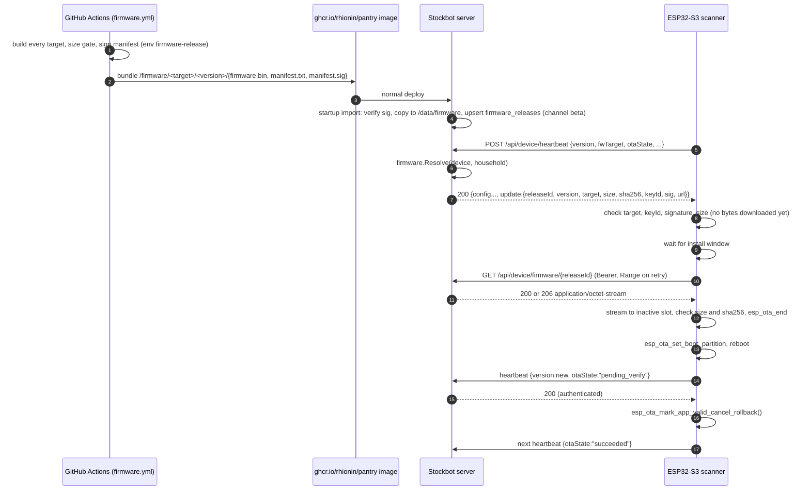
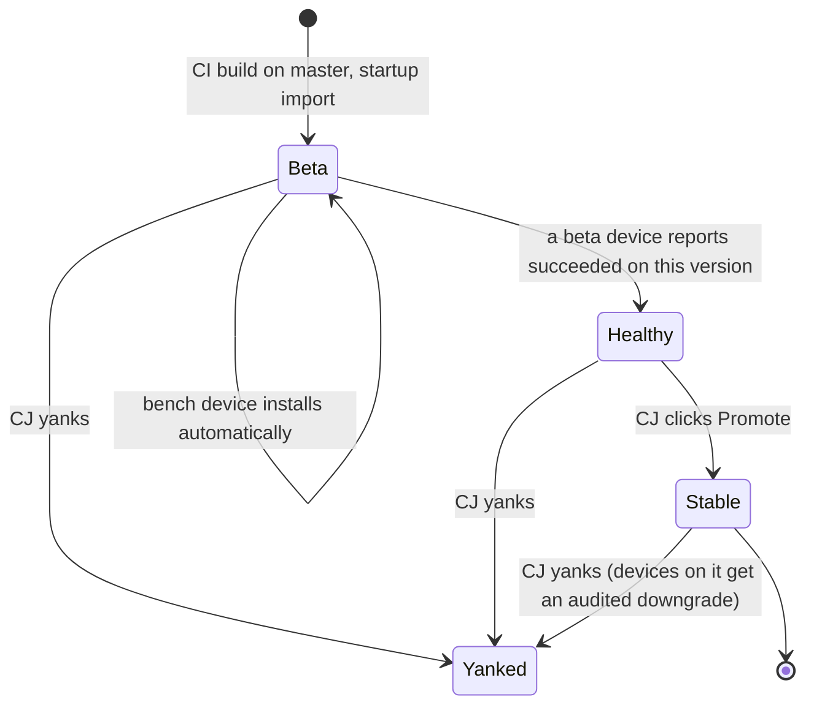
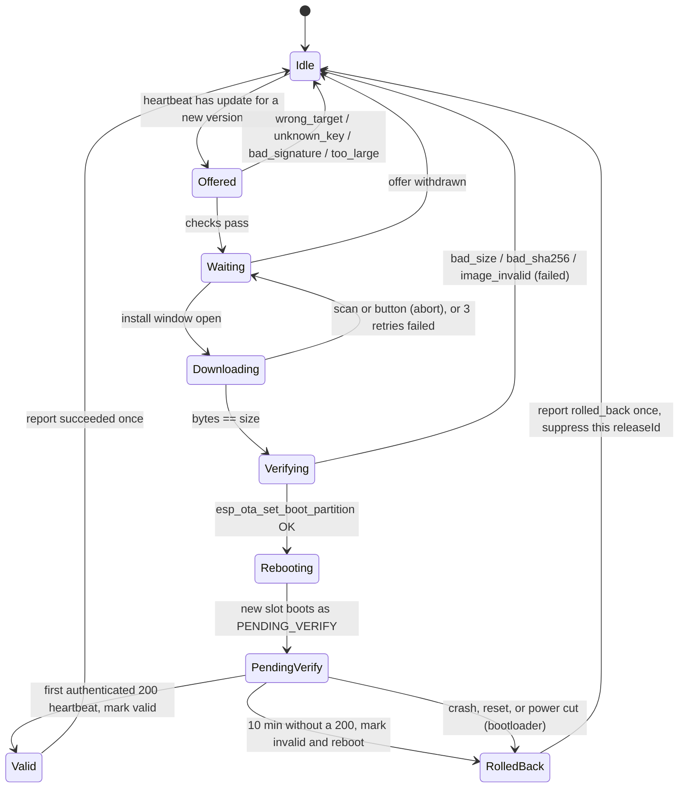

# Firmware over-the-air updates (ESP32-S3 scanners)

- **Status:** Approved design for [#452](https://github.com/Rhionin/stockbot/issues/452). Decisions and rationale are in [ADR-001](adr-001-firmware-ota.md).
- **Contract:** [api-contract.md, Firmware updates](api-contract.md#firmware-updates). The HTTP shapes are defined in the contract. If this page and the contract differ, the contract is correct.
- **Scope:** the `esp32_scanner` product only. Pi hub updates (`internal/hub/update.go`) are a separate system with a separate key.

Everything here is language independent. The C++ firmware and the Rust firmware (#445) implement it unchanged. §9 lists the values that are frozen.

## 1. Delivery path



- The scanner learns about an update from the `update` object on the 60 s heartbeat response. That key was reserved in the contract and is now defined. If `update` is missing, there is nothing to install.
- Binaries ship inside the server image and are imported into the `pantry-data` volume at startup (ADR-001 ruling 4). Devices never contact GitHub.
- The server checks the signature again on import. It never offers an image it cannot verify, an unknown `keyId`, or an unknown target.

## 2. Targets

| `fwTarget` | PlatformIO env | Board | Power | Notes |
|---|---|---|---|---|
| `sticks3_u173` | `sticks3_u173` | `boards/m5stack-sticks3.json`, added in T0 | Battery | The install window needs the dock or a battery of 50% or more. |
| `sticks3_u173_uart` | `sticks3_u173_uart_split` | `boards/m5stack-sticks3.json` | Battery | Same hardware with different pin use. It gets its own id, so it never receives the I2C image. |
| `atoms3lite_u173_bench` | `atoms3lite_u173_bench` | `m5stack-atoms3` | Wall | CJ's bench scanner, the `beta` canary. |
| `atoms3lite_symcode_hid` | `atoms3lite_symcode_hid` | `m5stack-atoms3` | Wall | USB host. |

- The target id is compiled in with `-DSTOCKBOT_FW_TARGET="<id>"`. The same string is the manifest `target` and the heartbeat `fwTarget`.
- The version is compiled in as `STOCKBOT_FW_VERSION`, read from `firmware/VERSION` (semver 2.0.0, no leading `v`). It is reported as heartbeat `version`.
- A wrong-target image is refused in two places. The server only offers releases for the reported `fwTarget`. The device checks the signed `target` before it downloads anything.

## 3. Partition table

The table in `firmware/partitions_8mb_ota.csv` is frozen. It starts at offset `0x8000`, and OTA can never rewrite it.

| Name | Type / subtype | Offset | Size | Written by OTA |
|---|---|---|---|---|
| `nvs` | data / nvs | `0x9000` | `0x6000` (24 KB) | No |
| `otadata` | data / ota | `0xf000` | `0x2000` (8 KB) | Only by `esp_ota_set_boot_partition` and mark valid or invalid |
| `ota_0` | app / ota_0 | `0x20000` | `0x300000` (3 MB) | When it is the inactive slot |
| `ota_1` | app / ota_1 | `0x320000` | `0x300000` (3 MB) | When it is the inactive slot |
| `littlefs` | data / spiffs | `0x620000` | `0x100000` (1 MB) | No |

- An image must be 3 MB (`0x300000`) or less. CI fails the build above 2.4 MB (2,516,582 bytes) and writes the size to the job summary.
- The bootloader comes from Arduino-ESP32 2.0.17 (ESP-IDF 4.4.x, `espressif32@6.9.0`). App rollback is on. Anti-rollback, Secure Boot, signed apps, and flash encryption are off. Flash mode is DIO. OTA never updates the bootloader.
- CI publishes the exact `bootloader.bin` and `partitions.bin` for each target. USB recovery uses those files.

## 4. Manifest and signature

### Canonical signed bytes

The signature covers this exact byte string. It is UTF-8, with lines joined by a single `\n` (0x0A), no trailing newline, no spaces, no `\r`, and keys in this order:

```text
stockbot-fw-manifest-v1
product=esp32_scanner
target=<fwTarget>
version=<semver>
size=<decimal byte length of firmware.bin>
sha256=<64 lowercase hex of firmware.bin>
keyId=<fw-YYYY-N>
```

Field rules:

- `product` is always `esp32_scanner` in v1.
- `target` is one of the ids in §2.
- `version` is semver 2.0.0 with no leading `v`. Pre-release tags such as `1.0.2-rc.1` are allowed.
- `size` is a decimal integer with no leading zeros, greater than 0 and at most `3145728`.
- `sha256` is exactly 64 characters `[0-9a-f]`.
- `keyId` matches `fw-[0-9]{4}-[0-9]+`.
- A verifier rejects any field that breaks these rules before it checks the signature.

Example. This is the form only. The real values come from the golden vectors.

```text
stockbot-fw-manifest-v1
product=esp32_scanner
target=atoms3lite_u173_bench
version=1.0.1
size=1532416
sha256=3f1c0a9e5b7d2c4e6f8091a2b3c4d5e6f708192a3b4c5d6e7f8091a2b3c4d5e6
keyId=fw-2026-1
```

### Signature

- The algorithm is Ed25519 as defined by RFC 8032: pure, no prehash, and no context. The signature is 64 bytes, sent as standard base64 with padding (88 characters).
- Verifiers:
  - Go: `crypto/ed25519.Verify`.
  - C++: libsodium `crypto_sign_ed25519_verify_detached`, or Monocypher `crypto_eddsa_check`.
  - Rust: `ed25519-dalek` `VerifyingKey::verify_strict`.
- CI writes `manifest.txt` (the bytes above) and `manifest.sig` (the base64 signature) next to `firmware.bin`.
- The server stores the manifest fields and sends them as JSON in `update`. The device rebuilds the canonical bytes from those JSON fields and verifies `sig`. Because the signature covers target, version, size, and sha256, the server cannot change any of them.
- A correct sha256 over the downloaded bytes therefore proves the signature applies to the image itself.

### Keys and rotation

- The private key is a raw 32-byte Ed25519 seed. It is stored base64 as `FW_SIGNING_KEY_ED25519` in the GitHub environment `firmware-release`, which only `master` can deploy to (CJ, Q2). An offline backup is kept. The key is separate from `HUB_RELEASE_PUBKEY`.
- Public keys are committed as `firmware/keys/<keyId>.pub`, each holding the raw 32-byte key in base64 on one line. Both firmware builds generate their trusted-key table `{keyId, pubkey}` from that directory. The server embeds the same directory as its allow list.
- Firmware always trusts `{current, next}`. To rotate:
  1. Release an image signed with `current` that trusts `{next, next+1}`.
  2. Once the fleet runs it, sign with `next`.
- If a key leaks, remove it from `firmware/keys/` in the next release. The server stops importing and offering releases signed with it as soon as that server image deploys.
- Golden vectors live in `firmware/test/vectors/ota_manifest_v1.json`. Each vector holds `{seedHex, publicKeyB64, fields, canonical, sigB64, valid}`, and the set includes one case per field with a single changed byte. The Go, C++, and Rust tests all read this file. The vectors use a test-only seed, never the release key.

## 5. Channels and bench-first promote

This implements CJ's decision Q1 (b), dated 2026-10-29. Every release goes to `beta` first and installs automatically on the bench scanner. CJ promotes it to `stable` with one click once it reports healthy.



- `firmware_releases.channel` is `beta` or `stable`. Import always writes `beta`.
- `devices.fw_channel` defaults to `stable`. The operator sets CJ's bench scanner to `beta`. A `beta` device is offered the highest release from either channel, and a `stable` device only the highest `stable` release.
- **Healthy** means at least one `beta` device that is not revoked has sent a heartbeat with `version` equal to the release version, `otaState:"succeeded"`, and the matching `otaReleaseId`. That heartbeat is the authenticated check-in after mark valid (§7). The operator list shows `canary` for each release: `none`, `pending`, `healthy`, or `failed`.
- **Promote** acts on a version. Calling it on any release id promotes every release with that version, across all targets, together. It returns `uncoveredTargets`, the targets that had no healthy `beta` device for this version. The bench device is an AtomS3, so the StickS3 targets are uncovered unless a StickS3 is also on `beta`. The UI shows that list before the click.
- Promote is refused with `400 validation` and `field: "canary"` until the version is healthy. Promoting a version that is already `stable` returns `200` and changes nothing.
- **Yank** sets `yanked_at` on every release with that version. A yanked release is never offered or served. Devices on a yanked version are offered the highest remaining release for their channel, which may be an older version.
- **Pin.** `devices.fw_pinned_release_id` wins over the channel. Use it to hold one device on a version or to downgrade it. The pin's target must equal the device's `fw_target`.
- **Household pause.** The household setting `fw_auto_update` defaults to on. When it is off, the household's devices are offered nothing unless the device is pinned.
- **Audit.** Every promote, yank, pin change, and channel change writes an `audit_log` row (`actor_kind` operator). So does every offer whose version is lower than the device's running version (§7).

### Resolution

`firmware.Resolve(device, household, releases)` is a pure Go function covered by a table test. It returns at most one release:

1. If a pin is set, the pinned release is not yanked, and its target matches `fw_target`, return it.
2. If household `fw_auto_update` is off, return nothing.
3. Otherwise take the highest-semver non-yanked release for `fw_target` on `stable`, or on `beta` or `stable` for a `beta` device.
4. If its version equals the reported `version`, return nothing.
5. If the device reported `rolled_back` for this `releaseId` and an operator has not called retry since, return nothing.
6. If the device has not reported `fwTarget` yet, which is true of all firmware older than T4, return nothing.

## 6. Install on the device

### Install window

The device starts a download only when all of these are true:

1. It is paired and has a token.
2. The scan ring is empty after a flush.
3. For the last 120 s there was no scan, button press, or direction change, and the device is not in pairing, the captive portal, or a factory-reset hold.
4. On a StickS3, it is on the dock (VBUS present) or the battery is at 50% or more. AtomS3 targets are wall powered and always pass.
5. Wi-Fi RSSI is -80 dBm or better.

While downloading, the screen shows "Updating, do not unplug". A scan or button press stops the download, the scan is handled, and the device waits for the next window. Scanning always wins over updating.

### Order of operations

Each step ends the attempt on failure and records `otaError`:

1. `update.target` equals the compiled-in target. Otherwise `wrong_target`.
2. `keyId` is in the trusted table. Otherwise `unknown_key`.
3. The Ed25519 signature over the rebuilt canonical manifest is valid. Otherwise `bad_signature`.
4. `size` fits in the inactive partition. Otherwise `too_large`.
   Steps 1 to 4 happen before a single byte is downloaded.
5. `esp_ota_begin(inactive, OTA_WITH_SEQUENTIAL_WRITES)`, then `GET url` and stream into `esp_ota_write` while hashing SHA-256. A transport failure is `download_failed`, a non-2xx status is `http_status`, and a write error is `flash_write_failed`.
6. The byte count equals `size`. Otherwise `bad_size`.
7. The SHA-256 equals `sha256`. Otherwise `bad_sha256`.
8. `esp_ota_end` validates the image. Otherwise `image_invalid`.
9. Store `ota_rel` in NVS, then `esp_ota_set_boot_partition`, then reboot.

The boot partition never changes before step 8 succeeds.

**Resume.** Within one attempt, a dropped connection is retried up to 3 times with `Range: bytes=<written>-`, keeping the running hash context. The server answers `206`. After 3 failures the device goes back to waiting for a window. A reboot always starts again from byte 0.

### Device state machine



The reported `otaState` maps to these states: `Idle` is `idle`, `Waiting` is `waiting`, `Downloading` is `downloading`, `Verifying` is `verifying`, and `PendingVerify` is `pending_verify`. Next come `succeeded`, `failed`, and `rolled_back`, each reported on one heartbeat and then followed by `idle`. `Offered` and `Rebooting` are never reported.

## 7. Rollback rules

- The firmware overrides the Arduino weak function `bool verifyRollbackLater() { return true; }`, so the core does not mark a new app valid at boot. A Rust build sets `CONFIG_BOOTLOADER_APP_ROLLBACK_ENABLE=y` and does not mark the app valid at startup.
- **Mark-valid rule.** A new image calls `esp_ota_mark_app_valid_cancel_rollback()` only after its first HTTP `200` from `POST /api/device/heartbeat`. That heartbeat is authenticated with the stored device token and reports the new `version` with `otaState:"pending_verify"`. A `401`, a `5xx`, or a timeout does not count.
- **Check-in deadline.** If there is no `200` within 10 minutes of boot, the firmware stores `ota_err=checkin_timeout` and calls `esp_ota_mark_app_invalid_rollback_and_reboot()`.
- **Bootloader rollback.** If the new image resets for any reason before it is marked valid (crash, watchdog, power cut, or deep-sleep wake), the bootloader boots the previous slot. If NVS holds no reason, the old image reports `boot_failed`.
- **No sleep while pending.** While pending verify, deep sleep and the StickS3 power-off path are disabled, because a wake is a reset and would roll back the image.
- **Reporting after rollback.** The previous image sees `esp_ota_get_last_invalid_partition()` is non-null. On its next heartbeat it reports `rollback:true`, `otaState:"rolled_back"`, `otaReleaseId` from `ota_rel`, and `otaError` from `ota_err`. It then copies `ota_rel` to `ota_supp` and clears `ota_rel` and `ota_err`.
- **Suppression.**
  - The device does not install the `releaseId` held in `ota_supp`. It clears `ota_supp` when a `200` heartbeat arrives with no `update`, or with a different `releaseId`.
  - The server stops offering a release to a device that reported `rolled_back` for it, until an operator calls retry. Because the server goes quiet first, the device clears its suppression on its own, and a retry offer is then accepted.
- **Downgrades.** The device installs any correctly signed image for its target whose version differs from the running version, higher or lower. The server offers a lower version only because of a pin or a yank, and it writes `audit_log` action `firmware.downgrade_offered` once per device and release.
- **No anti-rollback.** eFuse anti-rollback and secure version numbers are never used. Someone who can make the server offer an old signed image already controls the server.

## 8. Power-cut safety

| Power is cut | Result |
|---|---|
| While waiting or downloading | Only the inactive slot was being written. `otadata` still points at the running app, so the device boots the old image and starts the next window from byte 0. |
| Between `esp_ota_end` and `esp_ota_set_boot_partition` | The same: the old image boots. The inactive slot holds a complete, unused image. |
| During `esp_ota_set_boot_partition` | `otadata` has two sectors with sequence numbers and a CRC. A torn write leaves the previous valid entry, so the old image boots. |
| After the switch, before mark valid | The new image is `PENDING_VERIFY`. A reset before mark valid makes the bootloader roll back. The old image reports `rolled_back` with `boot_failed`. |
| After mark valid | A normal reboot into the new image. |

- OTA writes only `ota_0`, `ota_1`, and `otadata`. It never erases `nvs` (token, Wi-Fi, settings) or `littlefs` (`/scans.ring`). An install also requires an empty ring, so no scans are at risk.
- USB recovery always works. ROM download mode stays available because no eFuses are burned. Flash with the published `bootloader.bin` and `partitions.bin`.

## 9. C++ to Rust handoff

The C++ firmware must install the first Rust image over the air, and the Rust firmware must implement this design unchanged. The values below are frozen. Changing one needs a new ADR.

| Item | Frozen value |
|---|---|
| Partition table | §3: offset `0x8000`, two 3 MB app slots, and an image of 3 MB at most (CI gate 2.4 MB). |
| Bootloader | The IDF 4.4.x bootloader from Arduino-ESP32 2.0.17, with rollback on and anti-rollback, Secure Boot, and signed apps off. Flash mode DIO. The ESP-IDF bootloader supports apps built with newer IDF versions, but an IDF 5.x Rust app on this exact bootloader must be proven on the bench in #445 Phase 0. `espflash` must be given the published `--bootloader` and `--partition-table` files, never its defaults. |
| C++ fallback | A Rust to C++ downgrade is allowed through a pin (§7). The C++ image uses IDF 4.4.x, matching the bootloader. |
| NVS | Namespace `stockbot`. `str` keys: `wifi_ssid`, `wifi_pass`, `server_url`, `device_token`, `label`, `default_dir` (`stock_in` or `stock_out`), `commit_mode` (`queue` or `immediate`), `ota_rel`, `ota_err`, `ota_supp`. `u32` keys: `inact_rev`, `cfg_ver`. Arduino `Preferences::putString`/`putUInt` and `esp-idf-svc` `EspNvs::get_str`/`get_u32` use the same types. Do not depend on the private `nvs.net80211` Wi-Fi namespace. |
| Scan ring | An install needs an empty ring, so Rust does not have to read `/scans.ring` (`SBR1`). If Rust reuses that file, it must read the format, or delete the file when the magic differs. |
| Signing | §4: the same canonical manifest v1, the same key, the same `firmware/keys/` table, and the same golden vectors. |
| Version and target | Semver in `version`, and the §2 target ids for the same hardware. |
| Reporting | The `otaState` and `otaError` values, `otaReleaseId`, `rollback`, the mark-valid rule, and the 10-minute deadline (§7). |
| Image format | A standard ESP-IDF app image (`esp_image_header_t` with the appended SHA-256), served raw. |

For Rust, for information only: use `esp_idf_svc::ota::EspOta` with `initiate_update()`, `write()`, and `complete()`. Use `mark_running_slot_valid()` and `mark_running_slot_invalid_and_reboot()` for marking, and `EspHttpConnection` with `crt_bundle_attach` for HTTP.

## 10. Server storage and CI

- **Import.** At startup the server scans `/firmware/<target>/<version>/` in the image. For each release it:
  1. checks the manifest fields and the signature against `firmware/keys/`;
  2. checks that `firmware.bin` matches `size` and `sha256`;
  3. copies the release to `/data/firmware/<target>/<version>/`;
  4. upserts `firmware_releases`, keyed on `(target, version)`. A re-import changes nothing.
  
  A release that fails any check is logged and skipped. The server keeps the last 5 releases per target and deletes older ones, except pinned releases.
- **Download.** `http.ServeContent` serves the file with `ETag: "<sha256>"` and `Accept-Ranges: bytes`. Range requests come for free. Caddy must not gzip this path, and T6 checks that.
- **CI (`firmware.yml`, ticket T3).**
  - Every PR builds every target and runs the size gate. Nothing is signed, and fork PRs never get the secret.
  - On `master`, when `firmware/VERSION` changes, a job in environment `firmware-release` writes `manifest.txt`, signs it, and verifies the result in a separate step using the committed public key.
  - The job puts `firmware-dist/` into the image build context, and the Dockerfile copies it to `/firmware`.
  - The same files are attached to a GitHub Release `fw-v<semver>` for audit and USB recovery. Devices never read that release.

## 11. Tests

Builders must ship these tests, and the Tester gives a NO-GO without CI coverage.

- **Firmware host tests** (`src/core/ota_*`, no Arduino):
  - The `OtaController` state machine, with fakes for clock, flash, HTTP, verifier, and NVS.
  - Cases: the happy path; each pre-download refusal with zero bytes fetched; `bad_size` and `bad_sha256`; resume at 40%; 3 failed resumes; a power cut before the switch leaving the boot slot unchanged; the check-in timeout; a `401` not marking the image valid; sleep inhibited while pending; rollback suppression; a scan stopping a download; no window with a non-empty ring or a low battery on a StickS3.
  - The canonical manifest builder and verification against the golden vectors.
- **Server Go tests:**
  - A `firmware.Resolve` table test.
  - Import: accept, refuse, and idempotent re-import.
  - Download: auth, revoked, wrong target, yanked, a `206` Range returning the correct bytes, ETag, and the rate limit.
  - Heartbeat: storing the new fields; an unknown `otaError` stored as `other`; old firmware bodies still returning `200`.
  - Promote: the canary gate and `uncoveredTargets`. Yank. Retry. Device PATCH for the operator only. Audit rows. The golden vectors.
- **End to end (Tester, T7):**
  1. Bench `1.0.0` to `1.0.1` reports `succeeded`.
  2. An image that never checks in rolls back with `checkin_timeout`.
  3. Pulling power during a download leaves the old image running.
  4. A wrong target is refused before download.
  5. A tampered `sig` is refused.
  6. Scans and the token survive every case.
  7. A StickS3 on battery below 50% and off the dock does not update.
  8. A stable household device gets the release only after Promote.

## 12. Schema (PROPOSED: migration `029_firmware_ota.sql`)

**PROPOSED.** CJ approves this schema at T2 PR time. It is additive only: no table rebuild, no data rewrite, and no backfill. This PR does not add the migration file.

```sql
CREATE TABLE firmware_releases (
    id          TEXT PRIMARY KEY,                 -- fwr_<ulid>
    product     TEXT NOT NULL DEFAULT 'esp32_scanner',
    target      TEXT NOT NULL,
    version     TEXT NOT NULL,
    size        INTEGER NOT NULL,
    sha256      TEXT NOT NULL,
    key_id      TEXT NOT NULL,
    sig         TEXT NOT NULL,
    channel     TEXT NOT NULL DEFAULT 'beta' CHECK (channel IN ('beta','stable')),
    path        TEXT NOT NULL,                    -- under /data/firmware
    created_at  TEXT NOT NULL,
    promoted_at TEXT,
    yanked_at   TEXT,
    UNIQUE (target, version)
);
ALTER TABLE devices ADD COLUMN fw_target TEXT;
ALTER TABLE devices ADD COLUMN fw_channel TEXT NOT NULL DEFAULT 'stable' CHECK (fw_channel IN ('beta','stable'));
ALTER TABLE devices ADD COLUMN fw_pinned_release_id TEXT;
ALTER TABLE devices ADD COLUMN ota_state TEXT;
ALTER TABLE devices ADD COLUMN ota_release_id TEXT;
ALTER TABLE devices ADD COLUMN ota_last_error TEXT;
ALTER TABLE devices ADD COLUMN ota_updated_at TEXT;
ALTER TABLE devices ADD COLUMN ota_retry_release_id TEXT;
```

- The firmware version reuses the existing `devices.hub_version` column, exposed as `fwVersion`.
- `ota_retry_release_id` records an operator retry, so `Resolve` rule 5 can offer that release again.
- The household setting `fw_auto_update` is a `household_settings` row with value `"1"` or `"0"`. A missing row means `"1"`.
- The migration runner is not transactional (#249), so 029 holds only these statements.
