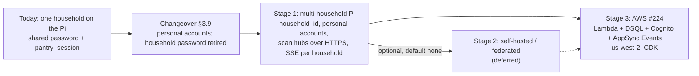
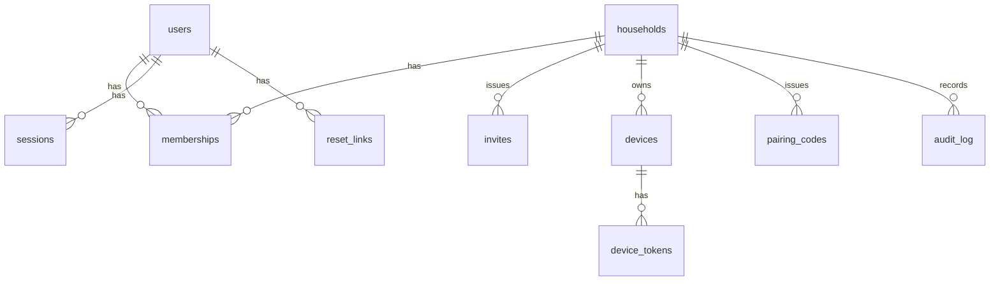
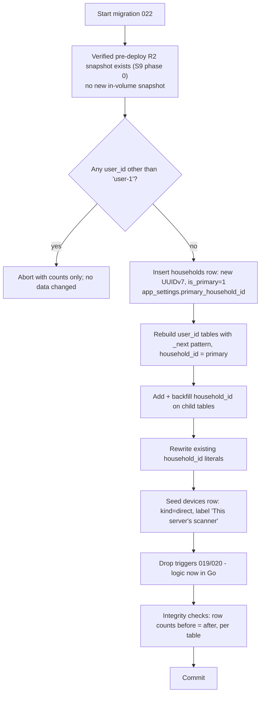
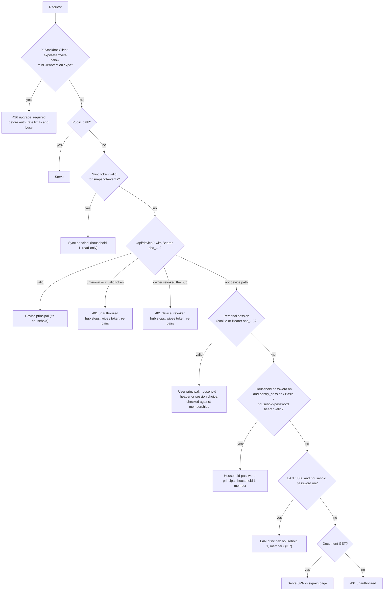
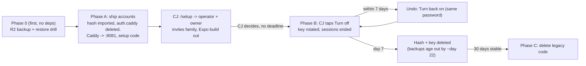
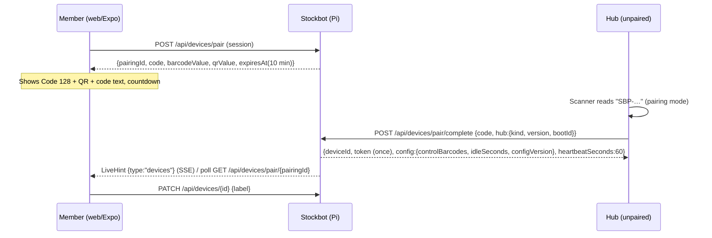
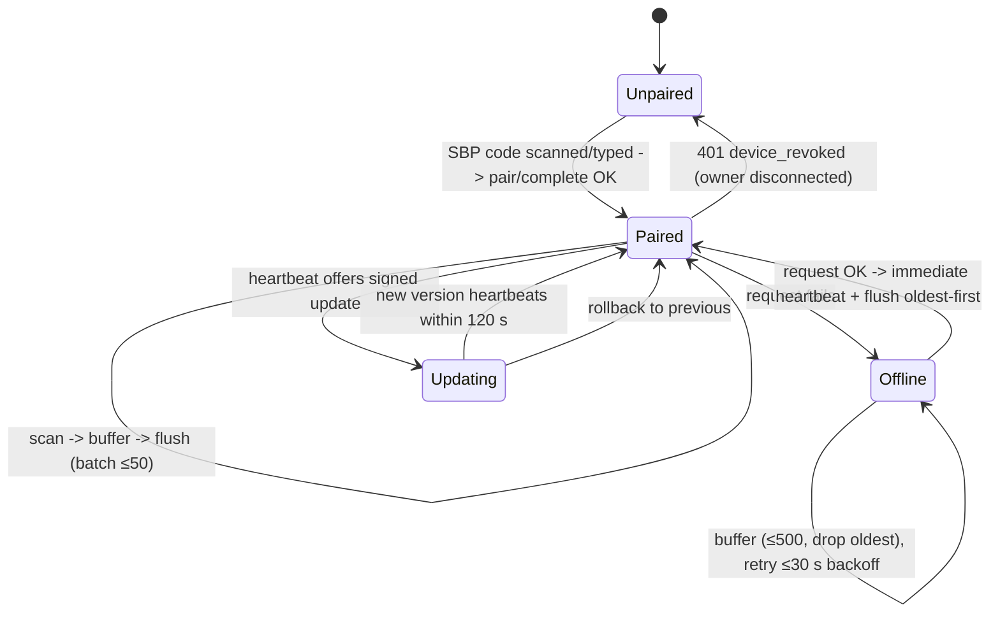
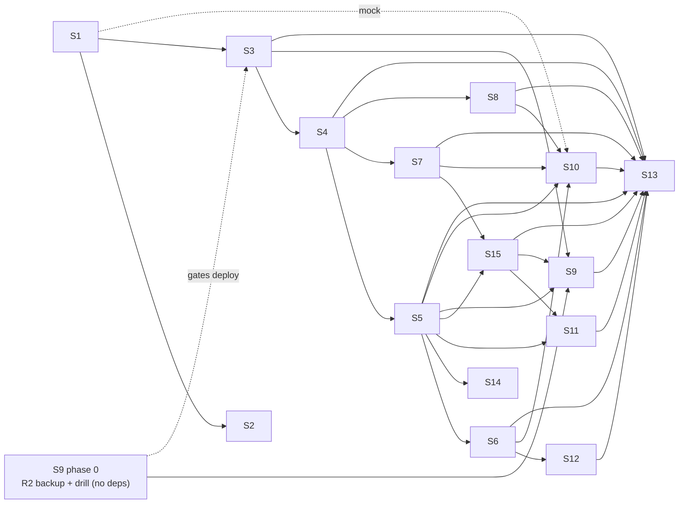

# Multi-household Stockbot: staged design (#224)

- **Status:** Approved by CJ 2026-10-23 8:21 AM MDT (relayed by Stockbot Manager); build in progress per tracker #363.
- **Repo basis:** `Rhionin/stockbot` master `dd3c6be`, the #364 contract (`docs/design/api-contract.md` on the PR ref), the #224 AWS design (`multi-tenant-saas.md`, `multi-tenant-saas-costs.md`), tickets T1–T25 (#337–#360, #362), and PM's Stage-1 requirements (`224-stage1-requirements.md`, called **PM-REQ** below).
- **Concrete Stage-1 target:** `https://stockbot.rhionin.com` on CJ's Pi 3B+. The domain, app name, cookie name and domain, and email sender are config (§10), so a rename is only a config change.
- **Conventions:**
  - **(opinion)** marks an architect judgement, not a sourced fact.
  - **(estimate)** marks an unmeasured number.
  - Source tags such as [CF-tunnel-sse] are listed in §15. Every source was accessed 2026-10-23.
- **Privacy:** this document contains no household data: no item names and no database contents.

---

## Decision log

All five Stage-1 questions were decided by CJ on 2026-10-23. Where a decision overrides an earlier PM call, the decision wins and the design below follows it.

| Date | Decision | By | Effect on this design |
|---|---|---|---|
| 2026-10-23 | **Q1: the hub is scan-only.** Household 2's Pi forwards scans to CJ's Pi. All household data lives on CJ's Pi. No second full Stockbot, no sync. | CJ | The hub design (§4) is final. The Q1 swap path is dropped. Stage 2 self-hosting/federation is a later possibility only (§1). |
| 2026-10-23 | **Q2: everyone uses personal email + password accounts**, CJ's family included. The shared household password is retired; the Pi keeps its hash only for PM's 7-day undo, then deletes it. Auth stays portable to OIDC/Cognito behind an `IdentityProvider` interface. Overrides PM's earlier "keep the shared password" call (PM-REQ §1 row on §13 #31, R2.3, C2.11 household-password link, R4.3). | CJ | No long-term shared-password design remains. The changeover (PM-REQ §2A, A1–A8) is §3.9. The #364 open question on Pi auth is answered in §11.3. |
| 2026-10-23 | **Q3: Stage 1 supports only a Pi as the hub.** ESP32 is deferred. The device protocol stays microcontroller-friendly: plain HTTPS + JSON, small payloads, bearer token, no client certificates. | CJ | §4.1 and §4.7: no mTLS, bodies ≤ 64 KB, batches ≤ 50, one `Authorization: Bearer` header. |
| 2026-10-23 | **Q4: invite-only households.** CJ sends a link; there is no open sign-up. A household-creation invite (`start_household`, operator only) is distinct from a member invite (`join_household`). | CJ | Invite-only is built in; there is no sign-up toggle (§10). §2.2 `invites.kind`, §3.6, S14. |
| 2026-10-23 | **Q5: nightly backups of every household, kept 14 days.** Storage and location proposed by Architect, confirmed by Network Engineer. | CJ | §9.1: recommend an encrypted nightly snapshot to Cloudflare R2 (≈ $0/month); Network Engineer confirms in S9. |
| 2026-10-23 | **S9 review (technical, not CJ questions):** R2 bucket name is configurable, default `pantry-pi-backups`; the setup code is written once to `/opt/pantry/setup-code` (0600, CJ's Pi user), deleted after the first account, never journaled; CJ alone holds the backup `age` private key. | Architect (from Network Engineer's S9 review) | §3.9 A1, §6, §9.1, §11.2 |

---

## 0. Summary

| | Decision |
|---|---|
| CJ decisions | Q1–Q5 all decided 2026-10-23 (decision log): hub is scan-only; everyone gets personal accounts and the shared password is retired; Pi-only hubs; invite-only; nightly 14-day backups. |
| Stage 1 | CJ's Pi serves several households from one SQLite database with `household_id` on every household-owned row. Household 2 uses personal accounts. Its scanner is a laptop or phone on the Scan page, or a **scan hub** (their own Pi) that sends scans over HTTPS through the existing Cloudflare tunnel. |
| Stage 2 | A later possibility only, not part of Stage 1; **none** by default **(opinion)**. Self-hosted or federated servers are deferred (PM-REQ §9). Export v1 exists for its own reasons (R5.1, Stage 3 moves). |
| Stage 3 | AWS per #224, unchanged: Lambda, DSQL, Cognito, AppSync Events, us-west-2, CDK. Stage 1 is built so households, hubs, ids, routes and the error registry carry over. |
| Device transport | **HTTPS batch** (`POST /api/device/scans`, plus a heartbeat). It is the same API in Stage 3. |
| Live push | SSE behind a `LiveHub` interface with per-household topics. In Stage 3 the same hints map onto AppSync channels `/hh/<household_id>/<channel_key>`. |
| Exposure | Keep the tunnel. **No Cloudflare Access** on the hostname. App-level auth stays the gate. One Free-plan WAF rate-limit rule (path-only match) is a backstop; per-device limits stay in the app. |
| Remaining CJ decisions | **None** (§13.2). Backup storage and the outside-check account are Network Engineer confirmations. |
| Changeover | Accounts ship first beside the household password, with no deadline. CJ then retires it from the app; there is a 7-day undo, after which the hash is deleted. Paired devices and the USB scanner never re-pair (§3.9). |



---

## 1. Stages

### Stage 1: the Pi serves several households, plus remote scan hubs

**Entry criteria**
- CJ approves this plan. Q1–Q5 are decided (decision log).
- The #364 contract amendment (S1, §11) is merged as a document before any code.
- A fresh pre-migration backup of the Pi database exists **in R2** and a restore has been tested (Network Engineer, S9 phase 0, the first Stage-1 work; it depends on no other ticket).

**Exit criteria**
- Every household-1 person signs in with a personal account. CJ has retired the household password; `pantry_session` and Basic auth are ended, and the hash is deleted after the 7-day undo (§3.9). The direct USB scanner, the grocy-sync token and every paired hub kept working through the changeover with no re-pairing.
- Household 2 can do the full flow on web and Expo: accept invite, sign in, scan, pair a hub, see live updates, and export.
- The isolation suite (S13) covers 100% of routes and passes. A route-coverage check fails the build if a route is missing.
- No `user-1` literal and no `HEADLESS_USER_ID` remain in non-test code. The unscoped-SQL lint passes.
- A hub that is offline for an hour flushes its buffer without loss or duplicates. It shows "Offline" within 10 minutes and "Online" within 1 minute.
- Backups run nightly to off-Pi storage, with 14-day retention and lifecycle deletion verified (§9.1). The outside check alerts CJ in a drill.

**Carries forward to Stage 3**
- Household and user ids (UUIDv7 text).
- The household-scoped schema and the portable SQL subset (§2).
- The device API, device tokens, pairing format and hub software.
- The LiveHint shapes, the error registry, and export v1.
- Personal accounts (`users.id`), the `IdentityProvider` seam and the `Mailer` seam.

### Stage 2 (optional, later possibility only): self-hosted, federated, or none

Not part of Stage 1. CJ decided Q1 on 2026-10-23: household 2's Pi is a scan hub only, so nothing in Stage 1 builds toward a second server or sync. The table below records options for a possible later decision.


| Option | What it means | Cost | Recommendation |
|---|---|---|---|
| None | Go straight from Stage 1 to Stage 3 when demand justifies it | 0 | **Recommend** **(opinion)** |
| Self-hosted copies | Another household runs its own full Stockbot with no sync. They move servers with export v1 → import. | Import (deferred T16 part) plus install docs | Only if a household insists on owning its server |
| Federated / sync | Servers sync households with each other | Very large: conflicts, two sources of truth (PM-REQ §9) | Do not build |

- **Entry:** a household asks to own its data on its own hardware, **and** CJ approves.
- **Exit:** import v1 works and a round-trip test passes.
- **Carries forward:** export/import v1 is exactly what Stage 3 T25 uses.

### Stage 3: AWS per #224 (kept, not discarded)

The `west2` design stays the target: Lambda + Function URL + CloudFront, Aurora DSQL, Cognito + SES, AppSync Events, EventBridge Scheduler, us-west-2, and CDK.

**Entry criteria**
- More households than one Pi should carry (§7). Or CJ wants the Pi out of the critical path.
- T12's port has run CI on both SQLite and PG.

**Exit criteria:** the T23 smoke test is green, and each household on the Pi has been moved with export → import (T25 generalised).

**What Stage 1 does to make this cheap**
- Ids are already UUIDv7 text.
- SQL is portable: no triggers and no SQLite-only functions (§2.4).
- The tenancy columns are already in the DSQL shape.
- Device and invite routes are the #364 routes. Hubs re-point by changing `APP_BASE_URL` in their config and rotating their token. They do not re-pair (§4.6).
- `IdentityProvider` gains a Cognito/OIDC implementation and keeps `users.idp_subject`.
- `LiveHub` gains an AppSync publisher.

---

## 2. Tenancy and data model (SQLite that ports to DSQL) (PM-REQ #3, #11)

### 2.1 Rules
1. Every household-owned table has `household_id TEXT NOT NULL`, including child tables. The column is denormalised so every query can filter on it directly. This matters because DSQL has no foreign keys and no row-level security [DSQL-unsupported], so the app layer must carry isolation.
2. Store functions take a `tenant.Scope` value. Only the auth package can construct one, from the resolved principal. No handler passes a raw household id.
3. Every primary key and unique constraint on a household table starts with `household_id`, e.g. `UNIQUE(household_id, barcode)`.
4. New ids are UUIDv7 as lowercase text [RFC9562]. They sort by time, which suits SQLite B-trees and is fine on DSQL because ids are not monotonic per writer **(opinion)**.
5. A cross-household id returns `not_found`, never `forbidden` (PM-REQ R4.1).

### 2.2 New tables (Stage 1)



| Table | Key columns |
|---|---|
| `households` | `id`, `name`, `restock_mode`, `created_at`, `deleted_at`, `purge_after`, `channel_key` (32 hex), `is_primary` (exactly one row = household 1) |
| `users` | `id`, `name`, `email_norm` (trimmed, lowercased, unique), `pw_hash` (PHC string), `idp` (`local` now, `cognito` later), `idp_subject`, `operator` (bool), `created_at`, `deleted_at` |
| `memberships` | `household_id`, `user_id`, `role` (`owner`/`member`), `created_at`; PK `(household_id, user_id)` |
| `sessions` | `id_hash` (SHA-256 of a 256-bit token), `user_id` (null only for `origin=household_password`), `kind` (`cookie`/`bearer`), `origin` (`personal`/`household_password`), `active_household_id`, `created_at`, `last_seen_at`, `expires_at`, `revoked_at` |
| `invites` | `id`, `kind` (`start_household`/`join_household`), `household_id` (null for start), `code_hash`, `created_by`, `expires_at`, `used_at`, `cancelled_at`, `attempts` |
| `reset_links` | `id`, `user_id`, `code_hash`, `created_by`, `expires_at` (24 h), `used_at` |
| `devices` | `id`, `household_id`, `kind` (`direct`/`pi_hub`/`box_hub`), `label`, `paired_by`, `created_at`, `first_seen_at`, `last_seen_at`, `revoked_at`, `hub_version`, `config_version`, `dropped_total` |
| `device_tokens` | `id`, `device_id`, `household_id`, `token_hash`, `prefix` (first 8 characters, for logs), `created_at`, `superseded_at`, `grace_until` |
| `pairing_codes` | `id`, `household_id`, `code_hash`, `created_by`, `expires_at` (10 min), `attempts`, `completed_device_id` |
| `audit_log` | `id`, `household_id` (null for server-level), `actor_kind`, `actor_id`, `action`, `target_kind`, `target_id`, `ip_hash`, `at`. It never stores item names or barcodes. |
| `household_password` | household 1 only, during the changeover: `household_id`, `pw_hash` (bcrypt, imported from `auth.caddy`), `state`, `session_key`, `retired_at`, `restore_until` (§3.9). Deleted in phase C. |
| `change_versions` | `household_id`, `scope` (`scans`/`stock`/`list`/`devices`), `version`. Bumped in the same transaction as the write, per the #364 changes-since rule. |

### 2.3 Existing tables

| Group | Tables | Change |
|---|---|---|
| Has `user_id` | barcodes, brand_preferences, cart_integrations, group_suggestion_dismissals, group_suggestions, item_deals, items, product_groups, provider_app_credentials, provider_connections, scan_entries, shopping_list_items, staged_cart_skips | Rebuild with the `_next` pattern. `user_id` → `household_id` (where the row means "who did it", also keep `actor_user_id` nullable). PK and UNIQUE constraints lead with `household_id`. |
| Has `household_id` already | categories, category_suggestion_dismissals, category_targets, item_categories, item_targets | Rewrite the current literal value to household 1's UUID. S3 first verifies which literal is stored today. |
| Household-owned, no column | consumption_events, fulfillment_ledger, group_suggestion_members, history_repair, item_instances, product_contributions, product_group_members, shopping_list_entry_adjustments, stock_in_events, stock_moves, supply_overrides, push_subscriptions, scan_alert_schedule | Add `household_id` and backfill it from the parent row (or household 1). `stock_in_events.id INTEGER PRIMARY KEY` becomes `TEXT`: old ids keep their decimal text and new ids are UUIDv7. `push_subscriptions` PK becomes `(household_id, endpoint)` plus `user_id` (§5). `scan_alert_schedule` PK becomes `(household_id, direction)`. |
| Settings | app_settings (`id=1`) | Split. Server-level settings (`primary_household_id`, operator) stay. Household settings (restock mode, scanner idle time, control barcodes) move to `household_settings(household_id, key, value)`. |
| Shared catalog | products, product_off_tags, barcode_misses | Stay global; see §2.6. |

The `items`, `scan_entries` and similar tables also gain `device_id` (nullable) and `client_scan_id` with `UNIQUE(household_id, device_id, client_scan_id)` for idempotent hub flushes (§4.4).

### 2.4 Portable SQL subset (works on SQLite and DSQL)

| Avoid (SQLite-only, or not on DSQL) | Use instead |
|---|---|
| Triggers: today's 019 `delete_item_target_with_item` and 020 `unshelve_item_on_stock_in`. DSQL has no triggers [DSQL-unsupported]. | Do the same work in Go, in the same transaction, with tests. S3 moves both triggers. |
| `INTEGER PRIMARY KEY` / rowid / AUTOINCREMENT | UUIDv7 text |
| `INSERT OR REPLACE`, `REPLACE INTO` | `INSERT … ON CONFLICT (…) DO UPDATE` (both engines) |
| `datetime()`, `strftime()`, `printf()`, `CAST(… AS INTEGER)` tricks (019 uses `printf`) | Compute in Go. Store RFC 3339 UTC text. |
| JSON1 functions, GLOB, partial indexes, `PRAGMA` in app SQL | Plain columns; Go-side parsing |
| Relying on FK enforcement for correctness | App-layer checks. FKs may stay declared on SQLite but are not relied on. |
| Long transactions | ≤ 1,000 rows per transaction. DSQL caps a transaction at 3,000 rows [DSQL-unsupported]; T12. |

The lint (S4) is a Go test that walks every SQL string passed to `ExecContext`/`QueryContext`/`QueryRowContext` in store packages. It fails when:
- a statement touches a household-owned table without a `household_id = ?` predicate (or `household_id` in an INSERT column list); or
- a statement uses a construct from the left column above.

An allow-list holds the few global-catalog and operator queries, each with a reason.

### 2.5 Migration: existing data becomes household 1



- Rows are moved, not copied. Counts are compared per table in the same transaction.
- Migration 022 is split into ordered steps (022a–022f) so each step stays small. The existing duplicate `006`/`007` prefixes stay as they are, and new numbers start at 022.
- **Rollback:** restore the pre-deploy R2 snapshot that S9 takes and verifies immediately before the phase-A deploy. This is a tested drill in S9.
- **No new in-volume snapshot.** Migrations 022a–f must **not** add a `writeSnapshot`-style copy (for example `pantry-pre-households-*.db`) to `/data`, as `internal/app/backup.go` does for migrations 012, 013 and 019. That pattern leaves a plaintext full copy on the SD card that no purge reaches. S3 relies on the S9 R2 snapshot instead.
- **Operator bootstrap:** see §3.9. The migration creates no user. Household 1 has no owner until CJ runs the bootstrap CLI.

### 2.6 Shared catalog with household overrides (PM-REQ #11; PM decided §10.9)

| Global (shared, never typed by a household) | Household-private |
|---|---|
| `products`: the public lookup result for a barcode (public name, brand, image URL, source) | `items`: the household's names, quantities and locations |
| `product_off_tags` | `barcodes`: the household's mapping from barcode to its own item, including merges and links |
| `barcode_misses`: that a public lookup failed. No household or time-of-scan is exposed. | `product_groups`, `product_group_members`, `group_suggestions*`, `brand_preferences` |
| | `household_product_overrides(household_id, product_id, display_name, …)`: any rename of a catalog product |
| | `product_contributions`: anything a household typed to contribute |

- **Rule:** a household write never updates a global row with text the household typed.
- **Test (S13):** H2 renames a product; H1 still sees the public name. H2's typed name appears in no global table.
- **Lookup refresh** (the daily product refresh) updates only global rows.

---

## 3. Auth without Cognito lock-in (PM-REQ #1)

### 3.1 How it works today (read from the repo)
- Caddy does **not** enforce Basic auth itself. In the catch-all handle, it sets `header_up X-Pantry-Entry public` and `header_up X-Pantry-Client-IP {client_ip}`, replacing any client-supplied values.
- `auth.caddy` (`basic_auth bcrypt Pantry { pantry <hash> }`) is only a file that the app reads through `PANTRY_AUTH_FILE` (`internal/server/household_auth.go`, `parseCaddyBasicAuth`).
- `HouseholdAuth.Middleware` enforces login only when `X-Pantry-Entry: public`. The LAN listener (`:8080`) never carries it, so it is open (`cmd/server/main.go`, `loadHouseholdAuth`).
- A public request is let through when any of these holds:
  - its path is on the public list (telemetry, build, deploy hook, sentry tunnel, logo, terms, privacy);
  - the sync token authorised it;
  - it carries a valid Basic credential (bcrypt);
  - it carries a valid `pantry_session`. This is a stateless HMAC cookie of `user|exp` with a 180-day lifetime, HttpOnly and SameSite=Lax, and Secure on the public host.
- Document GETs pass through to the SPA, which shows the login page.
- Limiter: 5 failures per 15 minutes per client IP, in memory.

### 3.2 Principals and resolution order



- On `/api/device/*`, an unknown or invalid device token is `401 unauthorized`, and an owner-revoked hub is `401 device_revoked`. Both mean the hub stops, wipes its token and re-pairs.
- A single `Principal` value carries `{kind, userId?, householdId, role, operator, deviceId?, sessionId?}`. `tenant.Scope` is derived only from it.
- **Active household** (PM-REQ R2.4). The session stores `active_household_id`. A request may send `X-Household-Id`, as in #364, so the same client code works in Stage 3. It is honoured only when the user has that membership; otherwise the response is `not_found`. Switching is `POST /api/auth/session/household {householdId}`.
- The household-password and LAN principals exist only while the household password is on (§3.7, §3.9). After retirement a LAN document GET is redirected to `APP_BASE_URL`. Both are deleted from the code in phase C.
- **Operator** routes require a user principal with `operator=true`. A household-password, LAN or device principal never has operator rights. Operator status never grants household data access (PM-REQ R4.2).

### 3.3 `IdentityProvider` interface

```go
type IdentityProvider interface {
    // Kind is "local" in Stage 1 and "cognito" (OIDC) in Stage 3.
    Kind() string
    // Authenticate checks credentials and returns a stable subject.
    Authenticate(ctx context.Context, c Credentials) (Subject, error)
    // SetPassword is supported by local only; Cognito returns ErrUnsupported.
    SetPassword(ctx context.Context, userID, newPassword string) error
}
```

- Stage 1 ships `local` (email + password).
- Stage 3 adds `cognito`. `users.idp_subject` links the Cognito `sub` to the same `users.id`, so memberships, devices and audit history carry over unchanged.
- Sessions are always Stockbot's own (§3.5), whatever the IdP. That is why there is no Cognito lock-in.

### 3.4 Password hashing on a Pi 3B+ (argon2id vs bcrypt)

| | argon2id (m=19 MiB, t=2, p=1) | bcrypt (cost 12) |
|---|---|---|
| OWASP status | Preferred; this is one of the listed minimum configurations [OWASP-pw] | "Legacy systems"; minimum work factor 10; 72-byte input limit [OWASP-pw] |
| Memory per verify | 19 MiB | About 4 KiB |
| CPU per verify on a Cortex-A53 at 1.4 GHz | About 150–300 ms **(estimate; S5 benchmarks on the Pi)** | About 250–400 ms **(estimate)** |
| Go library | `golang.org/x/crypto/argon2` (`IDKey`) [go-argon2] | `golang.org/x/crypto/bcrypt` (already used) |
| Risk on a 1 GB Pi | Memory spikes under parallel logins | Limited CPU cost; truncates passwords over 72 bytes |

**Recommendation: argon2id with m=19456 KiB, t=2, p=1**, stored as a PHC string so the parameters can change later.
- A **semaphore of 2 concurrent hashes** caps the worst-case memory at about 38 MiB.
- Requests that wait more than 2 s get `busy`.
- If the S5 benchmark exceeds 500 ms, use OWASP's equal-strength alternative m=12288, t=3, p=1 **(opinion)**.
- The shared household password is **retired** (Q2). Its bcrypt hash moves from `auth.caddy` into the database at first start. It is checked only while the password is on, and deleted 7 days after retirement (§3.9).
- Passwords must be at least 10 characters (PM decided). The maximum is 256 bytes, to bound the hashing work.

### 3.5 Personal sessions

| Property | Value |
|---|---|
| Token | 32 random bytes, base64url. Web cookie or Expo `Authorization: Bearer sbs_…`. Only the SHA-256 is stored (`sessions.id_hash`). |
| Cookie name | `SESSION_COOKIE_NAME`, default `__Host-stockbot_session` (host-only, `Path=/`, `Secure`). If `COOKIE_DOMAIN` is set, the `__Host-` prefix is dropped, because the prefix forbids a Domain attribute. |
| Attributes | `HttpOnly; Secure; SameSite=Lax; Path=/` |
| CSRF | State-changing requests must carry `Origin` equal to `APP_BASE_URL`. This is the #364 rule and applies to cookie auth only, not to Bearer. |
| Lifetime | 30-day sliding window, 180-day absolute cap, matching `pantry_session`'s 180 days **(opinion)**. `last_seen_at` is written at most once an hour, to limit SD-card writes. |
| Lookup | One indexed SELECT per request. It is not cached, so revocation takes effect immediately. |
| Independence | Personal sessions are opaque random tokens looked up by hash in `sessions`. They do not use the `pantry_session` key. Rotating that key at retirement ends only `pantry_session` cookies. |

**Ending sessions**
- **Logout:** set `revoked_at` on this session.
- **Password reset:** revoke all of the user's sessions, then issue a new one ("Password saved. You're signed in.").
- **Removed from a household:** memberships are checked on every request, so access ends immediately. Any session whose `active_household_id` is that household is cleared and must re-choose. The user's push subscriptions for that household are deleted. Their SSE streams for that household are closed (`LiveHub.Kick`).
- **Account deleted:** all of the user's sessions are revoked.
- **`pantry_session` cookies** are stateless. They all end at once when `household_password.session_key` is replaced at retirement (§3.9, A4). Household-password bearer sessions are rows with `origin=household_password` and are revoked in the same transaction.

**Rate limits.** The existing in-memory `attemptLimiter` is extended. It is keyed on `X-Pantry-Client-IP`, which Caddy sets.

| Route | Limit |
|---|---|
| `POST /api/auth/login` | 5 failures per 15 minutes per IP (as today), **and** 10 failures per 15 minutes per normalised email. Returns `rate_limited` with `Retry-After`. The error never says which field was wrong. |
| `POST /api/auth/reset`, `POST /api/invites/preview`, `POST /api/invites/accept` | 10 per 15 minutes per IP, and 5 attempts per code (stored as `attempts`) |
| `POST /api/devices/pair/complete` | 10 per 10 minutes per IP, and 5 attempts per code |

The WAF rule (§6) is an edge backstop only.

### 3.6 Roles, invites, password reset, email (Q2 and Q4 decided)

- **Personal accounts** (Q2). Everyone signs in at `POST /api/auth/login {email, password}`. The `{householdPassword}` form exists only while household 1's household password is on (§3.9). The C2.11 "Sign in with the household password" link shows only then.
- **Roles** follow PM-REQ §5 and #364: `last_owner` is enforced, and the operator is not a role.
- **Invites (Q4: invite-only, no open sign-up).** There is no sign-up route and no `SIGNUP_MODE` toggle. There are two invite kinds:
  - `start_household`: made only by the operator (CJ) and sent by CJ as a link. Accepting it creates the account, a new household, and an owner membership.
  - `join_household`: made by a member or owner of that household. Accepting it creates (or reuses, after sign-in) the account and adds a member membership. Nobody sets a password for someone else (PM decided §10.17).
  - Both use 48-bit codes (≥ 40 bits required), Crockford base32 with a check character, stored as a hash. They are single use, last 7 days, can be cancelled, and are attempt-limited. Statuses are `open`, `used`, `expired` and `cancelled`. Links are `<APP_BASE_URL>/invite/<code>`, as in #364.
- **Password reset with no mail sender on the Pi. Decision: an owner-issued one-time reset link** (PM-REQ R2.3, PM decided §10.4). Stage 1 has no email sender.
  - An owner makes a link for a member of their household: `POST /api/households/{id}/members/{userId}/reset-link` → `{url, expiresAt}`. The operator can make one for anyone, which covers owners.
  - The link is single use and lasts 24 h. Using it sets a new password, revokes all of that person's other sessions, and signs them in.
  - **The operator's own recovery** (CJ is the only one who can reset CJ) uses the same LAN-only setup path as bootstrap (§3.9 A1), in "recover" mode. It needs a fresh one-time code printed by the updater.
    - Recover resets the existing operator's password. It never creates an account, never changes the email, and never changes roles.
    - The POST takes `setupCode`, `email` and `newPassword`. The email must belong to an account with the operator role. An unknown or non-operator email gets the same `404` `not_found` as a bad code, so the endpoint never reveals which emails exist.
    - On success, in one transaction: set the new argon2id hash; revoke all of that account's sessions (web and Expo `sbs_`); delete the push subscriptions tied to those sessions and close their SSE streams; invalidate any outstanding reset tokens for that account; consume the code (delete the file, leave recover mode).
    - Device tokens (`sbd_`) and the household's other members are untouched.
    - No LAN session is set. A successful POST sends the user to sign-in at `APP_BASE_URL`.
    - The code is single-use with a 24 h expiry, and the setup rate limits apply. An expired code is `not_found`.
- **Email later.** A `Mailer` interface exists with a `noop` implementation, and `EMAIL_FROM` is config.
  - In Stage 3 the mailer becomes SES (Essentials $0.16 per 1,000 for new accounts from 2026-07-21 [SES-pricing]) or Cognito's own auth mail. Cognito's default sender is capped at 50 per day [Cognito-email].
  - Cloudflare Email Service (3,000 per month included on Workers Paid, then $0.35 per 1,000 [CF-email-pricing]) is the option if a Pi mailer is ever wanted.
  - Adding a mailer changes only who delivers the link, not the reset flow.

### 3.7 LAN `:8080` (PM-REQ #2, §2A A3, PM decided §10.21)

| When | People on the LAN | Devices on the LAN |
|---|---|---|
| Household password **on** (changeover) | As today: no sign-in, household 1, member (the LAN principal). `X-Household-Id` is ignored. It can never return household 2's data. Owner and operator routes need a personal session. `POST /api/auth/login`, `POST /api/auth/reset`, invite accept with `account`, and `POST /api/households` return `404` `not_found`. `Authorization: Bearer sbs_` is `401` `unauthorized` and is never honored. Session cookies are never set or honored. `GET /api/telemetry` is open and never includes changeover counts (the operator reads those on the public entry). `POST /api/telemetry/client`, `GET /api/config`, and `/health` stay open. | `/api/device/*` with device tokens. `GET /api/build` and `POST /api/devices/pair/complete` keep working (the pairing code is the credential, and rate limits apply). |
| Household password **off** (retired) | **No anonymous access.** The LAN listener stops serving the app to people. Document GETs are `302` to `APP_BASE_URL`. `GET /api/auth/session` is `401`. Other people-facing `/api/*` returns `401`, including `GET /api/telemetry` (the operator reads it, including changeover counts, on the public entry; the LAN response never includes those counts). `POST /api/auth/login`, `POST /api/auth/reset`, invite accept with `account`, and `POST /api/households` stay `404` `not_found`. `Bearer sbs_` is `401` `unauthorized` and is never honored. Session cookies are never set or honored. `POST /api/telemetry/client`, `GET /api/config`, and `/health` stay open. `GET /api/config` returns `entry: "lan"` on `:8080`, so a client on the LAN URL knows to move sign-in to `appBaseUrl`. | `/api/device/*` with device tokens keeps working. `GET /api/build` and `POST /api/devices/pair/complete` keep working (the pairing code is the credential, and rate limits apply). |

- **Why redirect rather than sign in over the LAN** **(opinion)**:
  - The LAN is plain http. Signing in there would send passwords and session tokens in clear text over home Wi-Fi.
  - It would also need a second, non-`Secure` cookie.
  - The cost is that people need the internet to use the app at home. The Pi's own USB scanner keeps working offline, because it is in-process.
- **Rejected alternative:** LAN sign-in with a separate host-only, non-`Secure` LAN cookie. It is available as `LAN_PEOPLE=signin` if CJ's household ever needs offline LAN use.
- **Entry is decided by listener, not by a header** (§3.8). A LAN client cannot forge public entry, and a public request is never treated as LAN.
- **Tunnel bypass check.** The tunnel must never point at `8080` (deploy README rule). Network Engineer re-verifies this (§6).

### 3.8 Caddy: basic-auth file and `X-Pantry-Entry` are removed (PM-REQ #1, §2A A2)

- **Today:** Caddy never challenges for Basic auth itself. It stamps `X-Pantry-Entry: public` on the catch-all, and the app reads the shared-password hash from `auth.caddy` via `PANTRY_AUTH_FILE`.
- **Change (ships in changeover phase A):**
  - On first start, the new version **imports** the bcrypt hash from `auth.caddy` into the `household_password` row for household 1 (§3.9). Once the import is verified, Network Engineer deletes `auth.caddy` and the `PANTRY_AUTH_FILE` mount from the Pi and from `deploy/`. The `Pantry` realm is gone.
  - Caddy proxies the public site to a **second app listener, `:8081`**, which is only on the compose network and not published on the host. The LAN stays on `:8080`. The app treats every request on `:8081` as public entry. This replaces `X-Pantry-Entry`: Caddy stops sending it, and the app ignores it.
  - Caddy keeps `X-Pantry-Client-IP` for rate limiting; the app trusts it only on `:8081`.
  - Add `request_body { max_size 1MB }` on the catch-all, and a nested `handle /api/device/*` with `max_size 64KB` (§8).
  - `deploy/setup.sh` and `deploy/check-publish-modes.sh` stop checking `X-Pantry-Entry` and check `:8081` instead (Network Engineer, S9).
- **App rule:** sign-in is the app's own for every entry point. A request needs **a principal** (§3.2). `SessionAuth`, `DeviceAuth`, `SyncAuth` and (only while the household password is on) `HouseholdPasswordAuth` form an `Authenticator` chain.
- **`isAuthEndpoint`:**
  - `/api/auth/login`, `/api/auth/logout`, `/api/auth/session`, `/api/auth/reset`;
  - `/api/invites/preview`, `/api/invites/accept`;
  - `/api/devices/pair/complete`;
  - `/setup` (§3.9 A1).
  - `/api/auth/login`, `/api/auth/reset`, and `/setup` behave differently on each listener (§3.7, §3.9 A1).
  - The old `/api/login`, `/api/logout` and `/api/session` are kept for old builds while the password is on, and removed in phase C.
- **`isPublicPath` is unchanged.**

### 3.9 Household 1 changeover: from the shared password to personal accounts (Q2; PM-REQ §2A)

**Goal.** Everyone moves to personal accounts at their own pace. Then CJ retires the household password from the app. The household password and `pantry_session` end; the hash is deleted after a 7-day undo window. No data moves, and no device re-pairs.

**New table (household 1 only):** `household_password(household_id PK, pw_hash, state 'on'|'off', session_key, retired_at, restore_until)`.
- The Pi no longer keeps the password in `auth.caddy`. The hash is imported at first start (§3.8).
- `session_key` signs `pantry_session` cookies. It starts as the current `PANTRY_SESSION_SECRET`, so today's cookies keep working during phase A, and the env var is then removed.
- Mobile household-password sign-ins (new Expo build) get `sessions` rows with `user_id NULL` and `origin='household_password'`.
- `GET /api/household/settings` returns `HouseholdSettings`: `householdPasswordEnabled: boolean` plus an optional `householdPasswordRestoreUntil` (status only, owner-only) (PM-REQ R2A.3). `GET /api/config` (`LiveConfig`) has `householdPasswordSignIn: boolean`. Households other than 1 return `householdPasswordEnabled: false` and omit `householdPasswordRestoreUntil`. The retire and restore routes return `not_found` for them.

**Invariant: device auth never depends on a person's session (PM-REQ R2A.4, §2A A7).**
- **Device tokens** (`sbd_…`) are random secrets stored as SHA-256 in `device_tokens` and checked only by `DeviceAuth`. They share no key or table with sessions or the household password.
- **Personal sessions** are opaque rows in `sessions`, not HMAC-signed.
- **`household_password.session_key`** signs only `pantry_session`. Rotating it, or deleting the hash, cannot touch devices or personal sessions.
- **The grocy-sync token** (`PANTRY_SYNC_TOKEN`) and the deploy-hook HMAC are separate secrets and are unchanged. Store connections (Kroger) are household-1 rows and are unchanged.
- **The Pi's own USB scanner** (`/dev/input`) runs in-process. It is bound to household 1 through the seeded `kind=direct` device (§4.9) and uses no HTTP auth.
- **Backend AC test (S13):** retire the household password and rotate the key. Then device heartbeat and scans, the direct listener, the sync snapshot and store connections all still succeed. All household-1 row counts are unchanged. Every shared-password session (cookie and bearer) gets `401`. Personal sessions still work.

**What happens to each thing**

| Thing | Phase A (password on) | After retirement |
|---|---|---|
| USB scanner on CJ's Pi | Unchanged | Unchanged |
| Scan hubs, paired phones (device tokens) | Unchanged | Unchanged. No re-pairing. |
| Grocy sync, store connections | Unchanged | Unchanged |
| LAN browsers | No sign-in, household 1 | Redirected to the HTTPS site to sign in (§3.7) |
| Public-site browsers on `pantry_session` | Work, with the teal banner C2A.1 | Signed out at once; land on sign-in with C2A.3 |
| Expo, new build, household-password option | Works, with banner | Session revoked; back to the sign-in screen with C2A.3 |
| Expo, old build (Basic `pantry`) | Works | `426 upgrade_required`, not `401`. The build shows "Update Stockbot to keep using it." and never a sign-in loop. |
| Push subscriptions made under the household password | Work | **Dropped at retirement** (§2A A8, PM decided §10.23): rows with `household_id = 1` and `user_id IS NULL` are deleted. People turn notifications on again after signing in. |
| Personal sessions | Work | Untouched |

**A1. CJ's first account without SSH editing. Decision: a LAN-only setup page unlocked by a one-time code that the updater writes to a CJ-only file.**
- After the phase-A deploy, the updater writes the code **once** (not on every 1-minute timer run) to `/opt/pantry/setup-code`, mode `0600`, owned by CJ's Pi user (`rhionin`). The file holds:

  `Stockbot setup code: XXXX-XXXX (open http://<pi>:8080/setup on your home network; expires in 24 h)`

  The code is 40 bits, stored in the database as a hash, and single use. It is **not** printed to the journal or any log: the updater runs as root, its output goes to the root journal that CJ cannot read without sudo, and whoever holds the code claims operator. The file is deleted once the first account is created (and when the code expires). Network Engineer cannot read it by design. **Decided by Architect 2026-10-23** (proposed by Network Engineer in S9).
- `/setup` creates the account but sets **no session** on the LAN. It exists **only while no personal account exists** and **only on the LAN listener**. It asks for the code, then name, email and password, then creates CJ's user with `operator=true` and an owner membership of household 1 (all existing data) (PM-REQ R2A.1). On success it sends the user to sign-in at `APP_BASE_URL` (a link or a `302`). Recover mode (§3.6) does not create an account. It sets no LAN session, and a successful POST sends the user to sign-in at `APP_BASE_URL`.
- On the public entry `/setup` is always `not_found`. On the LAN, after the first account exists, GET sends the user to sign-in at `APP_BASE_URL` and POST returns `not_found`, except in recover mode, where GET serves the page and a successful POST sends the user to sign-in at `APP_BASE_URL`. Recover mode needs a fresh code that the updater writes to the same file on request (`stockbot admin setup-code --recover`, run by the updater, not by SSH editing).
- **Rejected:**
  - A page open to anyone while no account exists: whoever opens it first gets operator.
  - "First household-password sign-in forces account creation": anyone who knows the shared password could claim operator **(opinion)**.
- Until setup is done, nothing changes for the family.

**Family members** get accounts by normal `join_household` invites to household 1 (PM-REQ R2A.2). The C2A.1 banner's **Make my account** opens C2A.1b, because there is no self-claim. The retire confirm (C2A.2) lists the household-1 members with their own accounts. These are names of people, not household data.

**A4/A6. Retire, undo, delete**
- `POST /api/household/household-password/retire` (owner, household 1). In one transaction it:
  - sets `state='off'`, `retired_at=now` and `restore_until=now+7d`;
  - replaces `session_key` with a new random key, so every `pantry_session` fails verification at once;
  - revokes every `sessions` row with `origin='household_password'`;
  - deletes household-password push subscriptions.
- After commit, `LiveHub.Kick` closes those SSE streams. Basic and `{householdPassword}` are rejected everywhere, including the LAN.
- `POST /api/household/household-password/restore` (owner, before `restore_until`) sets `state='on'` with the **same hash**. The key stays the new one, so old cookies stay dead and people sign in again with the password. Each retire and restore is written to `audit_log`.
- **Day 7:** the daily purge job sets `pw_hash` and `session_key` to NULL and removes the restore option. It runs with `PRAGMA secure_delete=ON`, so the freed bytes are overwritten in the live file [sqlite-pragma].
- Nightly snapshots taken during the window still contain the hash. They expire under §9.1's 14-day lifecycle, so the hash is gone from every copy by about day 22.

**A5. Expo (PR #230; Basic auth today)**
- **New build (S11):**
  - The built-in Basic (`pantry` user) path is deleted.
  - Sign-in is email + password via `POST /api/auth/login`, plus the household-password option while the server reports it on. It returns a Bearer `sbs_…` token kept in SecureStore.
  - Every request sends `X-Stockbot-Client: expo/<version>`.
  - **expo-401** (#364): Expo clears its stored `sbs_` on any `401` except the sign-in routes `POST /api/auth/login`, `POST /api/auth/reset`, and `POST /api/invites/accept`. A `401` on those is a failed sign-in and does not clear the token. Otherwise it returns to the sign-in screen, showing C2A.3 when `LiveConfig.householdPasswordSignIn` (`GET /api/config`) is false. `LiveConfig` also includes `appBaseUrl` and `entry` (`"lan"` or `"public"`, set by the listener). Clients fetch `entry` from `GET /api/config` first. As a fallback, a saved `http:` origin, or one that matches no public hostname, means LAN. **lan-client:** clients never show Sign in on a LAN URL and send sign-in to `appBaseUrl`.
  - PR #230's Cognito code is parked for Stage 3 behind the same `IdentityProvider` seam.
- **Version gate** (runs before auth). Web is never gated.
  - Header `X-Stockbot-Client: expo/<semver>`. Below `minClientVersion.expo` the server returns `426 upgrade_required`.
  - `GET /api/config` still exposes `minClientVersion.expo`. The new build checks it on launch and on each 401, and shows "Update Stockbot to keep using it." when it is too old.
  - CJ raises the minimum only after the new build is in the family's hands.
- **Old builds** send `Authorization: Basic` and no `X-Stockbot-Client`. They work until retirement. After the household password is retired, that request gets `426 upgrade_required`, not `401`, so the build shows "Update Stockbot to keep using it." and never a sign-in loop. The banner during phase A and the Server page's count of Basic requests (counts only) still tell CJ when it is safe to retire.

**Ordering and rollback**



| Phase | What | Gate | Rollback |
|---|---|---|---|
| 0 | Off-Pi R2 snapshot and a tested restore (S9 PR-1; depends on no other ticket and runs before any Stage-1 deploy). A fresh, verified pre-deploy R2 snapshot is taken immediately before phase A and recorded as the rollback point. | Restore drill passes | — |
| A, "ship accounts; both sign-ins work" | Deploy S3–S5, S8 and S10, with the S9 Caddy and listener change and the hash import. CJ runs `/setup`, invites the family, and the Expo build is released. Personal accounts and the household password both work. | None to start retiring: **CJ decides, with no automatic deadline** (PM decided §10.16). The Server page shows how many household-password sessions and Basic requests were seen in the last 7 days (counts only). The retire confirm lists who has an account. | Redeploy the previous image and restore the pre-deploy R2 snapshot. For an import fault, Network Engineer keeps the old `auth.caddy` off the Pi until phase A is verified, then deletes it. |
| B, "retire" | CJ's owner action (above) | — | **Turn household password back on** for 7 days; after that, owner or operator reset links (§3.6) |
| Day 7 | Purge deletes the hash and key | — | None by design: retirement is permanent after 7 days (PM decided §10.18) |
| C, "clean up" | ≥ 30 days after day 7: delete `HouseholdPasswordAuth`, the Basic parser, `/api/login`, `/api/logout`, `/api/session`, the LAN principal, and the `household_password` table | — | Revert the commit; no data effect |

---

## 4. Device protocol (scan hub; ESP32 later) (PM-REQ #5, #6, #7, #10)

### 4.1 Transport tradeoffs

| | **HTTPS batch (recommend)** | WebSocket | MQTT (over TLS or wss) |
|---|---|---|---|
| Through the Cloudflare tunnel today | Yes: plain HTTP via Caddy | Yes. WebSockets work on all plans; the WAF inspects only the 101 upgrade [CF-ws] [CF-tunnel-faq]. | Raw MQTT/TCP needs `cloudflared access` on the client or Spectrum [CF-tcp]. wss works, but it adds a broker on the Pi. |
| Same API in Stage 3 | Yes: Lambda Function URL, same routes | No: needs API Gateway WebSocket or AppSync and a new auth flow | No: needs IoT Core or a broker |
| Offline buffer and idempotency | Natural: POST a batch, get per-item results | Must build acks | QoS 1 gives duplicates anyway; still needs ids |
| Server cost on the Pi | No idle connections | One goroutine and socket per hub | A broker process |
| ESP32 fit | `esp_http_client` with the CA bundle; one TLS session per flush (§4.7) | One long-lived TLS session; heap is held | ESP-MQTT supports wss [ESP-MQTT] |
| Server → hub latency | Next heartbeat (≤ 60 s) | Instant | Instant |

**Recommendation: HTTPS batch with heartbeat polling.** Nothing in Stage 1 needs instant server → hub messages. Config changes, revocation and updates can wait up to a minute (PM-REQ R3.2 only requires learning at pairing and on check-in).

### 4.2 Pairing (PM-REQ R3.2; RFC 8628-style user code [RFC8628])



- One household per device. The token is returned once and stored as a hash.
- A paired hub ignores pairing barcodes. After an owner disconnects it, the next heartbeat or flush gets `401 device_revoked`, and the hub wipes its token and returns to pairing mode.

### 4.3 Pairing-barcode format (PM-REQ #6)
- **Payload:** `SBP-XXXX-XXXX-C`. This is 8 Crockford-base32 characters (40 bits; the code expires in 10 minutes and is attempt-limited) plus a check character.
  - **Why it can never collide with a product barcode:** a GTIN is digits only (GTIN-8/12/13/14) [GS1-GTIN]. A payload containing letters and hyphens cannot be one.
  - Uppercase letters, digits and `-` type identically on keyboard-wedge (HID) scanners across layouts, whereas `:` and `/` depend on shift handling **(opinion)**.
- **Symbols:**
  - The main symbol is **Code 128**, which every 1D scanner reads.
  - A **QR code** carries the same text, for 2D imagers and phone cameras.
  - The code is also shown as text.
  - A URI form such as `stockbot-pair:` was considered and rejected, because colon typing through HID is layout-dependent **(opinion)**.
- **Scan page (C3.5):** the client and the server reject any input matching `^SBP-[0-9A-HJKMNP-TV-Z]{4}-[0-9A-HJKMNP-TV-Z]{4}-[0-9A-HJKMNP-TV-Z*~$=U]$`. It is never created as a product.
- **Typed-code fallback:** no hub UI is needed. Laser scanners often cannot read phone screens **(opinion)**, so S12 adds two fallbacks:
  - While unpaired, the hub accepts the same `SBP-…` string typed on **any** USB keyboard plugged into it (the same evdev path).
  - The pairing screen offers **Print code**.

### 4.4 Scans: offline queue with idempotent ids

`POST /api/device/scans` (Bearer `sbd_…`). This amends #364 from a single scan to a batch; a single scan is a batch of one.

```json
{
  "scans": [
    {"id": "0192…uuidv7", "barcode": "…", "direction": "stock_in",
     "scannedAt": "2026-10-23T14:03:11Z", "ageMs": 5400000, "bootId": "…"}
  ],
  "droppedCount": 0
}
```

**Limits**
- At most 50 scans per batch and at most 64 KB per body.
- `barcode` is at most 64 printable ASCII characters.
- `direction` is `stock_in`, `stock_out` or null (null means the household default).

**Response:** `200 {"results":[{"id":"…","status":"created"|"duplicate"|"conflict"}], "config":{…}}`.
- `duplicate` means the same `(device, id)` with the same fingerprint. Resending is harmless.
- `conflict` means the same id with a different barcode or direction (#364 error registry).

**Server rules**
- The whole batch is **one transaction**. A conflict is reported per item and does not fail the batch.
- No network I/O happens inside the write transaction. Product lookups for new barcodes are queued after commit.
- **Scan time:** use `scannedAt` if present and within [now − 30 days, now + 5 min]. Otherwise use `receivedAt − ageMs` (time measured on the hub's monotonic clock). Otherwise use `receivedAt` with `timeApprox=true`.
- Scans are sorted and grouped by scan time with a 5-minute gap (PM-REQ R6.1, PM decided §10.11).
- `droppedCount > 0` creates a one-time C6.2 notice and adds to `devices.dropped_total`.

### 4.5 Heartbeat and online status (PM-REQ #7)

`POST /api/device/heartbeat {version, bootId, uptimeS, queued, droppedCount?, clockSynced}` → `{serverTime, config:{controlBarcodes, idleSeconds, configVersion}, heartbeatSeconds, rotateToken, update?}`

| Number | Value | Why |
|---|---|---|
| Heartbeat while idle | **60 s** | A flush also counts as contact. One small request per minute per hub is negligible (§7). |
| Offline threshold | **300 s since last contact** (5 missed beats) | Rides out a Pi deploy restart or a cloudflared reconnect without flapping **(opinion)**. A sweeper runs every 30 s, so worst-case "Offline" appears at ≈ 5.5 min, inside the 10-minute target. Three beats (3 min) would also meet the target but would flap on restarts. |
| Online again | **Immediate heartbeat on reconnect** | The hub retries with backoff capped at 30 s and beats as soon as a request succeeds. The server flips `online` on that contact and publishes a `devices` hint. Worst case ≈ 30 s plus a request, inside the 1-minute target. |
| Server decides | `online = now − last_seen_at < 300 s` | Web and mobile agree (PM decided §10.10). |

`last_seen_at` is kept in memory and written to SQLite only on a status flip or every 5 minutes, to save SD-card writes. A restart counts every hub as "unknown" until the first beat; the UI shows the last persisted value.

### 4.6 Tokens: per device, revocable, rotating
- **Format:** `sbd_` followed by 32 random bytes in base32. Only the SHA-256 is stored. That is sufficient because the token is high-entropy, so no slow hash is needed. Logs show `prefix` only.
- **Rotation:**
  - The hub calls `POST /api/device/token/rotate` every 30 days, or when a heartbeat says `rotateToken:true`.
  - The new token is written to disk with fsync **before** the hub stops using the old one.
  - The old token stays valid until the first use of the new one, or for at most 24 h (`grace_until`).
- **Revocation:** an owner calls `DELETE /api/devices/{id}`. This revokes all of the device's tokens at once (`401 device_revoked`) and rotates `households.channel_key` (#364 rekey).
- **Independent of people** (PM-REQ R2A.4): device tokens never use a person's session, password or the `pantry_session` key. Retiring the household password, resetting a password, or removing the member who paired a hub does not affect the device (§3.9).
- Stage 3 moves these rows to DSQL unchanged, so a hub keeps working after `APP_BASE_URL` changes (§1).

### 4.7 ESP32 (deferred by Q3; the protocol is ready)
- Q3 (CJ): plain HTTPS + JSON, bodies ≤ 64 KB, batches ≤ 50, one `Authorization: Bearer sbd_…` header, **no client certificates**.
- **TLS memory:** mbedTLS's default heap need is about 42 KB per session. Dynamic TX/RX buffers bring it to about 22 KB [ESP-mbedtls]. With HTTPS batch, a session is held only for the length of a flush or heartbeat.
- **Pinning vs CA bundle:** Cloudflare's edge CA can change without notice, among Let's Encrypt, Google Trust Services and SSL.com, with certificates as short as 14–90 days [CF-CAs] [CF-USSL-limits]. Cloudflare does not support HPKP-style pinning [CF-pinning]. **Use the ESP-IDF certificate bundle** [ESP-crt-bundle], not a pin. Refresh it with firmware OTA.
- **Time sync:** TLS validation needs a sane clock, so run SNTP before the first TLS connection (`esp_netif_sntp_init`, `esp_netif_sntp_sync_wait`) [ESP-SNTP]. Scans taken before sync carry `ageMs` from the monotonic clock (§4.4).

### 4.8 Hub software on a stranger's Pi (PM-REQ #6)

| Topic | Design |
|---|---|
| Binary | The same Go module, as `stockbot hub` (cmd/hub), built for arm64 and armv7. No Docker on the hub: it saves memory and SD space **(opinion)**. |
| Install | **Prepared SD image (recommend).** Built in CI with pi-gen [pi-gen] from Raspberry Pi OS Lite. It contains the hub binary, a systemd unit, the udev rule for HID scanners, chrony, and `APP_BASE_URL`. The user flashes it with Raspberry Pi Imager and sets Wi-Fi in Imager's OS customisation, or uses Ethernet. No SSH and no file editing (PM-REQ R3.2). An installer script was rejected because it needs a terminal. S12 verifies that Imager's customisation applies to the custom image; if not, the image ships a first-boot captive Wi-Fi setup **(opinion)**. |
| Updates | The heartbeat returns `update:{version, url, sha256, sig}`. The hub downloads from GitHub Releases into `/opt/stockbot-hub/releases/<v>` and verifies sha256 plus an ed25519 signature against a key built into the image. It then switches the `current` symlink and restarts. Rollout is staged per device by the server. |
| Rollback | After switching, the hub must complete a heartbeat within 120 s. Otherwise systemd's `OnFailure` / a watchdog script points `current` back to `previous` and reports `rollback:true` on the next beat. Two releases are kept. |
| Buffer | A SQLite file in WAL mode on the hub holds at most **500** scans. On overflow it deletes the oldest and increments a persisted `dropped` counter, which is reported as `droppedCount` and cleared on an acknowledged flush. It flushes oldest first in batches of 50. |
| Clock | chrony/NTP. The Pi has no real-time clock, so `scannedAt` is sent only when the clock was synced at scan time; otherwise `ageMs` plus `bootId` is sent (§4.4). |
| Control barcodes | Learnt at pairing and on every heartbeat (`configVersion`). The hub stamps direction locally, using the idle timeout to revert to the default, matching #223. Defaults come from `household_settings`, and the household-1 env vars `STOCK_IN_CONTROL_BARCODE`/`STOCK_OUT_CONTROL_BARCODE` seed household 1. |
| Flush endpoint | `POST /api/device/scans` (§4.4) |



**Q1 is decided (CJ, 2026-10-23; see the decision log at the top).** Household 2's Pi runs only the hub software above. It forwards scans to CJ's Pi and stores nothing but its unsent-scan buffer. There is no second full Stockbot and no sync, and no swap path is designed for it.

### 4.9 The direct scanner on CJ's Pi (PM-REQ #5, R3.4)
- `scanlistener` gets the household from `app_settings.primary_household_id` and the seeded `devices` row (`kind=direct`, "This server's scanner").
- `HEADLESS_USER_ID` is removed. If it is set to anything other than `user-1`, startup fails with a clear message.
- The direct device cannot be paired, revoked or moved. The API returns `not_found` for those actions on it.
- Scanner mode becomes per `(household, device)` (§5).

---

## 5. Live push (PM-REQ #4)

```go
type LiveHint struct{ Type, Cursor string } // scans|stock|list|devices|rekey — no names, <1 KB
type LiveHub interface {
    Publish(ctx context.Context, householdID string, h LiveHint, legacy any) // after commit
    Subscribe(p Principal) (events <-chan Event, cancel func())
    Kick(householdID, userID string) // removal / revoke closes streams
}
```

- **Pi implementation:** today's `events.Broadcaster` becomes a map of household id to subscribers.
  - `PublishScanEvent`, `PublishInventoryEvent`, `PublishScanProcessing*` and `PublishScannerModeEvent` all take the household id.
  - The scanner mode, which is global today, becomes per `(household, device)`.
  - On a full buffer, events are still dropped, and the client resyncs from changes-since.
  - Stage 1 SSE keeps today's event payloads, which go only to the same household on the same server, **and** adds `hint` events, so the frontend can move to hint-and-refetch (T19) **(opinion)**.
  - At most 10 concurrent `GET /api/events` streams per principal. The 11th gets `429` `rate_limited` with `Retry-After` in seconds. The shared LAN principal is counted per source IP.
  - Member removal nulls `activeHouseholdId` only on that person's sessions that point at the removed household.
- **Stage 3 mapping:** `Publish` sends only `LiveHint` to AppSync channel `/hh/<household_id>/<channel_key>` [AppSync-Events]. Clients get `LiveConfig` from `GET /api/config`; the Pi returns `{live:"sse"}` plus `appBaseUrl` and `entry` (config section of `docs/design/api-contract.md`). #364 adds `devices` to the hint types.
- **Cloudflare tunnel SSE behaviour:**
  - cloudflared buffers responses unless the type is `text/event-stream` [CF-tunnel-sse]. The handler already sets it.
  - The Cloudflare proxy read timeout is far longer than the 25 s `: ping` keepalive, which stays [CF-limits]. Missing it shows as a 524 [CF-524].
  - **Change:** write `: ok\n\n` immediately after the headers. Today only headers are flushed, and the edge may hold the response until the first body byte **(opinion, from field reports)**.
  - Caddy's `/api/events` `flush_interval -1` stays.
  - WebSocket also works through the tunnel [CF-ws] if ever needed.
- **Push subscriptions:**
  - `push_subscriptions` gains `household_id` and `user_id` (null for household-password and LAN principals; those rows are deleted at retirement, §3.9 A8), with PK `(household_id, endpoint)`, because one browser can subscribe for two households.
  - `scan_alert_schedule` gets PK `(household_id, direction)`.
  - An alert for household H goes only to H's subscriptions, so each person gets alerts for their own households. Member removal deletes that user's subscriptions in that household.
- **Operator alerts** (#313 busy, #320 out of storage) keep today's delivery path. They are tagged with the household UUID only, never a name (PM-REQ R6.3). S6 confirms the current path in code; I did not find it on master during this review.

---

## 6. Exposure: tunnel and Access (PM-REQ #7)

**Recommendation: keep the existing tunnel to Caddy and put no Cloudflare Access application on `stockbot.rhionin.com`** **(opinion)**.
- Access would make strangers and hubs carry a second identity (an Access login, or service tokens [CF-access-service-tokens]) before they reach Stockbot's own login.
- That breaks PM-REQ's "no Cloudflare account / no SSH" flows for household 2 and hubs.
- The deploy README already says not to add an Access policy to the hostname.
- The remotely managed tunnel `pantry-pi` serves **two** public hostnames, `stockbot.rhionin.com` and `pantry.rhionin.com`, both to `http://caddy:80` (per the compose comment; Network Engineer verifies the live config in task 1). Everything in this section applies to both.
- The zone still has unproxied A records for `*.rhionin.com`, `rhionin.com` and `www` pointing at the old home IP. Explicit tunnel records take precedence, but any other subdomain resolves straight to the home IP, where old router port forwards may still be open. Network Engineer will propose removing these records and closing the forwards as a separate change. Do this before the changeover.
- App-level auth (§3), body limits, rate limits and the isolation suite are the gate.
- A path-scoped Access app for operator-only routes is a possible later hardening [CF-access-policies]. It is not needed in Stage 1.

```mermaid
flowchart LR
  B[Browsers / Expo / hubs] -->|HTTPS| CF[Cloudflare edge<br/>stockbot.rhionin.com + pantry.rhionin.com<br/>WAF rate-limit rule (path only)]
  CF --> T[cloudflared on Pi]
  T -->|http://caddy:80 only| C[Caddy<br/>body limits]
  C -->|:8081 public listener| A[Stockbot app inside compose]
  L[LAN devices] -->|http://pi:8080 LAN listener| A
  A --> D[(SQLite WAL<br/>local disk)]
  A -->|nightly| R2[(Encrypted snapshot<br/>off the Pi)]
```

### Exact Network Engineer tasks (S9)
1. **Ingress check.** Confirm **every** public hostname on the tunnel (`stockbot.rhionin.com` and `pantry.rhionin.com`) points to `http://caddy:80` (or the host Caddy port) and **never** to `8080`, `10.77.77.1:8080` or `pantry:*`. Confirm `Caddyfile.tunnel`'s `trusted_proxies` is only `10.77.77.2/32`. Record the result in the S9 ticket.
2. **Caddy body limits.** Add `request_body max_size 1MB` (catch-all) and `64KB` (`/api/device/*`) to both Caddyfiles, then re-run the deploy ACCEPTANCE steps.
3. **WAF rate-limit rule.** The Free plan allows **one** rate-limiting rule, whose expression may use only the **Path** and Verified Bot fields (no Method, Host or Source IP); counting is by IP, with a 10 s period and a 10 s mitigation timeout [CF-WAF-rl]. Expression: `http.request.uri.path in {"/api/auth/login" "/api/login" "/api/auth/reset" "/api/invites/accept" "/api/invites/preview" "/api/devices/pair/complete"}`. Count by IP, 20 requests per 10 s, block for 10 s. The method clause is dropped, so the rule counts every method on these paths; that is harmless for a flood backstop. With no Host field it applies zone-wide; Network Engineer confirms no other app on `rhionin.com` uses these paths. The app limits (§3.5) are the real control; this rule only stops floods.
   - `/api/device/*` gets **no** edge rule (the one rule is used above). Its limits stay in the app: 600 scans per minute per device, batches ≤ 50, and Caddy's 64 KB body cap (§8).
   - A WAF **custom** rule could match `http.request.method` (Free allows 5 custom rules [CF-WAF-custom]), but custom rules cannot count requests, so they cannot add a POST-only rate limit. None is needed in Stage 1.
4. **Bot Fight Mode stays off for the whole zone `rhionin.com`.** On Free it protects the entire domain, cannot be scoped to a hostname or path, and cannot be skipped by a WAF custom rule or Page Rule [CF-BFM] [CF-WAF-skip]. Per-path skips need Super Bot Fight Mode (Pro and above) [CF-SBFM]. A JS challenge would break hubs and Expo. Also confirm "Block AI bots" does not challenge `/api/*`. Verify with `curl` from outside and from the Expo app.
5. **Caching:** confirm no Cache Rule caches `/api/*` and that `Cache-Control: no-store` responses pass through.
6. **Tunnel health notification:** create the Cloudflare **Tunnel Health Alert** for this tunnel, sent to CJ's email [CF-tunnel-notify]. It is included on all Zero Trust plans.
7. **Outside check** (§9.4): deploy the free Worker cron and create the healthchecks.io check; Network Engineer confirms which account it lives in, then run an alert drill by stopping the app for 15 minutes.
8. **Backups (phase 0, first, no ticket dependencies):** confirm R2 on CJ's Cloudflare account (or propose another off-Pi store with its cost). Create the bucket (name from the backup config, default `pantry-pi-backups`, §9.1) with **no** replication or extra copies, the 14-day expire lifecycle rule, and an R2 API token scoped to that bucket only. Install the nightly job (§9.1; new code, S9 PR-1). The Pi and Network Engineer get only the `age` **public** key. Run a restore drill off the Pi, with CJ supplying the private key, and record the time. After a verified R2 backup and a passing drill, remove the existing pre-migration copies from `/data` (with CJ's OK, §9.1).
9. **WAL on local storage:** confirm the DB volume is on local SD/USB storage, not network storage, which WAL requires [sqlite-wal]. Confirm the backup reads through SQLite, not a file copy.
10. **DNS stays on Cloudflare.** No new hostname is needed in Stage 1. Hubs use the same hostname.
11. **Changeover (§3.8, §3.9):** point Caddy's catch-all at the app's `:8081` listener and remove the `X-Pantry-Entry` stamp from both Caddyfiles. Update `deploy/setup.sh` and `deploy/check-publish-modes.sh` to check `:8081`. After the app confirms the hash import, delete `auth.caddy`, the `PANTRY_AUTH_FILE` mount and `PANTRY_SESSION_SECRET` from the Pi; keep the old `auth.caddy` off the Pi only until phase A is verified. Make the updater write the one-time `/setup` code once to `/opt/pantry/setup-code` (0600, CJ's user) and never to the journal (§3.9 A1). Verify that `:8081` is not published on the host.

---

## 7. Pi 3B+ capacity (PM-REQ #8)

**Settings (S3):**
- DSN `_pragma=journal_mode(WAL)&_pragma=synchronous(NORMAL)&_pragma=busy_timeout(5000)&_pragma=foreign_keys(1)`. modernc `database/sql` supports `_pragma` in the DSN [modernc]; the repo already has a test using the `busy_timeout` form.
- Keep **one writer connection**, as today (`SetMaxOpenConns(1)`), and **add a read-only pool** of 2 connections (`mode=ro`, `query_only`) for GET handlers **(opinion)**.
- WAL allows readers alongside one writer [sqlite-wal]. `synchronous=NORMAL` is durable across application crashes, and in WAL mode it loses at most the last transactions on power loss [sqlite-pragma].

| Load (assumptions; all **estimate**) | Value |
|---|---|
| Households | 2 now, design target 10 |
| Scans per household per day | 60 (busy) |
| Average scans/s across 10 households | ≈ 0.01 |
| Peak | One household unloading groceries: 2 scans/s for a few minutes. All 10 at once is ≈ 0.2 scans/s. |
| Hub flush after 1 h offline | ≤ 500 scans = 10 batch transactions of ≤ 50 rows each |
| Heartbeats | 10 hubs / 60 s ≈ 0.17 req/s, held in memory with no write |
| SSE streams | ≈ 3 per household ⇒ 30 idle goroutines |

- **Write transactions** are short (one batch is ≤ 50 rows, with no network I/O inside). Sustained load is ≪ 1 tx/s, and the Pi 3B+ can do hundreds of small WAL commits per second on SD **(estimate)**, so headroom is more than 50×.
- **`SQLITE_BUSY`** in this design can come only from the backup or an outside process, because there is one writer connection. `busy_timeout=5000` absorbs that.
- **`busy` error:** if a request waits more than 2 s for the writer, it returns the #319 `busy` error ("Stockbot is busy. Try again in a moment.") and the client retries. A hub keeps the batch and retries with backoff.
- **When to leave the Pi:** more than about 10 households, a p95 write wait over 200 ms for a week, or the database over 2 GB **(opinion)**. That is the Stage 3 entry signal (§1).

---

## 8. Device API security and cross-tenant abuse

| Threat (OWASP API Top 10 2023 [OWASP-API]) | Control |
|---|---|
| API1 Broken object-level authorisation (another household's ids) | `tenant.Scope` on every store call, the SQL lint, and `not_found` for foreign ids. The S13 isolation suite covers every route, with a route-coverage check. |
| API2 Broken authentication: stolen device token | Per-device tokens, hash only, rotation with 24 h grace, instant revoke, `prefix` in logs. Device tokens work only on `/api/device/*`. |
| API2: pairing-code or invite brute force | 40/48-bit codes, 10-minute/7-day expiry, 5 attempts per code, per-IP limits, WAF backstop (path-only rule, §6) |
| API4 Unrestricted resource consumption | Caddy body caps (1 MB / 64 KB); batches ≤ 50; barcodes ≤ 64 characters; per-device limit of 600 scans per minute (`rate_limited`, in the app; no edge rule on Free); argon2 semaphore; SSE subscriber cap of 10 per principal |
| Replay of a captured batch | TLS protects the channel. Replaying a batch returns `duplicate` with no effect, thanks to client scan ids. |
| API5 Broken function-level authorisation | Role checks per route (owner/member); operator routes check `operator`. Device, household-password (changeover only) and LAN principals cannot reach member, device-management or operator routes. |
| API8 Security misconfiguration | The tunnel never points at 8080; public entry is decided by listener (`:8081`), not a header; the LAN principal is pinned to household 1 and ends at retirement; `X-Pantry-Client-IP` is always overwritten by Caddy and trusted only on `:8081` |
| Hub on a stranger's network | Outbound HTTPS only, no listening ports, no SSH enabled in the image, signed updates |
| Operator over-reach | The operator overview returns counts and ids only (PM-REQ R4.2). The audit log records operator actions. |

**Audit log actions (Stage 1):**
- `login.success`, `login.failure` (by email hash), `password.reset_link_created`, `password.reset`, `session.revoked`, `household_password.retired`, `household_password.restored`, `household_password.purged`, `setup.completed`;
- `invite.created`, `invite.cancelled`, `invite.accepted`;
- `member.removed`, `role.changed`;
- `device.paired`, `device.revoked`, `device.token_rotated`, `device.renamed`;
- `household.created`, `household.deleted`, `household.restored`, `export.downloaded`, `account.deleted`.

Retention is 180 days **(opinion)**. The log never holds item names or barcodes.

---

## 9. Backups, separation, export and delete (PM-REQ #9; R5)

### 9.1 Backups that honour the deletion promise

| | Nightly `VACUUM INTO` snapshot **(recommend)** | Litestream continuous replication |
|---|---|---|
| Restore point | Up to 24 h old (meets "last night's backup", PM-REQ) | Seconds |
| Deletion promise "cleared within 2 weeks" | Simple: snapshots older than 14 days are deleted by a lifecycle rule [R2-lifecycle] | WAL segments and generations need retention tuning, and are harder to reason about |
| Pi load | One read for a few seconds at night | A constant sidecar process |
| Moving parts | A new backup job plus a systemd timer (S9 PR-1). `internal/app/backup.go` only writes one-time pre-migration copies into `/data`; there is no nightly job to reuse | A new daemon |

**Design (Q5: nightly, every household, 14 days; PM-REQ §12 #9: off the SD card, old copies truly gone)**
- **Snapshot.** At 03:30 local time, take one `VACUUM INTO` copy of the whole database, which covers every household [sqlite-vacuum]. It reads through SQLite and is consistent under WAL; the online backup API is an alternative [sqlite-backup].
  - The copy is written to a RAM-backed staging directory (`/run/stockbot-backup`, tmpfs) when it fits. Whenever the database is too large for tmpfs, the job stages on the data volume instead. There is no size range where the backup refuses to run.
  - In both cases the staging file is removed as soon as the upload is verified.
- **Check and encrypt.** Run `PRAGMA integrity_check` on the copy, gzip it, and encrypt it with `age` to a recipient key. Encryption is required because the database holds household data.
  - **Key custody:** **CJ alone** holds the `age` private key (generated on his laptop, kept in his password manager plus one offline copy). The Pi and Network Engineer have only the public key. The private key is never on the Pi, the shared agent box or GitHub.
- **Store off the Pi.** Upload to the R2 bucket, then verify size and sha256 with a HEAD request. The bucket name comes from the backup config, **default `pantry-pi-backups`** (host-tied, so the pending product rename does not strand it). **Decided by Architect 2026-10-23** (proposed by Network Engineer in S9). Object keys follow S9's naming.
  - **Target: no backup copy stays on the Pi's SD card.** The earlier "keep 2 local copies" is dropped, so a failed card cannot take the backups with it (PM-REQ §12 #9).
  - **Today this is not yet true.** `/data` holds one-time `pantry-pre-groups-*.db`, `pantry-pre-restock-*.db` and `pantry-pre-targets-*.db` copies from `internal/app/backup.go`, and an orphan `deploy_pantry-data` volume may hold an old copy. They are removed after a verified R2 backup and a passing phase-0 drill (deleting data on the Pi needs CJ's OK). S3's migrations must not write new in-volume snapshots (§2.5).
  - Restores download from R2.
  - **Config secrets.** S9 also uploads an encrypted tarball of the Pi's config secrets (the Caddy auth file and `.env` backups) to R2. It uses the same `age` public key and the same 14-day lifecycle. The private key stays with CJ.
- **Retention and true deletion.** R2 is the only place backups live. Three controls make old copies actually go away:
  1. **R2 lifecycle rule:** objects expire 14 days after upload. R2 says expired objects are "typically removed within 24 hours" [R2-lifecycle]. Deleted objects are no longer stored or billed.
  2. **Nightly sweep:** after each upload, the job lists the bucket and deletes any object older than 14 days itself. This covers lifecycle delays.
  3. **Alarm:** if any object older than 15 days is still listed, the job reports to the outside check (§9.4), which alerts CJ.
  - The bucket has no replication and no second bucket. The R2 token can reach only this bucket. Network Engineer confirms in S9 that no other copy exists, such as a laptop download left behind after a drill. Drill copies are deleted when the drill ends.
- **Cost:** R2 Standard storage is $0.015/GB-month with 10 GB-month free, and egress is free [R2-pricing]. Fourteen snapshots of a database under 500 MB stay inside the free tier, so the cost is ≈ $0/month **(estimate)**. Whether R2 needs a payment method on file is **unverified**; Network Engineer confirms in S9.
  - The alternative is S3 in us-west-2: Standard is about $0.023/GB-month, with a lifecycle expiry rule. It would be ≈ $0.20/month at 7 GB **(estimate)** and needs an AWS account now.
  - A USB disk on the Pi is rejected because it is not off the Pi.
- **Promise check:**
  - **Household delete:** a household is soft-deleted on day 0 and purged on day 30. A snapshot taken on day 29 is the last to contain it. It expires on day 43, and is gone by day 44 at the latest under the 24 h lifecycle note. That matches "cleared within two weeks after that" (PM-REQ C6.3; the "day-44 deletion promise", §12 #9).
  - **Live database:** the purge job runs with `PRAGMA secure_delete=ON`, so freed pages are overwritten [sqlite-pragma]. `VACUUM INTO` copies carry no freed pages.
  - **Household password hash:** deleted on day 7 after retirement, and gone from all snapshots by about day 22.
- **Restore drill** (S9 phase 0, then monthly): runs only on CJ's own computer, never on the shared agent box and never on the Pi. CJ supplies the private key (on that computer, or pasted into a tmpfs scratch dir that is wiped afterwards). Restore the newest snapshot into a scratch container, run integrity_check and the row-count script (counts only), record the time, then delete the scratch copy and the key copy.

### 9.2 Export (PM-REQ R5.1)
- `GET /api/households/{id}/export` (owner) streams a zip: `stockbot-export.json` (export format v1, per #364/T16, with ids remapped to export-local ids and no other household's rows), plus `items.csv` and `shopping-list.csv` for people.
- On the Pi it runs synchronously and is streamed, so no job table is needed. This is fine because a household is small **(estimate)**. #364's async job shape (`202 + poll`) is kept in the contract for Stage 3. The Pi returns the file at the job URL immediately.
- `stockbot admin export --household <id> --out …` is the CLI equivalent, also used for Stage 2/3 moves.

### 9.3 Delete (PM-REQ R5.2–R5.3)
- **Household delete:** owner only, with a typed-name confirmation. Sets `deleted_at` and `purge_after = +30 d`. Access ends immediately: memberships are suspended, devices are revoked, sessions are cleared of that household, and push subscriptions are deleted. Restore is possible until purge.
- **Purge job:** daily. It deletes all rows with that `household_id` in batches of 1,000, then the household row, then writes an `audit_log` entry with the id only.
- **Account delete:** blocked while the user is the last owner of any household, with copy C6.1. Otherwise it revokes sessions, removes memberships, keeps audit entries with `actor_id` pseudonymised, and deletes the user row.

### 9.4 Outside check (PM-REQ R6.2; PM-REQ #9)

| Option | Catches | Cost | Notes |
|---|---|---|---|
| **Cloudflare Worker cron + healthchecks.io (recommend)** | Pi down, tunnel down, app down, DNS problems | $0. Workers Free includes cron triggers [CF-cron] [CF-workers-limits]. Healthchecks.io Hobbyist is $0/month [healthchecks-pricing]. | The Worker fetches `https://stockbot.rhionin.com/api/build` every 5 minutes. On 200 it pings healthchecks.io. Missing pings alert CJ by email after a 10-minute grace. It catches the Worker failing too. |
| Cloudflare Tunnel Health Alert | Tunnel down or degraded | $0 [CF-tunnel-notify] | Does not catch "the tunnel is up but the app is down". Use it as well. |
| UptimeRobot-style free monitor | Similar to the first option | $0 tier | Another account; no advantage **(opinion)** |

The Pi cannot alert about itself being down, so the check must run elsewhere.

### 9.5 One database vs one database per household

| | **One SQLite DB with `household_id` (recommend)** | One DB file per household |
|---|---|---|
| Isolation strength | App-layer (Scope plus lint plus tests) | Physical |
| Stage 3 port | Direct: DSQL is one database with `household_id` (#224) | Needs a merge step later |
| Shared catalog, operator overview, users across households | Simple | Needs cross-database attach or duplication |
| Backups / delete | One snapshot; delete by rows (§9.3) | Per-file, and delete is easy, but many files on SD |
| Migrations | Once | N times, with partial-failure states |

**Recommendation: one database** **(opinion)**. It matches Stage 3, and §2's lint plus §8's suite cover the isolation risk.

---

## 10. Configurability (domain, app name, sender)

| Env / setting | Default (Pi) | Used for |
|---|---|---|
| `APP_BASE_URL` | `https://stockbot.rhionin.com` | Origin check, invite/reset/pair links, hub config, Expo default server |
| `APP_NAME` | `Stockbot` | UI title, email subject prefix (later), pairing screen |
| `PUBLIC_HOST` | derived from `APP_BASE_URL` | Host checks, `Secure` cookie decision |
| `SESSION_COOKIE_NAME` | `__Host-stockbot_session` | §3.5 |
| `COOKIE_DOMAIN` | empty (host-only) | Only if a subdomain split is wanted later |
| `EMAIL_FROM` | empty (no mailer in Stage 1) | Stage 3 SES/Cognito sender |
| `LAN_PEOPLE` | `redirect` | After retirement: `redirect` sends LAN browsers to `APP_BASE_URL`; `signin` is the rejected LAN-cookie alternative (§3.7) |
| `EXPO_MIN_VERSION` | `1.0.0` | `GET /api/config` `minClientVersion.expo`, and `426 upgrade_required` below it (§3.9 A5) |
| `PUBLIC_LISTEN_ADDR`, `LAN_LISTEN_ADDR` | `:8081`, `:8080` | Entry by listener (§3.8) |
| `PANTRY_AUTH_FILE`, `PANTRY_SESSION_SECRET` | as today, **phase A first start only** | Read once to import the hash and key into `household_password`, then removed from the Pi (§3.9) |

There is no sign-up toggle: Q4 makes Stage 1 invite-only in code. The household-password state is data (`household_password.state`), changed by CJ's owner action, not an env var.
| `BACKUP_R2_BUCKET`, `BACKUP_R2_*` credentials, `BACKUP_AGE_RECIPIENT` | — | §9.1 (Network Engineer) |
| `HUB_RELEASE_PUBKEY` | built into the hub image | §4.8 |

Renaming the product or moving the domain is a config change plus a Network Engineer DNS/tunnel change. No code changes.

---

## 11. Ticket mapping (T1–T25, #364) and new Stage-1 tickets

### 11.1 Existing tickets

| Ticket | Verdict | Stage-1 note |
|---|---|---|
| T1 #337 SES production access and sending domain | **Defer** (Stage 3) | Stage 1 sends no email: invite and reset links are shared by hand (§3.6) |
| T2 #338 API contract | **Change** | It is #364. Amended by S1 rather than rewritten. |
| #364 contract PR | **Change** | Amend via S1: local auth routes, batch scans, heartbeat, pairing format, `devices` hint. Everything else carries over. |
| T3–T11 #339–#347 (CDK skeleton, DSQL, backups, Lambda/CloudFront, Cognito+SES, AppSync, Scheduler/KMS, alarms, CI/CD) | **Defer** (Stage 3) | Kept as written; us-west-2. CDK skeleton PR #366 can be parked as-is. |
| T12 #348 PG/DSQL port | **Change (split)** | Stage 1 does the portable-SQL subset, trigger removal and lint (in S3/S4). The PG engine and DSQL CI stay deferred. |
| T13 #349 tenancy and auth middleware | **Change** → S3, S4, S5 | Same rules on SQLite; Cognito replaced by the local IdP behind the seam |
| T14 #350 Lambda adapter | **Defer** | — |
| T15 #351 live ticket and changes-since | **Change** | Changes-since and `change_versions` now (S7). The AppSync ticket is deferred; SSE is used on the Pi. |
| T16 #352 export/import | **Change** | Export v1 now (S8). Import deferred (Stage 2/3). |
| T17 #353 deletion | **Change** | Soft delete plus purge on SQLite; backup promise per §9.1 (S8) |
| T18 #354 web onboarding | **Change** | Local sign-in and invites, no Cognito UI (S10) |
| T19 #355 push client | **Change** | Hint-and-refetch over SSE (S10/S11) |
| T20 #356 Expo Cognito (PR #230) | **Change** | Expo uses local Bearer sessions (S11). Cognito sign-in for Expo is parked for Stage 3. |
| T21 #357 export/delete UI | **Carry** | Same UI against the Stage-1 routes |
| T22 #358 isolation tests | **Change** | Run against SQLite now; same suite on DSQL later (S13) |
| T23 #359 E2E on AWS | **Defer** | — |
| T24 #360 DSQL load | **Defer** | — |
| T25 #362 import CJ's household | **Defer** | Becomes "move every Pi household with export → import" |

### 11.2 New Stage-1 tickets (contract first)

| # | Ticket | Owner | Depends on |
|---|---|---|---|
| S1 | **#364 amendment (doc only, first)**: local auth routes (`/api/auth/login` with `{email,password}` and, during the changeover, `{householdPassword}`; `logout`, `session`, `reset`), session shape, the §11.3 answers, `GET /api/household/settings` `householdPassword`/`householdPasswordRestoreUntil`, `POST /api/household/household-password/retire` and `/restore`, `minClientVersion.expo` in `GET /api/config`, the `upgrade_required` (426) error, `POST /api/auth/session/household`, invite preview/accept, operator household-start invites, reset links, Device `kind`/`online`/`lastSeenAt` plus PATCH label, batch `POST /api/device/scans`, `POST /api/device/heartbeat`, `POST /api/device/token/rotate`, `GET /api/devices/pair/{id}`, hint type `devices`, `device_revoked` error, pairing-code grammar | Backend Builder | — |
| S2 | Config: `APP_BASE_URL`, `APP_NAME`, cookie name/domain, listener addresses, `LAN_PEOPLE`, `EXPO_MIN_VERSION` (§10) | Backend Builder | S1 |
| S3 | Migrations 022a–f (§2.5), triggers moved to Go, WAL/pragmas and read pool (§7), `household_password` table and the one-time import from `auth.caddy` | Backend Builder | S1 |
| S4 | `tenant.Scope` through all stores, unscoped-SQL lint, `user-1`/`HEADLESS_USER_ID` removal, direct device binding, catalog split (§2.6) | Backend Builder | S3 |
| S5 | Auth: local IdP (argon2id), opaque sessions, principal chain, listener-based entry (`:8081`/`:8080`), household-password and LAN principals, rate limits, roles, invites, reset links | Backend Builder | S4 |
| S15 | **Changeover (§3.9, A1–A8)**: LAN-only `/setup` with the updater-printed code (and recover mode); retire/restore with key rotation, session revoke, push-row delete and SSE kick; day-7 purge with `secure_delete`; LAN redirect after retirement; Server-page counts of household-password sessions and Basic requests; `426` version gate | Backend Builder | S5, S7 |
| S6 | Device API: pairing, batch scans, heartbeat, online sweeper, token rotate/revoke, per-device limits; confirm the operator-alert path | Backend Builder | S5 |
| S7 | `LiveHub`: per-household SSE, hints, scanner mode per device, push subscription and alert scoping, `change_versions`/changes-since | Backend Builder | S4 |
| S8 | Export v1 zip, household soft delete/restore/purge, account delete | Backend Builder | S4 |
| S9 | Pi ops: the §6 list (ingress check, body limits, WAF rule, bot mode, cache, tunnel alert, outside check, backup storage confirmation, R2 bucket and lifecycle, off-SD staging, restore drill, WAL disk) plus changeover task 11 (Caddy → `:8081`, `X-Pantry-Entry` removed, `setup.sh`/`check-publish-modes.sh`, `auth.caddy` deletion, setup-code printing). **Phase-0 backup and drill (PR-1) come first, before any Stage-1 deploy.** | Network Engineer | PR-1 Phase-0 backup and restore drill: none; edge and outside-check PRs: after PR-1; task 11: S3, S5, S15 |
| S10 | Web: sign-in (email + password; household-password link only while on), C2A.1 banner, C2A.2 retire/restore confirm under ⋯, C2A.3 sign-in note, household switcher, members/invites, devices/pairing screens (Code 128 + QR + print), status indicators, export/delete (T21), copy per PM-REQ §8 | Frontend Builder | S1 (mock), S5–S8 |
| S11 | Expo: delete the Basic (`pantry`) path; email + password and changeover household-password sign-in, Bearer in SecureStore, `X-Stockbot-Client`; any 401 → sign-in (C2A.3); version gate; C2A.1 banner; household switcher, pairing screen, offline/online indicators | Frontend Builder | S1, S5, S15 |
| S12 | Hub: `stockbot hub` binary, buffer, flush, heartbeat, signed update/rollback; pi-gen image and Imager customisation check | Backend Builder (binary) + Network Engineer (image, release signing key custody) | S6 |
| S13 | Tests: isolation suite on every route with a coverage check, migration test on a synthetic DB, hub offline-flush test, auth/limit tests, LAN-pinning test, catalog-leak test, restore drill sign-off; **changeover tests**: device independence (§3.9), retire ends every household-password session and keeps personal sessions, restore within 7 days, purge on day 7, `/setup` locked after the first account, LAN redirect after retirement, old-build `426 upgrade_required` (Basic with no `X-Stockbot-Client` after retirement; version gate before auth); backup lifecycle and alarm test | Tester | S3–S12, S15 |
| S14 | Operator overview (ids and counts only) and household-start invites | Backend Builder | S5 |



**Order:** S9's phase-0 backup and restore drill start first and depend on nothing, in parallel with S1 (contract), which is merged before any other code. Phase 0 must pass before any Stage-1 deploy. S2–S8 and S15 follow on a branch. Web and Expo work (S10, S11) builds against S1 mocks in parallel. The phase-A deploy needs S3–S5, S8, S9 task 11, S10, S11 and S15 green on S13. Build work starts only after CJ approves this plan.

### 11.3 #364 answers (draft text for S1; nothing is posted to GitHub)

- **Open question 3 / reviewed-contract question 31 (Pi auth). Answer:** CJ decided on 2026-10-23 (Q2) that everyone, household 1 included, uses personal email + password accounts. On the Pi this is the `local` IdentityProvider. Sessions are opaque, server-stored and Stockbot's own, so the same `users.id` links to Cognito `sub` in Stage 3 (no lock-in). Household 1's shared password exists only during the changeover. It signs in to household 1 as member, until an owner retires it with `POST /api/household/household-password/retire`. It is restorable for 7 days and then deleted. Device tokens are independent of every person's session.
- **Open question 1 (session cookie name). Answer:** `__Host-stockbot_session` (host-only, `Secure`, `HttpOnly`, `SameSite=Lax`, `Path=/`), set by `SESSION_COOKIE_NAME`. Expo uses `Authorization: Bearer sbs_…`.
- **New error:** `upgrade_required` (HTTP 426), meaning "Update Stockbot to keep using it."
- **Pi-only additions, outside the AWS contract:** `HouseholdSettings` has `householdPasswordEnabled: boolean` plus an optional `householdPasswordRestoreUntil` (status only, owner-only), and `LiveConfig` (`/api/config`) has `householdPasswordSignIn: boolean`, plus the retire and restore routes. `LiveConfig` has `appBaseUrl` and `entry` in both the Pi and hosted variants. Stage 3 returns `householdPasswordEnabled: false`, `householdPasswordSignIn: false`, and `not_found` for the routes.

---

## 12. PM technical items 1–11: answers

| # | PM item | Answer | Where |
|---|---|---|---|
| 1 | Personal sign-in, with both sign-ins during the changeover: hashing, cookie, limits, ending sessions | argon2id (19 MiB, t=2, semaphore 2); `__Host-stockbot_session` opaque cookie (or Bearer `sbs_`) with Origin check, 30-day sliding / 180-day cap; per-IP and per-email limits; revoke on logout, reset, removal and deletion. Household password works until CJ retires it; retirement handled per A1–A8 below. | §3, §3.9 |
| 2 | LAN `:8080` | Before retirement: household 1, member, never another household (`X-Household-Id` ignored). After retirement: no anonymous access; browsers redirected to the HTTPS site to sign in; device routes keep working with device tokens. | §3.7 |
| 3 | Tenancy in SQLite | `household_id` on every household row, Scope type, lint, `user-1` removed, migration into household 1 with count checks, isolation suite | §2, S13 |
| 4 | SSE and push per household | `LiveHub` keyed by household, hints added, push subscriptions per (household, endpoint, user), alert schedule per household | §5 |
| 5 | Direct listener | Bound to `primary_household_id` via the seeded direct device; `HEADLESS_USER_ID` removed | §4.9 |
| 6 | Hub install, updates, buffer, clock, control barcodes, flush, pairing format, typed fallback | pi-gen SD image; signed updates with 120 s rollback; 500-scan SQLite buffer; chrony plus `ageMs`; control barcodes via heartbeat; batch endpoint; `SBP-XXXX-XXXX-C` Code 128 + QR; USB-keyboard and print fallbacks | §4.3, §4.8 |
| 7 | Device routes via the tunnel; heartbeat and threshold | HTTPS through the same tunnel with `sbd_` bearer; 60 s heartbeat; offline at 300 s (≤ 5.5 min shown); immediate beat on reconnect (≤ ~30 s) | §4.5, §6 |
| 8 | Capacity and busy rate | WAL + NORMAL + `busy_timeout`, one writer plus 2 readers; ≪ 1 tx/s sustained; `busy` after a 2 s wait; leave the Pi at ~10 households | §7 |
| 9 | Backups and outside check | Nightly encrypted `VACUUM INTO` of every household to R2, **off the Pi** (new job, S9 PR-1), with no local copy on the SD card as the target (existing pre-migration copies removed after phase 0); 14-day lifecycle expiry plus a nightly sweep and an over-age alarm, so the day-44 promise holds; ≈ $0; Network Engineer confirms storage. Worker cron + healthchecks.io + Tunnel Health Alert, $0. | §9.1, §9.4 |
| 10 | Stay aligned with #364 | Same routes and shapes for invites, devices, device scans (batch amendment), errors, export v1; only auth routes differ (S1) | §11 |
| 11 | Catalog split | Global products/tags/misses; household items, barcodes, groups, overrides and contributions private; leak test | §2.6 |

### 12.1 Household-1 changeover items A1–A8 (PM-REQ §2A): answers

| # | PM item | Answer | Where |
|---|---|---|---|
| A1 | CJ's operator/owner account on the Pi without SSH editing | The updater writes a one-time 24 h setup code once to `/opt/pantry/setup-code` (0600, CJ's user; not the journal), deleted after the first account. `/setup` works only on the LAN listener and only while no personal account exists. It creates CJ as operator and owner of household 1. After the first account, GET sends the user to sign-in at `APP_BASE_URL` and POST is `not_found`, except in recover mode. Recover resets the existing operator's password. It never creates an account, never changes the email, and never changes roles. The POST takes `setupCode`, `email` and `newPassword`. The email must belong to an account with the operator role. An unknown or non-operator email gets the same `404` `not_found` as a bad code, so the endpoint never reveals which emails exist. On success, in one transaction: set the new argon2id hash; revoke all of that account's sessions (web and Expo `sbs_`); delete the push subscriptions tied to those sessions and close their SSE streams; invalidate any outstanding reset tokens for that account; consume the code (delete the file, leave recover mode). Device tokens (`sbd_`) and the household's other members are untouched. No LAN session is set. A successful POST sends the user to sign-in at `APP_BASE_URL`. The code is single-use with a 24 h expiry, and the setup rate limits apply. An expired code is `not_found`. | §3.6, §3.9 |
| A2 | Remove Caddy basic-auth and the `X-Pantry-Entry: public` rule | The hash is imported from `auth.caddy` to the DB, then `auth.caddy` and `PANTRY_AUTH_FILE` are deleted. Caddy proxies to the internal `:8081` listener, and the app decides entry by listener and ignores the header. Sign-in is the app's own everywhere. | §3.8, §6 task 11 |
| A3 | LAN `:8080` after retirement | People must sign in: the LAN redirects browsers to `APP_BASE_URL`, because LAN sign-in over plain http is rejected **(opinion)**. The LAN keeps serving device routes and `/api/build`. `LAN_PEOPLE=signin` is the fallback. | §3.7 |
| A4 | End every `pantry_session` at once, without touching personal sessions | Retirement replaces `household_password.session_key`, so every cookie fails verification. Household-password bearer rows are revoked and their SSE streams kicked. Personal sessions are opaque rows with no shared key. | §3.5, §3.9 |
| A5 | Mobile: remove built-in Basic (`pantry`); 401 → sign-in | The new Expo build deletes the Basic path and uses Bearer `sbs_`. expo-401 (#364): clear stored `sbs_` on any `401` except `POST /api/auth/login`, `POST /api/auth/reset`, and `POST /api/invites/accept` (a `401` there is a failed sign-in). Otherwise show sign-in with C2A.3. `LiveConfig` includes `appBaseUrl`; clients never show Sign in on a LAN URL and send sign-in to `appBaseUrl`. The version gate runs before auth (`X-Stockbot-Client: expo/<semver>`; `426 upgrade_required` below `minClientVersion.expo`). After retirement, Basic with no `X-Stockbot-Client` gets 426, not 401. Web is never gated. | §3.9 |
| A6 | Keep the hash 7 days for restore, then delete | `restore_until = retired_at + 7 d`, and restore uses the same hash. On day 7 the purge NULLs the hash and key with `secure_delete`. Snapshots age out by about day 22. | §3.9, §9.1 |
| A7 | `/dev/input` scanner and paired devices independent of sessions | The direct scanner is in-process and bound to household 1's seeded direct device. Hubs use `sbd_` tokens checked only by `DeviceAuth`. The S13 retire test proves both, plus sync and store connections. | §3.9, §4.6, §4.9 |
| A8 | Push subscriptions made under the household password | Dropped at retirement (`household_id = 1 AND user_id IS NULL`), in the same transaction. People turn notifications on again (PM decided §10.23). | §3.9, §5 |

---

## 13. Questions and decisions

### 13.1 PM answers (Stockbot PM, 2026-10-23)
1. **LAN after retirement: accepted.** LAN `:8080` redirects to the HTTPS site; no plain-http sign-in. If home internet is down, people can't use the app until it returns; the Pi's own scanner keeps recording and scans appear afterward. Clients show the #373 sentence "Can't reach Stockbot. Check your connection and try again." Keep LAN HTTPS easy to add later (listener and cookie config already allow it, §10).
2. **Operator alerts:** push notification to CJ's operator account through the existing notification mechanism, and listed on the Server page. May include the household's name (never item or scan contents). Internally keyed by household UUID; the Server page resolves the name. (S6/S14 own this.)
3. **Retire confirm:** add "{N} devices opened Stockbot with an older app version in the last 7 days. They'll need to update the app to keep using it." (omit when N is 0; counts devices, not people). Version-gate copy: "Update Stockbot to keep using it." plus the store button. (S15, S10, S11.)
4. **Audit log:** deferred; operator CLI only in Stage 1.
5. **Disconnecting a hub discards its unsent scans.** Confirm behind ⋯: "Disconnect {hub name}? {N} scans it hasn't sent yet will be lost." (second sentence omitted when N is 0), red Disconnect plus Cancel; afterward "{hub name} was disconnected." The server needs the hub's last-reported queue depth (from heartbeat) to show N. (S6, S10.)
6. **Pairing fallback copy:** button "Print pairing code"; printed page "Scan this code with your scanner to connect your hub to {household name}. This code works once and expires in 10 minutes."; keyboard option "No printer? Plug a USB keyboard into the hub, type this code, and press Enter: {CODE}", code shown large and spaced; on expiry "This code expired. Get a new one." (S10, S12.)
7. **Sessions:** 30 days sliding with a 180-day cap. At the cap, the existing unauthorized sentence "Sign in to continue."

PM holds the canonical copy in PM-REQ.

### 13.2 CJ decisions (technical only, ranked)

**None remain.** Q1–Q5 are decided (decision log). The two items listed here earlier are now Network Engineer confirmations in S9: which account holds the healthchecks.io check, and R2 as the backup store (including whether it needs a payment method). Neither needs CJ unless Network Engineer finds that R2 cannot be used without a paid commitment, in which case it comes back as a cost question. The bucket name (configurable, default `pantry-pi-backups`) and the setup-code location (`/opt/pantry/setup-code`) were decided by Architect on 2026-10-23 (§9.1, §3.9 A1). CJ actions that are not design decisions (enable R2, generate the `age` key, OK deleting the pre-migration copies and orphan volume) are tracked in S9.

---

## 14. Tradeoff summary

| Choice | Picked | Rejected | Main reason |
|---|---|---|---|
| Household 2's Pi (Q1, decided by CJ) | Scan hub only | Full Stockbot, sync | CJ decision 2026-10-23 |
| Stage 2 | None (later possibility only) | Self-hosted copies, federation | Not in Stage 1; federation is much larger |
| Database layout | One SQLite DB with `household_id` | DB per household | Matches DSQL Stage 3 |
| Password hash | argon2id 19 MiB t=2 (semaphore) | bcrypt for new accounts | OWASP preference; bounded memory |
| Session | Opaque, server-stored | JWT | Instant revocation on the Pi |
| LAN (changeover) | Household 1, member, until retirement | — | PM-REQ §2A |
| LAN (after retirement) | Redirect people to HTTPS; devices only | Sign-in over plain http | No passwords in clear on home Wi-Fi |
| First account (A1) | LAN `/setup` + updater-printed code | Open first-visit page; first shared-password login | Nobody else can claim operator |
| Ending `pantry_session` (A4) | Rotate its DB-held key at retirement | Per-cookie epoch/denylist | Stateless cookies; one write |
| Backup location | R2, off the Pi, no SD copy | Local copies, USB disk, S3 now | Off-card; ≈ $0; lifecycle delete |
| Device transport | HTTPS batch + heartbeat | WebSocket, MQTT | Same API in Stage 3; simple offline replay |
| Pairing symbol | `SBP-…` Code 128 + QR + text | URI scheme | Not a GTIN; layout-safe |
| Hub install | pi-gen SD image | Installer script | No terminal for strangers |
| TLS on ESP32 | CA bundle | Pinning | Cloudflare CAs rotate; pinning unsupported |
| Exposure | Tunnel, no Access | Access on the hostname | Strangers and hubs need no second identity |
| Backups | Nightly `VACUUM INTO`, encrypted, 14 days | Litestream | Simple deletion promise |
| Outside check | Worker cron + healthchecks.io + tunnel alert | Pi self-check | The Pi cannot report itself down |

---

## 15. Sources (all accessed 2026-10-23)

- [AppSync-Events] AWS AppSync Events: https://docs.aws.amazon.com/appsync/latest/eventapi/event-api-welcome.html
- [CF-524] Cloudflare error 524: https://developers.cloudflare.com/support/troubleshooting/http-status-codes/cloudflare-5xx-errors/error-524/
- [CF-access-policies] Cloudflare Access policies: https://developers.cloudflare.com/cloudflare-one/access-controls/policies/
- [CF-access-service-tokens] Cloudflare Access service tokens: https://developers.cloudflare.com/cloudflare-one/access-controls/service-credentials/service-tokens/
- [CF-CAs] Cloudflare certificate authorities: https://developers.cloudflare.com/ssl/reference/certificate-authorities/
- [CF-cron] Workers cron triggers: https://developers.cloudflare.com/workers/configuration/cron-triggers/
- [CF-email-pricing] Cloudflare Email Service pricing: https://developers.cloudflare.com/email-service/platform/pricing/
- [CF-limits] Cloudflare connection limits: https://developers.cloudflare.com/fundamentals/reference/connection-limits/
- [CF-pinning] Cloudflare certificate pinning: https://developers.cloudflare.com/ssl/reference/certificate-pinning/
- [CF-tcp] Cloudflare Tunnel, arbitrary TCP: https://developers.cloudflare.com/cloudflare-one/networks/connectors/cloudflare-tunnel/use-cases/
- [CF-tunnel-faq] / [CF-tunnel-sse] Cloudflare Tunnel troubleshooting: https://developers.cloudflare.com/tunnel/troubleshooting/ ; cloudflared SSE buffering: https://github.com/cloudflare/cloudflared/issues/199
- [CF-tunnel-notify] Tunnel notifications: https://developers.cloudflare.com/cloudflare-one/networks/connectors/cloudflare-tunnel/monitor-tunnels/notifications/
- [CF-USSL-limits] Universal SSL limitations: https://developers.cloudflare.com/ssl/edge-certificates/universal-ssl/limitations/
- [CF-WAF-rl] WAF rate limiting rules (Availability table: Free = 1 rule, Path and Verified Bot fields, IP counting, 10 s period and timeout): https://developers.cloudflare.com/waf/rate-limiting-rules/
- [CF-WAF-custom] WAF custom rules (Free = 5 rules): https://developers.cloudflare.com/waf/custom-rules/
- [CF-WAF-skip] Custom rule Skip action ("you cannot skip Bot Fight Mode"): https://developers.cloudflare.com/waf/custom-rules/skip/
- [CF-BFM] Bot Fight Mode (entire domain; no skip via custom rules or Page Rules): https://developers.cloudflare.com/bots/get-started/bot-fight-mode/
- [CF-SBFM] Super Bot Fight Mode (Pro+; Skip exceptions): https://developers.cloudflare.com/bots/get-started/super-bot-fight-mode/
- [CF-workers-limits] Workers limits: https://developers.cloudflare.com/workers/platform/limits/
- [CF-ws] Cloudflare WebSockets: https://developers.cloudflare.com/network/websockets/
- [Cognito-email] Cognito email settings: https://docs.aws.amazon.com/cognito/latest/developerguide/user-pool-email.html
- [DSQL-unsupported] Aurora DSQL unsupported PostgreSQL features: https://docs.aws.amazon.com/aurora-dsql/latest/userguide/working-with-postgresql-compatibility-unsupported-features.html
- [ESP-crt-bundle] ESP-IDF certificate bundle: https://docs.espressif.com/projects/esp-idf/en/stable/esp32/api-reference/protocols/esp_crt_bundle.html
- [ESP-mbedtls] ESP-IDF mbedTLS memory: https://docs.espressif.com/projects/esp-idf/en/stable/esp32/api-guides/performance/ram-usage.html
- [ESP-MQTT] ESP-MQTT: https://docs.espressif.com/projects/esp-idf/en/stable/esp32/api-reference/protocols/mqtt.html
- [ESP-SNTP] ESP-IDF system time / SNTP: https://docs.espressif.com/projects/esp-idf/en/stable/esp32/api-reference/system/system_time.html
- [GS1-GTIN] GS1 GTIN: https://www.gs1.org/standards/id-keys/gtin (bot-blocked 403 on fetch; cited for GTIN = digits)
- [go-argon2] golang.org/x/crypto/argon2: https://pkg.go.dev/golang.org/x/crypto/argon2
- [healthchecks-pricing] Healthchecks.io pricing: https://healthchecks.io/pricing/
- [modernc] modernc.org/sqlite: https://pkg.go.dev/modernc.org/sqlite
- [OWASP-API] OWASP API Security Top 10 2023: https://owasp.org/API-Security/editions/2023/en/0x11-t10/
- [OWASP-pw] OWASP Password Storage Cheat Sheet: https://cheatsheetseries.owasp.org/cheatsheets/Password_Storage_Cheat_Sheet.html
- [pi-gen] pi-gen: https://github.com/RPi-Distro/pi-gen
- [R2-lifecycle] R2 object lifecycles: https://developers.cloudflare.com/r2/buckets/object-lifecycles/
- [R2-pricing] R2 pricing: https://developers.cloudflare.com/r2/pricing/
- [RFC8628] OAuth 2.0 Device Authorization Grant: https://www.rfc-editor.org/rfc/rfc8628
- [RFC9562] UUIDs (UUIDv7): https://www.rfc-editor.org/rfc/rfc9562
- [SES-pricing] Amazon SES pricing: https://aws.amazon.com/ses/pricing/
- [sqlite-backup] SQLite online backup API: https://www.sqlite.org/backup.html
- [sqlite-pragma] SQLite PRAGMA (synchronous, secure_delete): https://www.sqlite.org/pragma.html
- [sqlite-vacuum] SQLite VACUUM INTO: https://www.sqlite.org/lang_vacuum.html
- [sqlite-wal] SQLite WAL: https://www.sqlite.org/wal.html
- Repo: `Rhionin/stockbot` master `dd3c6be` (`internal/server/household_auth.go`, `internal/server/sync_auth.go`, `cmd/server/main.go`, `deploy/` Caddyfiles and README, `internal/store/migrations`), PR #364, #224 design docs.
