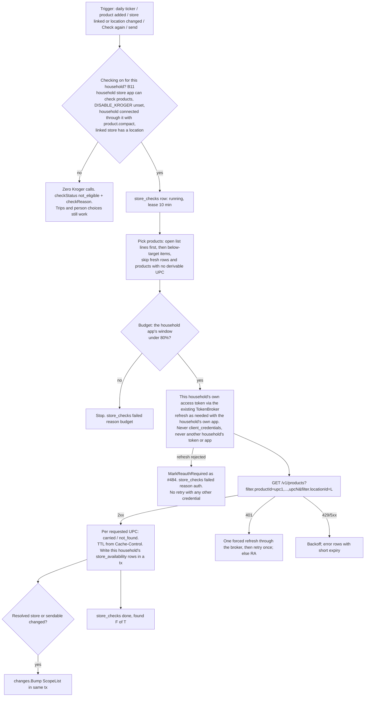
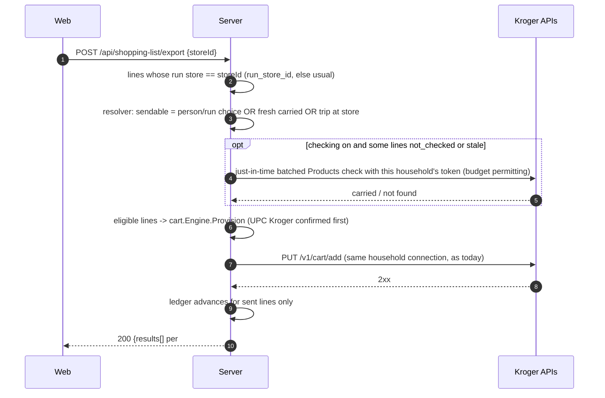

# Multi-store sourcing (#481)

- **Status:** Approved by CJ on 2026-10-31 at 1:37 PM MDT ("Approve #481"). Revised the same afternoon for CJ's Kroger decision at 1:38 PM MDT: "this isn't a for profit venture right now, so let's just leave that alone, and not use a centralized account." Requirements v6 (PM) apply. Revised again for CJ's Q4 answer at 4:04 PM MDT: "Each household should register its own developer app" (§4.6), to requirements v7 and PM's v7 design changes ([#481 comment](https://github.com/Rhionin/stockbot/issues/481#issuecomment-6549812452)). Where this page differs from PM's suggestion it says **My technical ruling** with the reason. See [Revision log](#revision-log). Stockbot Architect.
- **Issue:** [#481](https://github.com/Rhionin/stockbot/issues/481). The requirements (PM, v7) and the UX spec (UX, v4, with F9 in §9A and DEP-9 to DEP-12) are tracked on that issue. B-numbers are the requirement tickets.
- **Contract:** the HTTP shapes in §6 are in [`api-contract.md`](api-contract.md) under "Stores and multi-store sourcing" (ticket C0). Where this page and the contract differ, the contract wins.
- **Evidence:** master `c4c957d` at approval; this revision is on master `36e8aa14`, after [#484](https://github.com/Rhionin/stockbot/pull/484) merged. #484 carries the [#486](https://github.com/Rhionin/stockbot/issues/486) send-error fix. Open PR [#485](https://github.com/Rhionin/stockbot/pull/485) (send result panel), stacked on #484. Related bug [#489](https://github.com/Rhionin/stockbot/issues/489) (saving Kroger app credentials in one household swaps the app for every household).
- **Q4 decided: B (CJ, 2026-10-31 4:04 PM MDT).** Each household registers its own Kroger developer app (§4.6). [#489](https://github.com/Rhionin/stockbot/issues/489) is resolved by that, and is now the B11a ticket; its interim admin-only end state is superseded. Still for CJ: migration 030 and the one-time cutover (§4.6.5) at their PRs, and whether other households cut over at release (§9).

### Accepted by PM (2026-10-31 09:23 MDT), still in force
1. **TTL fallback.** A missing header or `no-store` gives a 1h status and no price or stock. If T1 shows Kroger reads `no-store` strictly, the fallback becomes 0 (§4.2).
2. **Store removal keeps trips**, and returns the per-next-store breakdown (§10, DEP-4).
3. **All banners.** B4 searches every Kroger-family banner, with a Smith's-only fallback (§4.1).
4. **`PUT /api/stores/default`** replaces the requirements sketch's settings path (§6.7).
5. **`cartUrl`** comes from the map T1 verifies. Omitted for unknown banners (§6.4).
6. **Undo ends at "Start a new cart"** (§10, DEP-1).
7. **B12** is a ticket of its own (§8).
8. **UX reason codes** are the canonical wire values (§6.6).

Labels: **Opinion** marks a judgment call. **PROPOSED** needs CJ's approval at PR time. **Spike** marks a value T1 confirms. **Unverified** marks a claim the Kroger docs don't state.

## 1. Context, goals, non-goals

### What master does today
- The shopping list is one flat list. `POST /api/shopping-list/export` sends every unpurchased line to one provider (`internal/cart/engine.go`).
- The Kroger adapter reports `Confirmation: per_request` (`internal/cart/kroger/kroger.go`), so any 2xx marks every line confirmed, even items the store doesn't carry.
- There are no store fields, and no durable record of where something was bought (`MarkPurchased` only sets `purchased_at`; "Start a new cart" deletes purchased auto lines; `fulfillment_ledger` records sends, not purchases).
- **Kroger sign-in:** one `kroger.Adapter` for the whole server (`cmd/server/main.go` `loadCartRegistry`), from `KROGER_CLIENT_ID`/`KROGER_CLIENT_SECRET`/`KROGER_REDIRECT_URI`, overridden by the primary household's `provider_app_credentials` row. Each household's members get their own shopper tokens (`provider_connections`, per person). The only scope requested is `cart.basic:write` (`AuthorizationScope`). Saving app credentials in any household swaps the app for everyone until restart; that's bug #489 (interim fix PR #498, §4.6). Under Q4 = B this changes to one app per household, and the env app becomes a one-time seed for the admin's household (§4.6).

### Goals
1. Households keep their own stores. One store can link to the Kroger-family cart and a Kroger location.
2. The app works out where products are sold:
   - Kroger Products API checks at the linked location, **only through the household's own Kroger connection** (§4.1, §4.5).
   - Learning from trips covers every store. A household with no Kroger connection learns Smith's from trips, like Walmart, Amazon or Macey's.
   - A person's choice always wins.
3. The list is grouped by store. A per-line "this time" override (`run_store_id`) survives "Update the list".
4. "Send to {store}" sends only eligible lines. The rest come back in `heldBack[]`, never dropped silently.
5. **No central account.** No shared lookup app, no app-only (`client_credentials`) token anywhere, no launch gate and no list of allowed households. A household with no connection makes **zero** Kroger calls.
6. **Nothing crosses households.** One household's connection, token or cached results are never used for another household. The availability cache is per household, with no shared table and no cross-household coalescing, and it's deleted when the household disconnects.
7. Comply with the Kroger Terms (https://developer.kroger.com/terms): §5(e) cache only as long as the cache header allows, no permanent copies (permanent rule, no exception sought); §2(c)/(d) documented access only, no getting around limits.

### Non-goals
- Automatic sources for Walmart, Amazon or Macey's; the Walmart affiliate program; Instacart; scraping.
- A shared or central Kroger lookup app, and any request to Kroger for a sharing or retention exception. Nothing waits on Kroger.
- Open Food Facts store names setting any state (a later "Maybe sold at…" chip only).
- Price comparison, splitting one line across stores, the phone-app list.

## 2. Flows

### 2.1 Lookup and refresh



### 2.2 Send to a linked store



A token failure before any batch is accepted is #484's whole-request `409 reconnect_required` or `502 provider_unavailable` (§6.5). If the just-in-time check's token refresh is rejected, the send stops with `409 reconnect_required` and nothing is sent, because the cart `PUT` would use the same token.

## 3. Data model (PROPOSED: migration `030_multi_store.sql`)

**PROPOSED.** CJ approves this schema at the PR for B1.
- **Why 030:** the last migration on master (`c4c957d`) is `028_esp32_scanner_devices.sql`. `029_firmware_ota.sql` is reserved by [`firmware-ota.md`](firmware-ota.md) §12 and hasn't landed on master or any branch. Re-check the highest number when B1 opens its PR.
- **Ordering:** the runner applies any file missing from `schema_migrations` in name order (`internal/app/migrate.go`), so 030 can merge before 029.
- **Additive only:** `CREATE TABLE/INDEX IF NOT EXISTS` and two nullable `ALTER TABLE ... ADD COLUMN` with no default, last (the runner isn't transactional, #249). No rebuild, no rewrite, no backfill, no stores created automatically (B9).
- **Conventions:** like 022a and 023, no foreign keys to `households` or `products`; Go cleans up references. CHECK constraints only on new tables; Go validates value sets too.

```sql
-- 030_multi_store.sql (PROPOSED)

CREATE TABLE IF NOT EXISTS stores (
    id              TEXT PRIMARY KEY,
    household_id    TEXT NOT NULL,
    name            TEXT NOT NULL,                     -- trimmed, 1-40 chars (Go)
    name_key        TEXT NOT NULL,                     -- case-folded trimmed name (Go)
    kind            TEXT NOT NULL DEFAULT 'physical' CHECK (kind IN ('physical','online')),
    linked_provider TEXT CHECK (linked_provider IS NULL OR linked_provider IN ('kroger')),
    location_id     TEXT,                              -- Kroger 8-char locationId; only when linked
    location_chain  TEXT,                              -- Kroger chain name of that location (cart URL, banner)
    position        INTEGER NOT NULL,
    created_at      TEXT NOT NULL,
    updated_at      TEXT NOT NULL,
    UNIQUE (household_id, name_key)
);
CREATE UNIQUE INDEX IF NOT EXISTS idx_stores_one_per_provider
    ON stores (household_id, linked_provider) WHERE linked_provider IS NOT NULL;
CREATE INDEX IF NOT EXISTS idx_stores_household_position ON stores (household_id, position);

-- What people set. Never written by automation (set_by_user_id NOT NULL).
CREATE TABLE IF NOT EXISTS product_stores (
    household_id    TEXT NOT NULL,
    product_id      TEXT NOT NULL,
    store_id        TEXT NOT NULL,
    state           TEXT NOT NULL CHECK (state IN ('carries','excluded')),
    is_usual        INTEGER NOT NULL DEFAULT 0 CHECK (is_usual IN (0,1)),
    set_by_user_id  TEXT NOT NULL,
    set_at          TEXT NOT NULL,
    PRIMARY KEY (household_id, product_id, store_id),
    CHECK (NOT (is_usual = 1 AND state = 'excluded'))
);
CREATE UNIQUE INDEX IF NOT EXISTS idx_product_stores_one_usual
    ON product_stores (household_id, product_id) WHERE is_usual = 1;
CREATE INDEX IF NOT EXISTS idx_product_stores_store ON product_stores (household_id, store_id);

-- Learned from trips. Household history; survives store removal (DEP-4) and Kroger disconnect.
CREATE TABLE IF NOT EXISTS store_trips (
    id              TEXT PRIMARY KEY,
    household_id    TEXT NOT NULL,
    product_id      TEXT NOT NULL,
    store_id        TEXT NOT NULL,                     -- soft reference
    store_name      TEXT NOT NULL,                     -- snapshot at write time
    store_name_key  TEXT NOT NULL,                     -- snapshot, for relink on re-add
    kind            TEXT NOT NULL CHECK (kind IN ('bought','this_time')),
    line_id         TEXT,
    via_run         INTEGER NOT NULL DEFAULT 0 CHECK (via_run IN (0,1)),
    actor_user_id   TEXT,
    occurred_at     TEXT NOT NULL
);
CREATE INDEX IF NOT EXISTS idx_store_trips_product ON store_trips (household_id, product_id, occurred_at);
CREATE INDEX IF NOT EXISTS idx_store_trips_store ON store_trips (household_id, store_id);
CREATE UNIQUE INDEX IF NOT EXISTS idx_store_trips_one_this_time ON store_trips (line_id) WHERE kind = 'this_time';
CREATE UNIQUE INDEX IF NOT EXISTS idx_store_trips_one_bought ON store_trips (line_id) WHERE kind = 'bought';

-- Kroger check cache (vendor content), per household only. Expired rows are never read and are purged.
-- Deleted for the household when its Kroger connection is removed.
CREATE TABLE IF NOT EXISTS store_availability (
    household_id       TEXT NOT NULL,
    store_id           TEXT NOT NULL,
    product_id         TEXT NOT NULL,
    source             TEXT NOT NULL DEFAULT 'kroger_api' CHECK (source IN ('kroger_api')),
    location_id        TEXT NOT NULL,
    upc                TEXT,
    status             TEXT NOT NULL CHECK (status IN ('carried','not_found','error')),
    stock_level        TEXT,
    price_cents        INTEGER,
    promo_price_cents  INTEGER,
    checked_at         TEXT NOT NULL,
    status_expires_at  TEXT NOT NULL,
    detail_expires_at  TEXT,
    PRIMARY KEY (household_id, store_id, product_id)
);
CREATE INDEX IF NOT EXISTS idx_store_availability_expiry ON store_availability (status_expires_at);

CREATE TABLE IF NOT EXISTS store_checks (
    household_id   TEXT NOT NULL,
    store_id       TEXT NOT NULL,
    state          TEXT NOT NULL CHECK (state IN ('running','done','failed')),
    trigger        TEXT NOT NULL CHECK (trigger IN ('daily','product_added','store_setup','manual','send')),
    started_at     TEXT NOT NULL,
    finished_at    TEXT,
    lease_until    TEXT NOT NULL,
    checked_count  INTEGER NOT NULL DEFAULT 0,
    found_count    INTEGER NOT NULL DEFAULT 0,
    total_count    INTEGER NOT NULL DEFAULT 0,
    failure        TEXT CHECK (failure IS NULL OR failure IN ('budget','kroger_unavailable','rate_limited','auth')),
    PRIMARY KEY (household_id, store_id)
);

-- Rate-limit accounting per issuing developer app. app_key = first 16 hex chars of
-- SHA-256(client_id); never the secret. No household data.
CREATE TABLE IF NOT EXISTS kroger_api_window (
    app_key            TEXT NOT NULL,
    endpoint           TEXT NOT NULL CHECK (endpoint IN ('products','locations')),
    window_started_at  TEXT NOT NULL,
    calls              INTEGER NOT NULL DEFAULT 0,
    blocked_until      TEXT,
    PRIMARY KEY (app_key, endpoint)
);
CREATE TABLE IF NOT EXISTS kroger_household_usage (
    household_id       TEXT NOT NULL,
    endpoint           TEXT NOT NULL CHECK (endpoint IN ('products','locations')),
    app_key            TEXT NOT NULL,
    window_started_at  TEXT NOT NULL,
    job_calls          INTEGER NOT NULL DEFAULT 0,
    on_demand_calls    INTEGER NOT NULL DEFAULT 0,
    PRIMARY KEY (household_id, endpoint)
);

-- Last statements (non-transactional runner).
ALTER TABLE shopping_list_items ADD COLUMN run_store_id TEXT;
CREATE INDEX IF NOT EXISTS idx_shopping_list_items_run_store
    ON shopping_list_items (household_id, run_store_id) WHERE run_store_id IS NOT NULL;
-- Scopes granted at the last code exchange. NULL = connected before #481
-- (cart.basic:write only): no product checks, no error (checkReason no_product_access).
ALTER TABLE provider_connections ADD COLUMN granted_scope TEXT;
-- Q4 = B (§4.6): the household app that issued this connection, and the app a
-- pending sign-in started with. app_key = first 16 hex chars of SHA-256(client_id).
-- NULL app_key = connected before B11a; the cutover (§4.6.5) sets the primary household's.
ALTER TABLE provider_connections ADD COLUMN app_key TEXT;
ALTER TABLE provider_connections ADD COLUMN auth_app_key TEXT;
-- Where the callback sends the browser after a sign-in: 'shopping' (NULL) or 'household' (F9, §4.6.7).
ALTER TABLE provider_connections ADD COLUMN auth_return TEXT;
-- Set only by test-and-save (§4.6.3): NULL = unknown, 0 = no Products, 1 = can check products.
ALTER TABLE provider_app_credentials ADD COLUMN product_access INTEGER;
ALTER TABLE provider_app_credentials ADD COLUMN product_access_at TEXT;
```

**Notes**
- **Default store:** `household_settings` key `default_store_id`; no DDL.
- **Tenant lint** (`internal/tenant/sqlcheck.go`): add `stores`, `product_stores`, `store_trips`, `store_availability`, `store_checks`, `kroger_household_usage` to `HouseholdTables`; `kroger_api_window` to `GlobalTables` ("per-app Kroger rate-limit counter; no household data").
- **Purge:** `internal/auth/purge.go` already deletes from every table with `household_id`; B1 adds a test.
- **Keying by product:** like `household_product_overrides` (023). Lines join `items` for `product_id`.
- **Additive-only check (B9):** apply 001–030 to a 028-era fixture built from generic test data. Pre-existing row counts unchanged; `run_store_id`, `granted_scope`, `app_key`, `auth_app_key`, `auth_return`, `product_access` and `product_access_at` NULL everywhere (before the Go cutover step, which T-B11k tests separately); no `stores` rows; `GET /api/shopping-list` byte-identical for a household with zero stores; a cart send on an existing connection still works.

### 3.1 Precedence (pure Go, `internal/sourcing/resolve.go`)
Inputs, loaded per household in one read: stores in order, `product_stores`, this household's fresh `store_availability` rows (`status_expires_at > now` and `location_id` equals the store's current location), `store_trips` joined to live stores, the default store, the line's `run_store_id`, and the household's checking state (§4.5, for `checkStatus` only).

**Carries(X, P), first match**
1. A person's `product_stores` row: `carries` = yes, `excluded` = no; origin `person`.
2. Automatic and learned, newest first: a fresh `carried` row (origin `found`) and the latest trip at X (origin `trip`). Both mean yes; the newer supplies origin and time. A fresh `not_found` or `error` adds nothing.
3. Unknown.

**Usual(P), first match**
1. A person's `is_usual` row: `person`.
2. Habit: the last N `bought` trips for P (`SOURCING_HABIT_RUNS`, default 2) are all at the same live, non-excluded store: `habit`. A run without P doesn't break the streak; a purchase elsewhere does.
3. The first store in household order where Carries is yes: `found`. The UI shows the origin line ("Found at Smith's" or "You bought it here"), never "Auto".
4. The household default, unless excluded: `household`.
5. None: `none`.

**DEP-5:** for `habit`, the resolver also returns `usualChangedAt` (the trip that completed the streak) and `previousUsualStoreId` (Usual(P) without that trip), only when they differ. Derived; no storage.

**Store for this run:** `run_store_id` (`run`), else Usual(P) (`usual`), else none.

**Sendable(line, S)** for a linked S: true when `run_store_id = S` or Carries(S, P) is yes from any origin; else false with reason `not_confirmed`. A person's `excluded` on S beats trips and Kroger; only an explicit `run_store_id = S` ("Include anyway") overrides it, and then no trip is recorded at the excluded store. For a household without checking, Smith's eligibility comes only from trips and people.

**Check status per (line, S) (DEP-2)**, linked S only, reported as `checkStatus`:
- `found` / `not_found` / `error`: a fresh row with that status. `not_found` means unknown, never "not sold".
- `checking`: `store_checks` for S is `running` with a live lease and no fresh row.
- `not_eligible`, with `checkReason` (first that applies):
  - `not_configured`: the household has no store app (§4.6), or `DISABLE_KROGER` is set.
  - `not_connected`: the household has no Kroger connection, or it's `disconnected` or `reauth_required`. (A `reauth_required` connection is shown as not connected for checking; the cart UI already offers Reconnect from the connection state, per #484/#485.)
  - `no_product_access`: the household app's `productAccess` isn't `true` (no Products, or not tested yet), or the connection's `granted_scope` doesn't include `product.compact` (connected before the app passed the test).
  - `no_location`: S has no Kroger location.
  - `no_barcode`: P has no derivable UPC.
- `not_checked`: none of the above, including expired rows.

Fresh rows win over `not_eligible`, except that a disconnect, a store app removal or a key replacement deletes them (§4.2, §4.6.6), so a disconnected household never shows checked results.

**Invariants (B2/B6 property tests):** no automatic or learned write changes `product_stores`; automatic data sets the usual store only through rule 3.

### 3.2 Writes and live updates
- Every write here runs in one transaction ending with `changes.Bump(ctx, tx, house, changes.ScopeList)`.
- **`run_store_id`:** set by `PUT /api/shopping-list/items/{id}/store`, which upserts the line's `this_time` trip (unless excluded); null deletes it if the line isn't bought. Fill (`upsertAutoLine`) and `SwapAutoLine` keep it. Cleared on purchase; goes with the row on delete.
- **`MarkPurchased`:** resolves the run store at commit time, inserts a `bought` trip with `via_run` if not excluded, sets `run_store_id = NULL`. "Mark all bought" loops per line (opinion).
- **Unpurchase (DEP-1):** `PATCH .../items/{id} {purchased:false}` clears `purchased_at`, deletes the `bought` trip, restores `run_store_id` when `via_run = 1`. A line already removed by "Start a new cart" is `404 not_found`.
- **Kroger disconnect** (the existing disconnect route, or any removal of a connection row): when the household has no remaining Kroger connection, the same transaction deletes that household's `store_availability` and `store_checks` rows. Trips and person choices stay. Connections are per person; while another member of the same household is still connected, the household's rows stay (they never leave the household).

## 4. Lookup and refresh

### 4.1 Kroger client (B5, `internal/cart/kroger/products.go`, `locations.go`)
- **Token: the household's own connection only.** Every lookup (Products and Locations) uses an access token from a `provider_connections` row belonging to a member of the calling household, through the existing `connection.TokenBroker` (the refresh path the cart send uses, as changed by #484). There is **no `client_credentials` lookup path**; the only `client_credentials` request is test-and-save's (§4.6.3), whose token is never kept or used. A B5 test fails if the stub sees a client-credentials grant from anywhere but `kroger.TestAppKeys`.
  - **Which connection:** the connection the cart send uses for that household. If several members are connected, the most recently refreshed `connected` row whose `granted_scope` has `product.compact`. Opinion: one is enough; no rotation.
  - **401 on a lookup:** one forced refresh through the broker, then one retry. If the refresh is rejected (an OAuth reconnect-class error, as #484 classifies), call `MarkReauthRequired`, fail the check with `auth`, and stop. Later sends then fail fast with `409 reconnect_required` exactly as #484 does. **No lookup retries with any other credential** or another household's connection.
  - **403 for a missing scope** (T1 records the body): sets nothing on the connection state; B5 removes `product.compact` from `granted_scope`, so lines show `no_product_access`. Cart sends keep working.
  - Tokens stay in the existing connection row and are never logged or returned. (Correction: they're stored as given, not encrypted; the database file is the secret store, per migration 007's comment. See §5.1.)
- **Credentials resolved per connection (Q4 = B).** B5 owns the single **`connection.AppFor(ctx, conn) (AppCreds, appKey, error)`** used for the authorize URL, code exchange, refresh, cart sends, and Products/Locations lookups. It returns **only the connection's own household's app** (§4.6), and checks that `conn.app_key` matches it. There is **no fallback** to a server-wide or env app for any household, the admin's included; after the cutover the env keys are only a one-time seed (§4.6.5). No app: zero Kroger calls (T-B11g). The `kroger.Adapter` stops holding mutable `clientID`/`clientSecret`/`redirectURI`; every OAuth and API call takes `AppCreds` as an argument. `ApplyAppCredentials`/`ClearAppCredentials` and the startup `LoadServerProvider` apply go away (B11a, ticket #489, adds the lookup; B5 moves every adapter call onto it). #498 already deleted `HouseholdAdapterResolver`/`ServerRegistryResolver`; don't bring them back.
- **Scope, per household (no server setting).** The Products API needs `product.compact` on the token: "if you need to get a token to call the Public Products API, you must include the `product.compact` scope in the token request" ([FAQ](https://developer.kroger.com/support/faq)). Locations needs no scope ([Applications](https://developer.kroger.com/documentation/support/website-help/applications)).
  - **`KROGER_PRODUCT_CHECKS` is deleted** (PM v7 change 3). Sign-in asks for `cart.basic:write product.compact` only when the household app's `productAccess` is `true` (set by test-and-save, §4.6.3), and `cart.basic:write` alone otherwise, which is today's authorize URL byte-for-byte for that app (test).
  - Kroger's help says an app without an API can't add it later: "If you find that you need an API you did not select during registration, you must create a new application" ([Applications](https://developer.kroger.com/documentation/support/website-help/applications)). So a household whose app lacks Products keeps a cart-only sign-in and shows `no_product_access`, and its sign-in can't break because of the scope.
  - At code exchange the server stores the token response's `scope` (or the requested scope if the response has none; **Spike** T1) in `granted_scope`.
  - **Older connections** (`granted_scope` NULL) never get checks and never get an error. A person reconnects through today's Connect flow to turn checking on.
- **Products:** `GET /v1/products?filter.productId=<upc,…>&filter.locationId=<8 chars>`. With `filter.locationId`, only products sold at that location come back. Fields used: `upc`, `items[].price.regular`/`promo`, `items[].inventory.stockLevel`, `items[].fulfillment.instore`. Sources: https://developer.kroger.com/documentation/api-products/public/products/overview and https://developer.kroger.com/reference/api/product-api-partner.
  - UPCs come from `catalog.ListBarcodesForProduct` plus `kroger.Normalize`, the cart's path. Every derivable UPC is sent; any match means `carried` and that `upc` is stored; none means `not_found`.
  - Batch size `KROGER_PRODUCT_BATCH_SIZE` (separate from `KROGER_BATCH_SIZE`), provisional 50; **Spike** T1 confirms the maximum.
  - The send's `resolveIdentities` prefers the UPC Kroger confirmed.
- **Locations (B4):** `GET /v1/locations?filter.zipCode.near=<zip>&filter.limit=<n>[&filter.chain=<name>]`, **with the household's token**. "If the parameter `filter.chain` is not provided, the results include all locations and chains owned by The Kroger Co." (https://developer.kroger.com/reference/api/location-api-public).
  - No connection (or `reauth_required`): `409 kroger_not_connected`, zero Kroger calls. The web runs today's connect flow first, then the store search (F1).
  - All banners by default, optional `chain=`; the server drops non-grocery locations (rule from T1). Fallback if T1 shows all-banner search can't work: Smith's only, same contract.
  - Results are never stored; only the chosen `location_id` and `location_chain` are kept.

### 4.2 Cache and TTL (B6) — permanent rule
`ttlFromHeaders(resp)` reads the headers at runtime, never a hard-coded value. No exception from Kroger is being sought, so there's no override setting.

| Response header | `status_expires_at` | `detail_expires_at` (price, stock) |
|---|---|---|
| `Cache-Control: max-age=N` (or `s-maxage`), else `Expires` | `checked_at + min(N, KROGER_STATUS_TTL_MAX)` | `checked_at + min(N, KROGER_DETAIL_TTL_MAX)` |
| Header missing | `checked_at + KROGER_CACHE_FALLBACK_TTL` (default 1h) | NULL: price and stock not saved |
| `no-store` or `no-cache` | same 1h fallback. **Spike:** if Kroger reads `no-store` strictly, the fallback becomes `0` and nothing is persisted (results used only within the request). | NULL |

- Caps `KROGER_STATUS_TTL_MAX` and `KROGER_DETAIL_TTL_MAX` default to 24h and can only shorten.
- Reads filter on expiry; price and stock appear only while `detail_expires_at > now`.
- Purge: the job and the 24h purge loop delete expired rows and null expired price and stock.
- Price and stock are never written to `item_deals` (test).
- A location change deletes the store's rows. A household's last Kroger disconnect deletes all its rows (§3.2).
- **Per household, permanently:** a row obtained with household A's token is never read for, served to or copied to household B, even for the same location and product (§5.3).

### 4.3 On demand vs the daily job (B7)
- **Daily job:** `sourcing.RunRefresh(ctx, 24*time.Hour)`, wired next to `RunPurge`. It runs only for households where checking is on (B11), each with **its own** token, open list lines first, then below-target items, skipping rows fresh for more than 6h (opinion).
- **On demand,** same code path with `trigger`: product added, store linked or location changed, `POST /api/stores/{id}/check`, `POST /api/products/{id}/stores/check`, and the just-in-time send check (that section's `not_checked` lines).
- A household that (re)connects with product checks gets a check on the next trigger, with no restart or setting change.
- **Concurrency:** a live `store_checks` lease (10 min) blocks a second run for the store; a manual check while running returns `202` with the current state.
- **Logs:** counts, status codes and durations only. No product names, UPCs, household names, tokens, client IDs or secrets.

### 4.4 Rate limits and backoff (one window per household app)
- **Cited limits:** Products 10,000/day, Cart 5,000/day, each Locations endpoint 1,600/day ([FAQ](https://developer.kroger.com/support/faq)). "All public APIs have a daily rate limit that is applied equally across all clients … we do not currently support individual rate limits by client. Rate limits reset 24 hours after the first call to an endpoint" ([API basics](https://developer.kroger.com/documentation/public/getting-started/apis)). So the limit is per developer app (the issuing client), as configured by whoever hosts it.
- **Per shopper token: Unverified.** Kroger's docs don't describe a per-user-token limit. The design assumes calls with any shopper's token count against the issuing app and that there's no extra per-shopper cap. T1 item (b) (B0 item 6 in the requirements) checks this; if limits turn out to be per shopper, the per-app window simply never binds.
- **Window per issuing app:** `kroger_api_window (app_key, endpoint)`, `app_key` from `AppFor` (§4.1). Under Q4 = B each household's app has its own window, so the budget is **per household**: one household's checks can never use up another's. (If two households paste the same client ID they share one window, first come first served. Opinion: allowed, not rejected, because rejecting would reveal that another household uses that app.)
  - Hard stop at **80%**: 8,000 Products and 1,280 Locations calls per app per window. Counters increment in a transaction before each call.
- **No fair share** (PM v7 change 4): the household's budget is its app's hard stop. The job may use 60% of it; on-demand uses the rest (opinion, kept so a big job can't starve a person's manual check). Out of budget: job `budget` failure; manual checks `429 rate_limited` with `Retry-After`.
  - Scale (opinion): at 50 UPCs a call, a 300-product household needs about 6 calls a day against its own app's 8,000, so the budget never binds in normal use.
- **Backoff:** 429 honors `Retry-After`, else 1, 5, 30 min; after 3 in a row, `blocked_until` to the end of the app's window. 5xx or timeout: one retry after 2 s with jitter, then `error` rows with a 15 min expiry and `kroger_unavailable`.
- **No getting around limits (§2(d)):** never rotates credentials, never uses another app (including another household's), never borrows another household's connection.
- **No cross-household coalescing.** Identical requests from two households are two requests, each with its own token. (The earlier draft's in-run coalescing is removed.)

### 4.5 Checking on (B11)
- **`lookupsEnabled(household)`** is true when all hold:
  - `DISABLE_KROGER` is unset;
  - the household has its own store app (§4.6) and its `productAccess` is `true`;
  - the household has a `connected` Kroger connection issued by that app whose `granted_scope` includes `product.compact`;
  - the household has a store linked to the Kroger cart with a location set.
- Computed per request from the connection and store rows. No household list, no owner-only mode, no `is_primary` rule: the same rule for every household, CJ's included.
- Every lookup call site checks it: the job, on-add, store setup, both manual checks, the send-time check. The location picker needs only a connected household (it's how the location gets set).
- **When it's off:** stores, cart send (if connected) and trip learning work as usual, with zero Kroger lookup calls. Lines show `checkStatus: not_eligible` with a `checkReason` (§3.1), so the UI never says "Couldn't find".
  - Check routes: `409 kroger_not_connected` when the household has no working connection, with `checkReason` `not_configured` (no store app) or `not_connected` in the body (§4.6.2); `409 store_check_unavailable` when it's connected but checking is still off (`not_configured`, `no_product_access`, `no_location`).
- Lookup code takes its token only from the calling household's scope (grep-style test, B11).
- **DEP-7 fields on `GET /api/stores`:** `lookupsEnabled`; per linked store `checkReason` when checking is off (`not_configured`, `not_connected`, `no_product_access`, `no_location`); and `canConnect`, true when this person may start the Kroger connect flow under the same rule as today's connect button (`GET /api/providers/kroger/authorize`; correction: it's a GET, not a POST), computed by the same check, not a copy of it. Under Q4 = B that check includes "this household has its own store app", so `canConnect` is false until an admin finishes setup (F9). With no store app the reason is `not_configured`, so the web's reconnect line (shown only for `no_product_access` and `canConnect`) stays hidden and admins get the setup link instead. When the app's `productAccess` isn't `true`, the reason is `no_product_access`; the web shows Reconnect only if the connection lacks the scope and the app has it, and otherwise points admins to the store app row (UX).

### 4.6 One Kroger app per household (Q4 = B, decided; requirements v7 B11a)

**Decision.** CJ, 2026-10-31 4:04 PM MDT: "Each household should register its own developer app." Each household registers its own free Kroger developer app (the "store app" in product copy) and saves its keys in Stockbot. No household signs in, sends a cart or checks products through a server-wide app, and there is no fallback to one. Option A is withdrawn, and so is #489's interim admin-only end state (requirements v7 §9 #27–#30).

**Relation to #489, #498 and #515.** [#498](https://github.com/Rhionin/stockbot/pull/498) (head `01c88d1a`, open) is the interim server-side fix for #489: only the server admin may `PUT`/`DELETE /api/providers/kroger/credentials`, which write the primary household's row; other households get `403` `forbidden_operator`. [#515](https://github.com/Rhionin/stockbot/pull/515) (open) is its frontend. Opinion: both may merge as interim isolation, because they close the cross-household swap today and #498's primary row is exactly the row §4.6.5 keeps. #515's body says "Fixes #489"; that must become "Refs #489", because [#489](https://github.com/Rhionin/stockbot/issues/489) is now the B11a ticket below. B11a replaces #498's operator gate and #515's dialog (F9).

#### 4.6.1 Storage
- **Table: keep `provider_app_credentials`** (PM's first option). Migrations 007 and 022b already key it by household and provider: `id = "{householdID}:{providerID}"`, `UNIQUE (user_id, provider_id)` with `Vault.Save` writing the household id into `user_id`, and reads through `tenant.Scope` on `household_id` (`internal/cart/appcred/vault.go`). Columns used: `client_id`, `client_secret`, `redirect_uri`, `modality`, `actor_user_id`, `updated_at`. A new table would copy the same columns and need a data move for no gain.
- **New columns (migration 030, §3):** `product_access INTEGER` (NULL = unknown, 0 = the app can't check products, 1 = it can), written only by test-and-save (§4.6.3); `product_access_at TEXT`.
- **Secret at rest. My technical ruling: stored as given; no new encryption in #481.** PM noted my earlier B plan proposed encryption. I'm withdrawing that. The same database file holds the household's plaintext refresh tokens (migration 006), which are more powerful than the app secret (a refresh token acts as the shopper; the secret only identifies the app). The key for encrypting only the secret would sit in env or a file on the same host as the database, so it wouldn't protect against the realistic threat (someone who has the host). Backups are already age-encrypted (`internal/backup/encrypt.go`). This meets B11a's "at least as safely as today's secrets and tokens". At-rest encryption of all provider secrets (tokens and app secrets together) is a separate follow-up if CJ wants it.
- **Write-only secret:** only `AppFor` (§4.1) selects `client_secret`. The GET query's column list leaves it out (test). The secret and tokens never appear in a response, log line or error, and the full client ID appears only in the PUT/test request that carries it (T-B11l).

#### 4.6.2 Routes (finalizes requirements §7)
Auth is Session. `{id}` must name the household selected for the request (`X-Household-Id` or the session's active household), as for every `/api/households/{id}` route; anything else is `404` `not_found`. Writes and the test need role **Owner** ("household admin" in product copy); a member gets `403` `forbidden_role` and nothing changes. The LAN principal is a member, so these writes need a personal session on the public entry, like other owner routes.

| Route | Role | Request | Response | Errors (besides the common ones) |
|---|---|---|---|---|
| `GET /api/households/{id}/kroger-app` | Member | | `200 KrogerApp` | |
| `PUT /api/households/{id}/kroger-app` | Owner | `{clientId, clientSecret, modality?}`, or `{modality}` alone on a saved app | `200 KrogerAppSaved` (the app plus the `test` result). Tests the keys first (§4.6.3); `wrong_keys` and `kroger_unreachable` save nothing, so on a replace the old keys stay in use. `no_product_access` and `redirect_mismatch` save (the keys work; both are fixed on Kroger's page or with a new app). `{modality}` alone saves without a test. | `validation`, `forbidden_role`, `store_app_keys_rejected` (400), `store_app_unreachable` (503) |
| `POST /api/households/{id}/kroger-app/test` | Owner | `{clientId, clientSecret}` (test only, nothing saved), or `{}` (re-test the saved keys and record `productAccess`) | `200 KrogerAppTest` | `validation`, `forbidden_role`, `rate_limited`, `kroger_not_connected` with `checkReason:"not_configured"` for `{}` when no app is saved |
| `DELETE /api/households/{id}/kroger-app` | Owner | | `200 KrogerApp` with `configured:false`, `status:"not_set_up"`. Idempotent. | `forbidden_role` |

```ts
type KrogerAppStatus = 'not_set_up' | 'ready_to_connect' | 'connected' | 'needs_reconnect';
interface KrogerApp {
  configured: boolean;
  clientIdLast4: string | null;          // never the full client ID
  redirectUri: string | null;            // exact Web Redirect URL to register; null when the server has none (§4.6.4)
  modality: 'pickup' | 'delivery' | null;
  productAccess: 'true' | 'false' | 'unknown';
  status: KrogerAppStatus;
  canManage: boolean;                    // caller is an owner of this household
}
type KrogerAppTestCode = 'wrong_keys' | 'redirect_mismatch' | 'kroger_unreachable' | 'no_product_access';
interface KrogerAppTest {
  ok: boolean;                           // true: the keys work (saved, on PUT)
  code?: KrogerAppTestCode;              // absent = all checks passed
}
interface KrogerAppSaved extends KrogerApp { test: KrogerAppTest; }   // PUT response
```

- **`productAccess` as a string.** My technical ruling: `'true' | 'false' | 'unknown'` rather than `true | false | null`, so a client can't treat unknown as false by accident. PM's sketch didn't fix the type.
- **`status`** is derived per request: `not_set_up` (no row); `connected` (some member has a `connected` Kroger connection issued by this app); `needs_reconnect` (none connected and at least one `reauth_required`, including after a replace, a refused refresh or #484's marking); `ready_to_connect` otherwise.
- **Test codes (PM v4 ruling 2).** `ok:false` with `wrong_keys` or `kroger_unreachable`: nothing saved. `ok:true` with `no_product_access` (saved with `productAccess:'false'`) or `redirect_mismatch` (saved; §4.6.3). When both notes apply, `redirect_mismatch` wins because it blocks connecting; `productAccess` still tells the UI about Products. `POST .../test {}` with no saved app is `409` `kroger_not_connected` with `checkReason:"not_configured"` (PM v4 ruling 1), not a test code.
- **`checkReason` (PM v4 ruling 1):** `not_configured` = the household has no store app (also when the server's `DISABLE_KROGER` kill switch is set, which looks the same to the household); `not_connected` = an app exists but no member has a live connection through it (including `reauth_required`).
- **Registry codes vs test codes.** My technical ruling: PUT failures are registry errors with a `store_app_` prefix (`store_app_keys_rejected` 400, `store_app_unreachable` 503), so the global registry has no bare `wrong_keys`; the test route returns PM's plain values in `code`. `store_app_keys_rejected` ↔ `wrong_keys`, `store_app_unreachable` ↔ `kroger_unreachable`.
- **`redirect_mismatch` (PM v4 ruling 2; supersedes my earlier "no code" ruling).** It's a test code, detected by a separate check before sign-in (§4.6.3), never by the token request. It's not a registry error.
- **Kroger routes for a household with no app** (store search, check routes, authorize, send): zero Kroger calls. Store search and the check routes return `409` `kroger_not_connected` with `checkReason:"not_configured"` in the body (my technical ruling: no new 409 code; the web already handles `kroger_not_connected` and branches on `checkReason` to send admins to setup instead of connect). `GET /api/providers/kroger/authorize` returns the same body, because UX v4 (§9A.4) branches on it when another admin removes the app mid-setup; the export keeps today's `409` `conflict`.

#### 4.6.3 Test and save (requirements §9 #30)
**Confirmed: PM's ruling #30, with guardrails.** I found no better check: Kroger offers no "validate keys" endpoint, `cart.basic:write` can't be requested with `client_credentials` ([Authorization endpoints](https://developer.kroger.com/api-products/api/authorization-endpoints-partner), requirements §12), and a shopper sign-in would need the admin's grocery login before we know the keys work.
- One `POST /connect/oauth2/token` with `grant_type=client_credentials`, `scope=product.compact`, HTTP Basic with the household's client ID and secret, 10 s timeout, no retry.
- Only the status and the OAuth `error` field are read. The access token is never parsed into a variable, stored, logged or used for a lookup; the body is drained and dropped. It lives in `kroger.TestAppKeys`, the only `client_credentials` call in the code. B5's stub rule becomes "fails on any `client_credentials` grant outside `TestAppKeys`" (test), so v6's no-`client_credentials`-lookup rule holds.
- Key mapping (T1 items (e) and (f) confirm the real bodies): 200 → `ok`, `productAccess` 1; `invalid_client` or 401 → `wrong_keys`; `invalid_scope` or a 400/403 that T1 shows means "app lacks Products" → `ok` with `no_product_access`, `productAccess` 0; 5xx, timeout or network error → `kroger_unreachable`. Anything else → `wrong_keys`.
- **Redirect check (PM v4 ruling 2). The throwaway token request can't detect a redirect mismatch:** a `client_credentials` request sends no `redirect_uri`, and Kroger only checks the redirect URL in the sign-in flow. So the test adds a second request, only after the keys pass: one `GET` to Kroger's authorize URL with the household's client ID, the exact `redirectUri`, `response_type=code`, `scope=cart.basic:write` and a random `state` that's thrown away. No cookies, redirects not followed, 10 s timeout, no shopper involved, nothing stored. An OAuth server checks `client_id` and `redirect_uri` before it shows a sign-in page and must not redirect on a mismatch ([RFC 6749 §4.1.2.1](https://datatracker.ietf.org/doc/html/rfc6749#section-4.1.2.1)), and Kroger's docs say it answers `invalid_request` "The redirect_uri did not match the registered redirect_uri for this application" (requirements §12).
  - **Mapping is allow-list only, so it can't give a false alarm:** the exact mismatch response T1 records → `redirect_mismatch`; Kroger's normal sign-in response (a redirect to its login page or the login page itself) → pass; anything else (bot wall, timeout, unknown page) → pass with no claim, logged as `redirect_check=unknown` (no ids). A failed redirect check never blocks a save.
  - **If T1 item (h) shows it can't be told apart** (Kroger checks the URL only after sign-in, or the pages look the same, or the request is blocked), the honest alternative ships instead: `TestAppKeys` never returns `redirect_mismatch`; F9 keeps the up-front warnings (UX c.app.s3.exact, c.app.s7.hint); and the callback reports `redirect_mismatch` only if Kroger sends the browser back with that error (§4.6.7, DEP-11). Otherwise Kroger's own page shows its message. The code stays in the type so no contract change is needed either way.
- Rate-limited by the app's own token endpoint; we add a per-household limit of 10 tests per hour (`rate_limited`) so a loop can't hammer Kroger.
- The migrated primary app starts with `productAccess` unknown, so its sign-in stays `cart.basic:write` until an admin presses **Test again** (I1).

#### 4.6.4 The redirect URL F9 shows
PM's note says there's no public-URL setting today. Correction: there is one. `APP_BASE_URL` is the server's public origin (`internal/app/runtimeconfig.go`, `AbsoluteURL` at line 205; it follows `PUBLIC_HOST` when empty, `deploy/check-publish-modes.sh` line 303), and invite links already use it. The server's callback is computed once at startup:
1. `KROGER_REDIRECT_URI` if set (it's what CJ's app is registered with today, so it stays byte-for-byte);
2. else `AbsoluteURL("/api/providers/kroger/callback")`;
3. else none: `redirectUri:null`, and F9 stops at step 4 with "This server's address isn't set up yet. Ask the person who runs it." (LAN-only installs).

A PUT stores that value in the row's `redirect_uri`. `GET` returns the row's value when set, else the server value, so CJ's migrated row keeps the URI his app was registered with. The household can't send its own `redirectUri` (`validation`), so a pasted app can't send codes elsewhere. T1 item (j) checks whether Kroger requires `https` and accepts the home domain; both live deployments use `https` on `PUBLIC_HOST`.

#### 4.6.5 Migration of today's app (B11a AC, PROPOSED: CJ approves at the PR)
SQL migrations can't read env, so the move is a one-time Go cutover step in B11a's startup, guarded by `app_settings` key `kroger_app_cutover_v1` and run in one transaction before the server serves requests. Idempotent: re-running it changes nothing.
1. **Primary household** (`households.is_primary = 1`): a saved row is kept as is. With no row, and `KROGER_CLIENT_ID`, `KROGER_CLIENT_SECRET` and the server callback (§4.6.4) all present, insert that app into the primary household's row once (`actor_user_id` NULL, `product_access` NULL). With incomplete env, nothing is copied and the primary household is `not_set_up`.
2. **Primary connections:** set `app_key` from the primary row's client ID where NULL. They keep working with no reconnect (same client ID).
3. **Every other household:** delete its Kroger `provider_connections` rows (tokens were issued by the shared app), its `store_availability` and `store_checks` rows, and any leftover `provider_app_credentials` row saved before #498 (it was never tested and may be a copy of the shared app; my technical ruling, so every other household starts clean at `not_set_up`). Stores, lists, trips and choices stay.
4. Log counts only: households cut over, connections removed, leftover rows removed. Never ids, names or tokens.
5. After cutover the env app is a **seed only**: `AppFor` never reads `KROGER_CLIENT_ID`/`_SECRET`. Opinion: keep the variables documented as "copied once into the admin's household" for one release, then remove them (I1 runbook).

**Count before ship (no tokens read).** NE runs this read-only query on the live server before B11a deploys and reports only the number (household data stays off GitHub):
```sql
SELECT COUNT(DISTINCT c.household_id) FROM provider_connections c
JOIN households h ON h.id = c.household_id
WHERE c.provider_id = 'kroger' AND h.is_primary = 0
  AND c.state IN ('connected', 'reauth_required');
```
(`household_id` from 022b; the query reads `state` only, never a token.) The Manager tells CJ if the count isn't zero.

**Migration test (T-B11k), 029-era fixture, generic data:** (a) a primary household with a saved row keeps it byte-for-byte; (b) env-only: the app is copied once, and a second start changes nothing; (c) a second household connected through the shared app ends `not_set_up`, its connections and check rows gone, its stores kept; (d) the primary connection still refreshes with the same client ID (stub records it); (e) incomplete env copies nothing.

#### 4.6.6 Remove, replace and the old routes
- **Remove** (`DELETE`): one transaction deletes the row, every Kroger `provider_connections` row of the household (all members), and its `store_availability` and `store_checks` rows. `AppFor` reads per call, so the next call finds no app: zero calls at once, no restart (T-B11j).
- **Replace with a different client ID** (`PUT`): in the same transaction as the save, every connection of the household gets state `reauth_required` with tokens and `app_key` cleared, and its `store_availability`/`store_checks` rows are deleted. Status becomes `needs_reconnect`; the send flow's Reconnect covers it. (PM wrote `reconnect_required`; the connection state is #484's `reauth_required`, and `reconnect_required` stays the send error.)
- **Same client ID, new secret:** keeps connections. **Unverified:** that Kroger refreshes a token with the same client ID and a regenerated secret. T1 item (k) confirms it; if it fails, a new secret is treated like a new client ID.
- **`/api/providers/{id}/credentials`. My technical ruling: retired in B11a's PR, no alias period.** For `kroger`, `PUT` and `DELETE` return `404` `not_found`, and `GET /api/providers` stops returning `credentials` for Kroger (it keeps `credentialsConfigured`, now per household). These routes were never in the hosted index; the only caller is the web's `CredentialsDialog` (and #515), which F9 replaces in the same deploy. Keeping two write paths to one secret would need both to keep every B11a rule. No other provider has app keys today.

#### 4.6.7 OAuth: authorize, callback, refresh
- **Authorize** (`GET /api/providers/kroger/authorize`, optional `?return=household` for F9; anything else means `shopping`): `AppFor` loads the household's app. None: `409` `kroger_not_connected` with `checkReason:"not_configured"`, zero calls. Otherwise it stores `auth_state`, **`auth_app_key`** and `auth_return` on the person's `provider_connections` row and builds the URL with that app's client ID and the row's `redirect_uri`. The scope is `cart.basic:write`, plus ` product.compact` only when the app's `product_access = 1`.
- **Callback outcome back to the web (DEP-11).** Today an `error` from Kroger, or a failed exchange, ends as a JSON error page in the browser. B11a changes the callback to always redirect to `/{auth_return}?kroger=` + one of: `connected`; `cancelled` (`error=access_denied`); `redirect_mismatch` (`error=invalid_request` whose description names `redirect_uri`, only if Kroger sends it back at all, T1 item (h)); `failed` (anything else, including a failed exchange). Kroger's text is never passed through. `/shopping?connected=kroger` stays as an alias for one release for the current web.
- **Callback:** `ConsumeAuthState` runs in the session's household scope, so the household and its app are found from the stored state. It exchanges the code only if the app's `app_key` still equals `auth_app_key`, otherwise it fails like an invalid state (keys were replaced mid-sign-in). On success it writes `app_key = auth_app_key` and `granted_scope`, and clears both auth columns.
- **Refresh and every API call** (cart, products, locations) use the app that issued the connection: `AppFor(ctx, conn)` returns the household's app when `conn.app_key` matches. A mismatch is a reconnect-class failure (`reauth_required`).
- `cart.Registry.CredentialsConfigured(provider)` becomes per household (`AppFor` finds an app), used by authorize, the export guard (`handler_shopping_list_export.go`) and `GET /api/providers`.

#### 4.6.8 Setup flow (F9; UX spec v4 §9A)
The UX spec owns the screens and copy (PM's v7 UX changes 1–8). The design supplies:
- **Values to copy:** `redirectUri` from `GET`; a suggested app name and description built client-side (no "Kroger" in the name; UX picks the pattern); the boxes to tick (Products, Cart).
- **Order:** deep link to Kroger's developer site → register (Production) → paste the two keys → **Test and save** (`PUT`) → straight into today's connect flow (`GET .../authorize`) → back to household settings, or the store search when started from "Link to online cart…".
- **Resume (DEP-10). My technical ruling: browser storage, UX's stated fallback.** `localStorage` key `stockbot.krogerAppSetup.{householdId}` holds UX's fields `{step, done[], suggestedName, returnTo, updatedAt}`, never keys or email. Why not the server: it would add a table and two routes for a one-time flow, and the cross-device case is mostly covered anyway, because server status wins once keys are saved (`configured` → step 7, `connected` → cleared). The one gap, a second device before keys are saved, restarts at step 1 with the same suggested name: the 4 characters come from the household id (first 4 base32 characters of SHA-256(householdId), UX alphabet without 0/O/1/I), so every device suggests the same name with nothing stored.
- **Product words (PM v4 ruling 3):** product-facing text says "household admin" and "store app", never "owner" or "Kroger app". Internal names (`Owner` role, `kroger-app` route, `KrogerApp` type) stay.
- **Members** get `canManage:false`: status only and the ask-an-admin line; no steps, fields or menu.
- **Admin ⋯ menu:** Replace keys (`PUT`), Test again (`POST .../test {}`), Remove store app (`DELETE`, confirmation).

## 5. Security and tenancy

### 5.1 Credentials
- **No new credentials.** Lookups use the household's existing connection tokens through the broker. There are no lookup client ID or secret variables and no `client_credentials` token.
- **App credentials:** one Kroger app per household (§4.6), resolved through **`connection.AppFor`** (§4.1) from the household's `provider_app_credentials` row. Only an owner of the household may set, test, replace or remove it (`403` `forbidden_role`; another household's id is `404`). No household ever uses another household's app or a server-wide app; the env keys are only a one-time seed for the admin's household (§4.6.5).
- **At rest:** client secrets and OAuth tokens are stored as given in the database file, as today (migration 007); backups are age-encrypted. My technical ruling (§4.6.1): no secret-only encryption in #481; encrypting all provider secrets is a separate follow-up.
- **`app_key`:** a truncated SHA-256 of the client ID, used for the rate window and to bind a connection and its pending sign-in to the app that issued them (`provider_connections.app_key`, `auth_app_key`). Never the secret.
- **Never exposed:** tokens and the client secret never appear in a response, UI payload, log line or error. `GET /api/households/{id}/kroger-app` returns `clientIdLast4` only; the full client ID appears only in the request that saves or tests it and in the authorize URL (where Kroger requires it). The test token is discarded unread (§4.6.3). T-B11l greps every route's bodies and captured logs for the stub's tokens, client ID and secret.
- **Testing:** never CJ's shopper account, tokens or developer app. Tests use `httptest` through `Adapter.WithBaseURL`/`WithTransport` and `carttest` fakes; CI has no network access to Kroger. T1 uses a fresh non-CJ developer app and a throwaway test shopper. I1's re-test of the admin's migrated app is pressed by the admin (CJ) in the UI; no agent handles his keys.

### 5.2 Tenancy
- Every new table except `kroger_api_window` has `household_id`, and every query goes through `tenant.Scope` (#377); the sqlcheck lint enforces it.
- Every route uses `X-Household-Id`. Another household's store, product or line is `404 not_found`.
- A household's lookups use only a connection of one of its own members, issued by its own app. No code path reads another household's connection, token, app credentials or availability rows.
- A product route answers only if the household has an `items` row for that product.

### 5.3 The availability cache is per household, permanently
- One row per (household, store, product). No shared table keyed by location and UPC, and no cross-household coalescing (§4.4).
- A household's last Kroger disconnect deletes its rows (§3.2). Expiry still applies (§4.2).
- Two households with the same location and product each get their own rows from their own calls (tenant test, B6).

## 6. API contract

These shapes are in [`api-contract.md`](api-contract.md) under "Stores and multi-store sourcing" (C0). Auth is Session, `X-Household-Id` required, role **Member** unless stated. Errors use `{error, code, field?}`. Every route can also return `unauthorized`, `not_found`, `busy` and `internal`.

### 6.1 Types

```ts
type StoreKind = 'physical' | 'online';
type Origin = 'person' | 'found' | 'trip';
type CheckStatus = 'not_checked' | 'not_eligible' | 'checking' | 'found' | 'not_found' | 'error';
type CheckReason = 'not_configured' | 'not_connected' | 'no_product_access' | 'no_location' | 'no_barcode';
type UsualReason = 'person' | 'habit' | 'found' | 'household' | 'none';

interface Store {
  id: string; name: string; kind: StoreKind; position: number;
  linkedProvider: 'kroger' | null;
  locationId: string | null;
  locationChain: string | null;
  cartUrl: string | null;                // DEP-6
  check: StoreCheck | null;              // DEP-3
  checkReason?: CheckReason;             // DEP-7: linked store only, present when lookupsEnabled is false
}
interface StoreCheck {
  state: 'running' | 'done' | 'failed';
  startedAt: string; finishedAt: string | null;
  checked: number; found: number; total: number;
  failure: 'budget' | 'kroger_unavailable' | 'rate_limited' | 'auth' | null;
}
interface StoresResponse {
  stores: Store[];
  defaultStoreId: string | null;
  lookupsEnabled: boolean;               // DEP-7, §4.5
  canConnect: boolean;                   // DEP-7: this person may start the Kroger connect flow (today's connect-button rule)
}
interface Availability {                 // only while fresh
  priceCents?: number; promoPriceCents?: number;
  stockLevel?: 'HIGH' | 'LOW' | 'TEMPORARILY_OUT_OF_STOCK';
  checkedAt: string;
}
```

`KrogerApp`, `KrogerAppStatus` and `KrogerAppTest` are in §4.6.2. A `409` `kroger_not_connected` body is `{error, code, checkReason: 'not_configured' | 'not_connected'}`.

### 6.2 Stores

| Route | Request | Response | Errors (besides the common ones) |
|---|---|---|---|
| `GET /api/stores` | | `200 StoresResponse` | |
| `POST /api/stores` | `{name, kind?, linkedProvider?, locationId?, locationChain?}` | `201 Store`, appended last; starts a `store_setup` check if checking is on | `validation`, `store_name_taken`, `store_already_linked` |
| `PATCH /api/stores/{id}` | any of the same fields | `200 Store`. A location change deletes the store's availability rows and starts a check; unlinking clears location and rows. | `validation`, `store_name_taken`, `store_already_linked` |
| `GET /api/stores/{id}/removal-preview` | | `200 StoreRemovalPreview` (DEP-4) | |
| `DELETE /api/stores/{id}` | | `204` (DEP-4) | |
| `PUT /api/stores/order` | `{storeIds}`, exact permutation | `200 StoresResponse` | `validation`, `conflict` |
| `PUT /api/stores/default` | `{storeId \| null}` | `200 StoresResponse` | `validation` |
| `GET /api/stores/kroger-locations?zip=&chain=` | 5-digit zip; optional exact chain name | `200 {locations: [{locationId, chain, name, address:{line1, city, state, zipCode}}]}`, at most 10, not stored | `validation` (`field:"zip"`), `kroger_not_connected`, `store_check_failed`, `rate_limited` |
| `POST /api/stores/{id}/check` | | `202 Store` with `check.state:"running"` (or current state) | `store_not_linked`, `kroger_not_connected`, `store_check_unavailable`, `rate_limited` |
| `GET /api/households/{id}/kroger-app` | | `200 KrogerApp` (§4.6.2) | |
| `PUT /api/households/{id}/kroger-app` (Owner) | `{clientId, clientSecret, modality?}` or `{modality}` | `200 KrogerApp`; tests first, saves nothing on failure | `validation`, `forbidden_role`, `store_app_keys_rejected`, `store_app_unreachable` |
| `POST /api/households/{id}/kroger-app/test` (Owner) | `{clientId, clientSecret}` or `{}` | `200 KrogerAppTest` | `validation`, `forbidden_role`, `rate_limited` |
| `DELETE /api/households/{id}/kroger-app` (Owner) | | `200 KrogerApp`, `status:"not_set_up"`; idempotent | `forbidden_role` |

```ts
interface StoreRemovalPreview {
  storeId: string;
  openLines: number;
  openLinesNext: { storeId: string | null; count: number }[];
  runOverrides: number; usualChoices: number; personChoices: number;
  checkedItems: number; tripsKept: number;
  isDefault: boolean; isLinked: boolean;
}
```

### 6.3 Product stores

| Route | Request | Response | Errors |
|---|---|---|---|
| `GET /api/products/{id}/stores` | | `200 ProductStores` | |
| `PUT /api/products/{id}/stores` | `{stores: [{storeId, state:'carries'\|'excluded'}], usualStoreId}`; `{stores:[], usualStoreId:null}` = "Let the app decide" | `200 ProductStores` | `validation` |
| `POST /api/products/{id}/stores/check` | | `200 ProductStores` after one synchronous batched call | `store_not_linked`, `kroger_not_connected`, `store_check_unavailable`, `store_check_failed`, `rate_limited` |

```ts
interface ProductStores {
  productId: string;
  usualStoreId: string | null; usualReason: UsualReason;
  usualChangedAt?: string; previousUsualStoreId?: string | null;   // DEP-5
  lookupsEnabled: boolean;
  entries: {
    storeId: string;
    carries: 'yes' | 'no' | 'unknown';
    origin: Origin | null;
    person: { state: 'carries' | 'excluded'; isUsual: boolean } | null;
    checkStatus?: CheckStatus; checkReason?: CheckReason;          // linked store only
    checkedAt: string | null;
    availability?: Availability;
  }[];
  suggestions: { storeId: string; from: 'open_food_facts' }[];   // [] in the MVP
}
```

### 6.4 Shopping list (changed and new)

| Route | Change |
|---|---|
| `GET /api/shopping-list` (already indexed) | Entries gain the fields below. The body gains `lookupsEnabled` and `storeChecks: {storeId, check}[]`. (The reconnect line lives on `/household`, so `checkReason` per store and `canConnect` are on `GET /api/stores` only.) With zero stores the new fields are absent or null and existing fields are unchanged. |
| `PUT /api/shopping-list/items/{id}/store` (new) | `{storeId \| null}`; null = "Move back to {usual}". `200 ShoppingListEntry`. Errors `validation`, `conflict` (already bought). |
| `PATCH /api/shopping-list/items/{id}` (newly indexed) | `{purchased}`; `false` un-marks (DEP-1), or `not_found` after "Start a new cart". |
| `POST /api/shopping-list/export` (newly indexed) | Request `{provider?, storeId?, useItemIds?}`. Response is #484's (`results[]`, counts, `reconnectRequired?`, legacy fields) plus `storeId?`, `heldBack[]`, `cartUrl?`. Errors: `store_not_linked`, `validation`, #484's `reconnect_required` (409) and `provider_unavailable` (502), today's `conflict`. |

```ts
interface ShoppingListEntryStoreFields {
  store: { id: string; name: string } | null;
  storeReason: 'run' | 'usual' | null;
  usualStoreId: string | null; usualReason: UsualReason;
  usualChangedAt?: string; previousUsualStoreId?: string | null;
  availableAt: { storeId: string; origin: Origin; checkedAt: string | null }[];
  sendable: boolean | null;              // null when the line's store isn't linked
  checkStatus?: CheckStatus; checkReason?: CheckReason;
  availability?: Availability;
}
```

**Export with `storeId`:** only unbought lines whose run store is `storeId`; the just-in-time check runs first if checking is on (a rejected token refresh ends the send with `409 reconnect_required`, nothing sent). Sendable lines go through `cart.Engine.Provision` as #484 leaves it. Held-back lines never reach the engine or the ledger and appear as `{entryId, itemId, name, quantity, reason:'not_confirmed', checkStatus, checkReason?}`. Without `storeId`: today's behavior for one release with `Deprecation: true`; zero-store households keep calling without it (G10). **`cartUrl`:** from a static, reviewed banner→URL map on `location_chain` (T1 verifies), omitted for unknown banners.

### 6.5 Error codes (registry rows and the `HostedErrorCode` union, same PR)

Hosted error sentences on **non-send** routes have **no `{…}` placeholders** and never name a retailer; store names come from the UI. The web uses **`hostedErrorSentence(code)`** only as a fallback when it has no richer copy. **Send** routes from #484 still return provider-named text in the JSON **`error`** field on whole-request failures (before any batch is accepted); the send panel shows #485's **`provisionWholeRequestMessage(code, storeLabel)`** copy (`shared/provisionExportUX.ts`, lines 222–231 at #485 head `d2c8ff5a`) instead of the hosted registry sentences.

| code | HTTP | sentence | notes |
|---|---|---|---|
| `store_name_taken` | 409 | You already have a store with that name. | `field:"name"`. |
| `store_already_linked` | 409 | Another store is already linked to your online cart. | One store per provider. |
| `store_not_linked` | 409 | This store isn't linked to an online cart. | Export or check on an unlinked store. |
| `store_check_failed` | 503 | Couldn't reach the store right now. Try again later. | Provider 5xx or timeout after retry; also store location search. |
| `store_check_unavailable` | 409 | Checking isn't on for this store. | Connected, but checking is off (`not_configured`, `no_product_access`, `no_location`). Body `{error, code, checkReason}`. The web shows Reconnect only when `checkReason` is `no_product_access` and `canConnect` is true. The web hides check controls from `lookupsEnabled`, so this is a guard. |
| `kroger_not_connected` | 409 | Connect your store account first. | Store search and check routes when the household has no working connection. Body `{error, code, checkReason}`: `not_configured` (no store app) or `not_connected`. Zero provider calls. The web sends admins to store app setup (F9) or the connect step, and members to "Ask a household admin", with no error text. |
| `store_app_keys_rejected` | 400 | Those keys didn't work. Check that you copied both keys. | `PUT .../kroger-app` when test-and-save gets `wrong_keys`. Nothing saved. |
| `store_app_unreachable` | 503 | Couldn't reach the store. Try again in a few minutes. | `PUT .../kroger-app` when test-and-save gets `kroger_unreachable`. Nothing saved. |
| `reconnect_required` | 409 | Couldn't connect to your store account. Nothing was sent. | From #484. Send only, before any batch is accepted. Body `{error, code, provider}`. Marks the connection `reauth_required`. The send panel shows #485's **`provisionWholeRequestMessage`** copy with the store name; this sentence is the code fallback only. |
| `provider_unavailable` | 502 | Your store isn't responding. Try again later. | #484's server-composed `error` still uses the provider display name on non-send routes (e.g. Open Food Facts refresh). Whole-request send failure before any batch is accepted (never for a cart `PUT` 5xx/timeout); send panel shows #485's **`provisionWholeRequestMessage`** copy and this sentence is the code fallback only. |

- The `rate_limited` notes gain: manual checks and the store search when the household app's daily budget is used up, and the 11th store app test in an hour, with `Retry-After`.
- Sentences for the six new store and connection codes are drafts for PM and UX approval at C0. The two `store_app_` sentences are drafts for UX's F9 spec; they name no retailer and never say "admin" or "operator".

**Send failure rules (#484's, adopted; [PM on #484](https://github.com/Rhionin/stockbot/pull/484#issuecomment-6546229451)):** Whole-request `409 reconnect_required` or `502 provider_unavailable` (no `results[]`, no ledger change) only **before any batch is accepted**. `502 provider_unavailable` covers non-reconnect OAuth/token failures before the first accepted batch; it is never returned for a cart `PUT` 5xx or timeout, including the first PUT.

- **401/403 on a cart PUT:** if no batch was accepted yet, `409 reconnect_required` with no `results[]` and the connection marked `reauth_required`. After a batch was accepted, `200` with `reconnectRequired: true` and per-line `results[]`: the refused batch's lines are **`failed` / `reconnect_required`**; every later batch is not sent—those lines are **`failed` / `reconnect_required`** (§6.6).
- **5xx or timeout on a cart PUT (including the first):** always `200` with `results[]`, never `502`. Lines in the failing batch are **`unknown` / `request_incomplete`**; every later batch is not sent—those lines are **`failed` / `request_incomplete`**.
- At most one cart-triggered OAuth refresh retry per send, only before any batch is accepted.

### 6.6 Send result reasons (canonical set = #484's public names)

| `reason` | status | when |
|---|---|---|
| `no_upc` | `skipped` | No barcode to derive. |
| `no_match` | `skipped` | Barcodes, but none normalize to a store UPC. |
| `unavailable` | `skipped` | `per_line` providers only; never Kroger cart send. |
| `batch_rejected` | `failed` | Store rejected the batch (4xx on cart `PUT`). |
| `invalid_line` | `failed` | A rejected batch with a line-level error. |
| `api_error` | `failed` | Fallback. |
| `reconnect_required` | `failed` | **Per line, `failed` only:** 401/403 on a cart `PUT` after a batch was accepted—the refused batch and every later batch not sent (#484 `engine.go`). Whole-request **`409`** when no batch was accepted yet (no `results[]`). #484's union still allows `unknown` for it, but `engine.go` never emits it per line as `unknown`. (#484 `shared/types.ts` currently declares this reason unknown-only; fix tracked on #484.) |
| `request_incomplete` | `unknown` / `failed` | **`unknown`:** 5xx, timeout, or indeterminate disposition on the batch that got the PUT (including the first; response stays `200`, never `502`). **`failed`:** lines in batches never sent after that halt. (#484 `shared/types.ts` currently declares both reasons unknown-only; fix tracked on #484.) |
| `no_per_item_result` | `unknown` | `client_handoff`/`none` providers; never Kroger cart send. |

`heldBack[].reason` is separate, with the single value `not_confirmed`.

**Aliases, accepted only until A1:** `no_product_identity` → `no_upc` (copy "No barcode saved for this item", PM ruling); `provider_rejected` → `batch_rejected`; per-line `provider_unavailable` in #484's `ProvisionUnknownReason` is never emitted per line and A1 removes it from the union.

### 6.7 Endpoint and error count
`endpoint-count` goes from **63 to 78 (+15)**: 13 new routes (`GET/POST /api/stores`, `PATCH/DELETE /api/stores/{id}`, `GET /api/stores/{id}/removal-preview`, `PUT /api/stores/order`, `PUT /api/stores/default`, `GET /api/stores/kroger-locations`, `POST /api/stores/{id}/check`, `GET/PUT /api/products/{id}/stores`, `POST /api/products/{id}/stores/check`, `PUT /api/shopping-list/items/{id}/store`) and 2 newly indexed (`PATCH /api/shopping-list/items/{id}`, `POST /api/shopping-list/export`). Q4 = B adds **4** more (`GET/PUT/DELETE /api/households/{id}/kroger-app`, `POST /api/households/{id}/kroger-app/test`), so the count is **82**. The error registry gains **10** codes (§6.5): the 8 store codes and `store_app_keys_rejected`, `store_app_unreachable`. Go 1.22 mux prefers literal segments, so `/order`, `/default` and `/kroger-locations` don't collide with `{id}`.

## 7. Rollout and tests

### 7.1 Order
1. **C0** contract (docs, shared types, contract tests; count 82). **T1** spike in parallel.
2. **#484** (with the #486 fix) merges; B3 and B5 build on it.
3. **B1** migration 030 and stores. Deployed with no stores, every household sees today's behavior.
4. B6, B2, B3, B12, B8: trips and people only, no Kroger lookup calls.
5. **B5, B11, B4, B7:** lookups through each household's own connection. **B11a (#489) and F9 ship in one deploy, before B5:** the store app routes, test-and-save, the cutover (§4.6.5) and the retirement of `/api/providers/kroger/credentials`. The admin's household keeps working on its migrated app; other households move to `not_set_up` and set up their own (F9). B5 then moves every adapter call onto `AppFor`.
6. **I1:** after T1 and B5, the admin (CJ) presses **Test again** on his household's migrated app; if it passes with product access, he reconnects once to add `product.compact`. There's no server-wide switch or changeover. Every other household gets checks when its own app passes the test and it connects. I1 also publishes the household setup guide.
7. Frontend F1–F8 behind the zero-stores rule; F9 (store app setup) ships with B11a, after the UX spec update.

No launch gate and nothing waits on Kroger. If T1 item (a) fails (a shopper token can't check products), stop and report to PM before B5; the fallback is trips-only for everyone, decided by CJ.

### 7.2 Strategy
Go unit and handler tests, the sqlcheck tenant lint, `httptest` Kroger stubs that record the bearer token on every call, `carttest` fakes, an injected clock, and Vitest plus Playwright with a mocked API at 390 and 320. No real network, never CJ's account, generic fixtures only.

### 7.3 Key cases
1. **Precedence:** person beats fresh `carried`; `excluded` beats trip and `carried`; newer of `carried` and trip wins; `not_found` stays unknown; expired or wrong-location rows are unknown; automatic sets usual only with no person `is_usual`; an excluded default is skipped.
2. **Property:** random job, check and trip writes never change `product_stores`.
3. **Habit:** two runs in a row set usual, one doesn't; A, B, A doesn't; a run without the item doesn't break it; DEP-5 fields correct.
4. **Fill:** `run_store_id` survives fill and swap; cleared on purchase; restored on unpurchase with `via_run`.
5. **Export:** only eligible lines sent; `heldBack[]` with `checkStatus`; ledger untouched for held lines; unlinked store 409; no-`storeId` call unchanged; "Include anyway" sends.
6. **Checking (requirements T-B11a–e):**
   - **a.** Two households, only the connected-with-checks one is called; the other has zero calls and zero rows, and its trip learning works.
   - **b.** Same location and product in two households: no row is shared, served or written across them; each request carries its own household's token.
   - **c.** The household's last disconnect deletes its availability rows and keeps trips and choices.
   - **d.** Older connection without `product.compact`: no call, `not_eligible/no_product_access`, no error.
   - **e.** (v7) The household app's `productAccess` isn't `true`: the authorize URL asks for `cart.basic:write` only (byte-for-byte today's for that app), the household is never checked, reason `no_product_access`.
   - Also: three households (with checks, connected without, not connected) in one job run call the stub only for the first; a refresh rejected mid-job marks `reauth_required` and makes no call with any other credential; the stub fails on any `client_credentials` grant outside `kroger.TestAppKeys`.
7. **TTL:** `max-age` honored and capped at 24h; missing or `no-store` gives 1h and no price; fallback `0` persists nothing; price disappears after `detail_expires_at`; nothing in `item_deals`.
8. **Budget:** 80% stop per app; two household apps have separate windows; two households on one client ID share one window; 429 backoff and `blocked_until`; reset 24h after the first call; no coalescing (two identical household requests are two calls).
9. **Secrets and logs:** no token, client ID or secret in any body or log; no product names or UPCs in job logs.
10. **Tenancy:** cross-household store, product or line is 404 on every new route; purge removes every new household table.
11. **Migration:** the additive-only upgrade test.
12. **Send failures:** #484's tests stay green; a just-in-time refresh rejection gives `409 reconnect_required` with no cart `PUT`.
13. **Remove store:** preview counts match DELETE; trips kept; re-adding the same name re-links them.
14. **Scope and DEP-7:** with `productAccess` true, the authorize URL asks for `cart.basic:write product.compact`; code exchange stores `granted_scope`; a missing-scope 403 doesn't mark `reauth_required`; `GET /api/stores` returns `lookupsEnabled`, per-store `checkReason` and `canConnect` matching today's connect permission for an owner and a member.
15. **Per-household app (requirements T-B11f–l, B11a):**
   - **f. Isolation** (kept from #489): households A and B with different apps; each authorize URL carries its own client ID; the callback exchanges with the app in `auth_app_key`; refresh, cart and Products calls use the issuing app (stub records client ID per call); saving, replacing or removing A's app never changes B's sign-in or calls.
   - **g. No app:** a household with no store app makes zero Kroger calls of any kind (job, checks, search, authorize, send) and gets `409` `kroger_not_connected` with `checkReason:"not_configured"` (authorize included; the export keeps `409` `conflict`). No fallback to the env app, the admin's app or any other.
   - **h. Roles:** a member's `PUT`, `DELETE` and `POST .../test` are `403` `forbidden_role` and change nothing; a member's `GET` works with `canManage:false`; any call naming another household's id is `404` `not_found`.
   - **i. Test and save:** stubbed token endpoint returns 200, `invalid_client`, `invalid_scope`, 500 and a timeout → `ok`, `store_app_keys_rejected`/`wrong_keys`, saved with `productAccess:'false'`/`no_product_access`, `store_app_unreachable`/`kroger_unreachable` (twice). Failures save nothing. The test token never reaches the database, a log or a lookup (grep the DB file and logs for the stub token). A foreign `redirectUri` in the body is `validation`.
   - **j. Remove and replace:** remove deletes every member's connection and the household's `store_availability`/`store_checks` rows in one transaction, and the next job run makes zero calls for it; a different client ID sets every connection `reauth_required` (status `needs_reconnect`) and deletes the check rows; the same client ID with a new secret keeps connections; another household is untouched.
   - **k. Migration:** §4.6.5's (a)–(e) on a 029-era fixture, and a second start changes nothing.
   - **i2. Redirect check:** stub authorize endpoint returns T1's recorded mismatch response → `ok:true`, `code:"redirect_mismatch"`, saved; the login redirect → no code; a 403 bot page, a timeout and an unknown 200 → no code and `redirect_check=unknown` logged with no ids; no request when the keys fail; the stub never receives a cookie, and the client follows no redirect.
   - **i3. Callback outcomes:** `error=access_denied` → `/household?kroger=cancelled` when `auth_return` is household; `invalid_request` naming `redirect_uri` → `?kroger=redirect_mismatch`; any other error or a failed exchange → `?kroger=failed`; success → `?kroger=connected`; state consumed in every case; Kroger's text never appears in the URL.
   - **l. Secrets:** the secret and tokens never appear in any response or captured log; `GET` returns `clientIdLast4` only; `/api/providers/kroger/credentials` `PUT`/`DELETE` are `404`.

## 8. Ticket breakdown

Owners: **Arch**, **BB** (Backend Builder), **FB** (Frontend Builder), **UX**, **NE** (Network Engineer). Estimates are opinions for one developer who knows the repo. Every build ticket includes automated tests.

| # | Ticket | Owner | Depends on | Acceptance criteria (summary) | Size |
|---|---|---|---|---|---|
| C0 | API contract: §6 into `api-contract.md`, count 63→82, 10 error codes, §6.6 reasons and aliases, `checkStatus`/`checkReason` (and `checkReason` on `kroger_not_connected`), `lookupsEnabled`/`canConnect`, `heldBack[]`, the store app routes and `KrogerApp` types (§4.6.2), TS types and `HostedErrorCode` | Arch | — | Both contract tests pass. PM and UX approve the new sentences. | 1.25 d |
| T1 | Kroger spike, fresh **non-CJ** app and throwaway test shopper, production API | BB | — | Write-up in the repo, no secrets or household data: (a) a shopper token with `cart.basic:write product.compact` reaches Products at a `locationId` and Locations, and one sign-in grants both; (b) limits per app or per shopper; (c) what happens when an app without Products asks for `product.compact` at sign-in; plus Cache-Control, max batch, `/v1/chains` names and all-banner search, the grocery rule, cart URL per banner, whether the token response returns `scope`, and the missing-scope 403 body. **Requirements §12 items:** (d) the register-page deep link; (e) the wrong-key token error body; (f) what a `client_credentials` `product.compact` request returns for an app without Products; (g) whether the developer account is separate from the grocery login, current form labels and checkboxes, and whether Locations must be ticked; (h) the redirect mismatch: record Kroger's exact pre-sign-in response to an authorize request with a wrong `redirect_uri` and with the right one (does §4.6.3's redirect check work?), and whether a mismatch ever reaches our callback; (i) any delay between registering and the keys working; (j) `https` and host rules for the redirect URL; (k) refresh after regenerating the secret on the same client ID. These are the Kroger console facts (field names, redirect rules, Products and Cart scopes); if they differ from the docs, only the UX spec's k.* block (§12.2) changes, not the design. If (a) fails, stop and report to PM before B5. Results feed F9's copy before it ships. | 1.25 d |
| B1 | Migration 030 (PROPOSED, CJ approves at the PR) + stores CRUD, order, default, removal preview, delete. Includes the Q4 = B columns (`provider_connections.app_key`, `auth_app_key`, `auth_return`, `provider_app_credentials.product_access`, `product_access_at`) | BB | C0 | Tenant 404s, name rules, one store per provider, DELETE matches preview, additive upgrade test (new columns NULL), sqlcheck lists, purge test. | 3.25 d |
| B6 | Resolver, availability reads, TTL helper, purge, delete-on-disconnect | BB | B1 | Cases 1, 2, 7, 6b, 6c. `checkStatus`/`checkReason` derivation. | 2 d |
| B2 | Person choices: GET/PUT product stores | BB | B6 | One usual store; no automatic writer; live update. | 1.5 d |
| B3 | Run override, trips, export with `storeId`, `heldBack`, `cartUrl` | BB | B6, #484 merged | Cases 4, 5, 12 with the `carttest` fake. Uses #484's send errors unchanged. | 2.5 d |
| B12 | Unpurchase, habit, DEP-5 | BB | B3 | Case 3; `purchased:false` restores the line and removes its trip. | 1 d |
| B8 | List entry fields, `lookupsEnabled`, `storeChecks` | BB | B6, B3 | §6.4 fields; zero stores byte-identical; no `item_deals` writes. | 1 d |
| B5 | Products client on the household's own token: broker refresh and reauth marking; every adapter call (authorize, exchange, refresh, cart, products, locations) takes the app from B11a's `AppFor`; scope per household `productAccess`; `granted_scope` | BB | T1, B1, #489 (B11a), #484 merged | Cases 6d, 6e, 9, 14, 15f, 15g. No `client_credentials` lookup path, no server-app fallback. Two households, each request carries its own token and client ID. Missing product is `not_found`. Header read at runtime. Preferred UPC in send. | 3.5 d |
| B11 | Checking only through the household's own connection: `lookupsEnabled`, per-store `checkReason`, `canConnect`, guards at every call site, 409 `kroger_not_connected` / `store_check_unavailable` | BB | B5, B6 | Case 6a, 6c, 14 (DEP-7 fields). Grep-style test: lookup code reads tokens only from the calling household's scope. Connect or reconnect gives a check on the next trigger with no restart. | 0.5 d |
| B4 | Location picker, all banners, Smith's fallback, household token | BB | T1, B5 | Stub sees only the calling household's token. Not connected: `409 kroger_not_connected`, zero calls. Results not stored. | 1 d |
| B7 | Refresh job, on-demand checks, `store_checks`, one budget per household app, backoff, live bump | BB | B5, B6, B11 | Cases 6 (three households), 8, 9. Two household apps have separate windows; two households on one client ID share one. No coalescing. Clock-injected job test. Not connected: zero calls. | 2.5 d |
| I1 | After T1 and B5: the admin (CJ) presses Test again on his migrated app and reconnects once if it gains product access (NE prepares the steps, never handles his keys); publish the household guide to registering a free store app; release note for households that moved to `not_set_up` | NE | T1, B5, F9 | Runbook and guide; no secrets or household data in the repo. | 0.75 d |
| U1 | Copy and states for DEP-2 to DEP-7 (UX spec v3): reconnect line, connect-first link dialog, remove dialog, reason mapping, sentences for the new error codes; store app status row and the two `store_app_` sentences (F9 screens: UX spec v4 §9A, done) | UX | C0 | Approved strings. No "Auto" or "added". Product copy says "household admin" and "store app", never "operator", "owner" or "Kroger app", and never mentions another household. | 1 d |
| F1 | Stores settings, link flow (connect first, then store search), quiet reconnect line, remove preview | FB | B1, B4, B11, U1 | UX §9, T14–T16, **T29**, **T30**. Reconnect line only for `no_product_access` and `canConnect`. | 2 d |
| F2 | Product "Where to buy" | FB | B2 | UX V4. Person over Found test. | 1.5 d |
| F3 | This time only / Move back / Undo bought | FB | B3, B12 | Override survives "Update the list"; Undo works. | 1 d |
| F4 | Grouped list and zero-stores parity | FB | B8 | Sections in order, then "No store set"; zero stores matches master. | 1.5 d |
| F5 | Also available here | FB | B8 | Collapsed, hidden when empty. | 0.5 d |
| F6 | Linked section: held back, checking, cart link, learning note; send result reuses #485's panel | FB | B3, B7, B8, U1, #485 merged | UX T9–T13, T17, T22. Households without checking never see checking UI or "Couldn't find". Reasons from §6.6; aliases accepted until A1. | 1.5 d |
| A1 | Retire send-reason aliases (`no_product_identity`, `provider_rejected`, per-line `provider_unavailable` in the union) | BB + FB | B3, F6 released, one release after Pi builds stop sending them | Grep finds no legacy values; alias table removed; tests assert canonical values only. | 0.5 d |
| #489 | **B11a:** per-household store app (§4.6): `AppFor` lookup; `GET/PUT/DELETE /api/households/{id}/kroger-app` and `POST .../test`; test-and-save (`kroger.TestAppKeys`) plus the redirect check; callback outcomes back to the web (`?kroger=`, `auth_return`); status derivation; remove and replace transactions; the one-time cutover and its migration test; server redirect URL; retire `/api/providers/kroger/credentials` writes and the shared adapter's mutable keys; replaces #498's interim gate | BB | #498 merged, B1 | Cases 15f–15l (with i2, i3), including the two-household isolation test. Secret never in a response. CJ approves the cutover at the PR. | 3 d |
| F9 | **Set up your store app** (§4.6.8, requirements F9): guided setup for a household admin on a phone; deep link; Copy for app name, redirect URL and boxes to tick; two key fields; Test and save with one message per failure; straight into connect; resumable; member view; status on household settings; ⋯ Replace / Test again / Remove; replaces `CredentialsDialog` and #515 | FB | #489 (B11a), U1; UX spec v4 §9A is done; T1 §12 results change only the k.* strings | UX spec §15 T36–T48 at 390/320/1280: the 4 statuses × admin/member, each test code (`wrong_keys`, `redirect_mismatch`, `kroger_unreachable`, `no_product_access`), callback outcomes, replace mode keeps old keys, resume, remove confirmation, link pre-step. | 2.5 d |
| F8 | Vitest + Playwright at 390/320, full scenario set | FB | F1–F6, F9 | Requirements F8 and UX §15, including T22, T29, T30. | 1 d |

**Estimate (Q4 = B, v7, UX spec v4):** backend about 23, frontend about 11.5, Architect/UX/NE about 3. ±25%. One backend and one frontend builder in parallel: about 5 weeks; the frontend has slack for F9 to wait on the UX spec. Change from the Q4 = A baseline (18 / 9 / 2):

| Ticket | Extra work for Q4 = B | Days | vs PM's v7 sketch |
|---|---|---|---|
| C0 | Store app routes, `KrogerApp` types, 2 codes, `checkReason` on `kroger_not_connected`, count 82 | +0.25 | new |
| T1 | Requirements §12 items (d)–(k) | +0.25 | PM change 13 |
| B1 | Five nullable columns in migration 030 and the upgrade test | +0.25 | same |
| B5 | Every adapter call takes the household app; callback checks `auth_app_key`; refresh uses the issuing app; scope per `productAccess` | +1.5 | same |
| #489 (B11a) | Routes, test-and-save and the redirect check, callback outcomes, status, remove/replace transactions, cutover and migration test, credentials-route retirement, isolation test (no at-rest encryption, §4.6.1) | +3.0 | PM +1.5 |
| B7 | Fair share removed; window per app was already planned | 0 | PM +0.25 removed |
| F9 (new) | Guided store app setup, resumable, 5 states | +2.5 | PM +2 |
| U1 | Status row and `store_app_` sentences | +0.5 | same |
| I1 | Re-test steps, household guide, release note | +0.25 | PM +0.5 |
| **Total** | | **+8.5** | PM quoted +6.5 |

Why it's above +6.5 (opinion): the +6.5 was my pre-v7 figure, sized for owner-only storage behind today's `/api/providers` routes. v7 adds test-and-save with a redirect check, callback outcomes for F9, four new routes with status, explicit remove and replace transactions, a Go cutover step with its own migration test, retiring the old routes, and a guided resumable F9. Dropping fair share and the server switch saves about 0.5 d. B5 waits on B11a's lookup, not on CJ.

## 9. Open items
1. **CJ, before B11a ships:** cut over other households at release (their Kroger connections are removed, they keep stores and lists, and an admin sets up their own app), or a grace period. Recommendation: cut over at release; a grace period would mean other households keep using the admin's app, which Q4 = B rules out, and their tokens can't be refreshed by a different app anyway. NE reports the count from §4.6.5 first; the Manager tells CJ. Q4 itself is decided (B).
2. **CJ, at the B11a PR:** approve migration 030 and the one-time cutover (§4.6.5).
3. **T1:** shopper-token Products and Locations access; per-app vs per-shopper limits; what a Products-less app does with `product.compact` (at sign-in and in test-and-save); the requirements §12 items (T1 row, §8); Cache-Control; max batch; banners and chain names; grocery rule; cart URLs; whether the token response returns `scope`.

Nothing waits on Kroger. No support request is planned.

## 10. UX dependencies (UX spec v4 §16)

| DEP | Verdict | Where |
|---|---|---|
| DEP-1: un-mark bought | **Confirmed.** `PATCH ... {purchased:false}`; `404` after "Start a new cart". | §3.2, §6.4, B12 |
| DEP-2: never checked vs can't check vs not found | **Confirmed.** `checkStatus` plus `checkReason`. A household without checking gets `not_eligible` with `not_connected`, `no_product_access` or `no_location` (`not_configured` when the household has no store app or `DISABLE_KROGER` is set; `no_barcode` per line). Only `not_found` may say "Couldn't find". | §3.1, §6 |
| DEP-3: per-store check status | **Confirmed.** `check` on `Store` and `storeChecks` in the list; `POST /api/stores/{id}/check`. | §4.3, §6.2 |
| DEP-4: removal preview | **Confirmed.** Counts per category; trips kept. | §6.2, B1 |
| DEP-5: usual-store change | **Confirmed.** `usualChangedAt`, `previousUsualStoreId`, derived. | §3.1 |
| DEP-6: cart URL | **Confirmed, with a limit.** Static banner map, T1 verifies. | §6.4 |
| DEP-7: checking state | **Confirmed (v3).** `lookupsEnabled` on `GET /api/stores`, `GET /api/shopping-list` and `GET /api/products/{id}/stores`: true only when the household's store app has `productAccess` true, the household is connected through it with `product.compact`, and the linked store has a location. `GET /api/stores` also returns per linked store `checkReason` and household-level `canConnect` (today's connect-button rule). The reconnect line shows only for `no_product_access` with `canConnect`. | §4.5, §6.1, B11, F1 (T29, T30) |
| DEP-9: store app routes | **Confirmed (v4).** `GET/PUT/DELETE /api/households/{id}/kroger-app` and `POST .../test` with the UX fields. `productAccess` is the string `'true' \| 'false' \| 'unknown'` (my technical ruling: a three-way value can't be a JSON boolean). PUT returns the app plus `test`; test codes add `redirect_mismatch`. | §4.6.2, B11a |
| DEP-10: setup progress | **Partly, my technical ruling.** Browser storage (UX's fallback) with UX's fields, not the server; the suggested name comes from the household id, so it matches across devices; server status wins. | §4.6.8, F9 |
| DEP-11: callback outcomes | **Confirmed.** `?kroger=connected\|cancelled\|redirect_mismatch\|failed` back to `/household` or `/shopping`; plus a pre-sign-in redirect check if T1 (h) shows it can be detected. | §4.6.3, §4.6.7, B11a |
| DEP-12: one exact `redirectUri` | **Confirmed.** `KROGER_REDIRECT_URI`, else `APP_BASE_URL` + callback path, same for every household; `null` if neither is set (step 3 blocks). | §4.6.2 |

## Revision log
- **2026-10-31 13:37 MDT:** CJ approved the design ("Approve #481").
- **2026-10-31 13:38 MDT and PM v6 (13:42–13:50 MDT):** CJ: "this isn't a for profit venture right now, so let's just leave that alone, and not use a centralized account." Changes from the approved draft:
  - Removed the shared CJ-owned lookup app, its `client_credentials` token and the `KROGER_LOOKUP_CLIENT_ID`/`_SECRET`/`_BASE_URL` variables.
  - Removed the pre-launch gate (`kroger_lookup_households`/`KROGER_LOOKUP_HOUSEHOLDS`, `KROGER_SHARING_CONFIRMATION_REF`, owner-only default, `is_primary` rule). B11 is rewritten as "checking only through the household's own connection" (0.5 d).
  - Removed the Kroger support request and the retention override (`KROGER_STATUS_TTL_OVERRIDE`/`_REF`). Cache-Control capped at 24h is permanent.
  - Lookups (Products and Locations) use the household's own connection through the broker, with #484's reauth marking. New `KROGER_PRODUCT_CHECKS` setting (default off, authorize URL unchanged), new nullable `provider_connections.granted_scope`, `AppFor` seam for Q4.
  - The availability cache is per household permanently; cross-household coalescing removed; rows deleted on the household's last disconnect.
  - Budget per issuing app; per-shopper limits marked Unverified.
  - `checkReason`: `gated` replaced by `not_configured`, `not_connected`, `no_product_access`. `lookupsEnabled` also requires a located linked store. New `canConnect` and per-store `checkReason` on `GET /api/stores` (UX v3).
  - Errors: `kroger_not_connected` and `store_check_unavailable` (409) for the store search and check routes; `reconnect_required` and `provider_unavailable` stay send-only, from #484. Registry +8. Endpoint count stays 78.
  - Send failures and reasons follow #484 and [PM on #484](https://github.com/Rhionin/stockbot/pull/484#issuecomment-6546229451) (first-PUT 5xx is `200`/`unknown`, never `502`; halt lines `failed`/`request_incomplete`). Alias `no_product_identity` → `no_upc`.
  - T1 re-scoped to shopper-token access, per-app vs per-shopper limits, and a Products-less app. New conditional I1 (NE). B5's merge waits on CJ's Q4.
- **2026-10-31 16:04 MDT, Q4 = B (requirements v7; PM's v7 design changes, [#481 comment](https://github.com/Rhionin/stockbot/issues/481#issuecomment-6549812452)):** CJ: "Each household should register its own developer app." Changes:
  - §4.6 rewritten as decided B. #489 is the B11a ticket; its interim admin-only end state is superseded. `AppFor` returns only the connection's household app; every adapter call takes it; the callback binds the app through `auth_app_key`; refresh uses the issuing app.
  - Storage stays on `provider_app_credentials`; migration 030 adds `provider_connections.app_key`, `auth_app_key` and `provider_app_credentials.product_access`, `product_access_at`. My technical ruling: no secret-only encryption (§4.6.1).
  - New routes `GET/PUT/DELETE /api/households/{id}/kroger-app` and `POST .../test` (§4.6.2). Count 78→82. Registry +2 (`store_app_keys_rejected`, `store_app_unreachable`). `kroger_not_connected` gains `checkReason` (`not_configured` = no app; my technical ruling instead of a new 409 code). No `redirect_mismatch` API code (my technical ruling, RFC 6749 §4.1.2.1).
  - Test-and-save (§9 #30) confirmed with guardrails (§4.6.3). `KROGER_PRODUCT_CHECKS` deleted; scope and checking follow the household's `productAccess`. `not_configured` now means no store app.
  - Redirect URL from `KROGER_REDIRECT_URI` or `APP_BASE_URL` (PM's "no public URL setting" corrected, §4.6.4).
  - One-time cutover (§4.6.5): the admin's household keeps its row or gets the env app once; other households' connections and check rows removed; read-only count before ship; migration test. Remove and replace transactions (§4.6.6). `/api/providers/kroger/credentials` writes retired in B11a (my technical ruling).
  - Rate limits: one window per household app; fair share removed.
  - F9 progress in browser storage (my technical ruling, §4.6.8). T1 gains the §12 items. Tests T-B11f–l (§7.3 case 15). I1 is a re-test by the admin, not a server changeover.
  - Estimate: +8.5 dev-days over Q4 = A (§8), about 5 weeks.
  - **UX spec v4 and PM v4 rulings (16:21 MDT):** `redirect_mismatch` added as a test code with a separate pre-sign-in redirect check, and an honest fallback if T1 shows it can't be detected (§4.6.3); PUT returns `KrogerAppSaved` with the test result; failed tests keep the old keys; `checkReason` `not_configured` = no app, `not_connected` = app but no live connection; callback outcomes `?kroger=connected|cancelled|redirect_mismatch|failed` with `auth_return` (DEP-11); F9 progress uses UX's DEP-10 fields in browser storage (my technical ruling) with a household-derived suggested name; product words "household admin" and "store app"; authorize with no app now returns `kroger_not_connected`/`not_configured` (UX §9A.4 "app removed"). B11a +0.5 d.
  - #484 merged to master (`36e8aa14`) during this revision. "#484 merged" dependencies are met; the "fix tracked on #484" notes stay as history.
  - Corrections: the authorize route is `GET`, not `POST`; tokens aren't encrypted at rest; #498 head is `01c88d1a` and already removed `HouseholdAdapterResolver`.
  - #490 follow-ups: `reconnect_required` is `failed` only per line (§6.6); send-panel copy cites #485's `provisionWholeRequestMessage` instead of `c.res.reconnectMsg`/`c.res.down` (§6.5).
