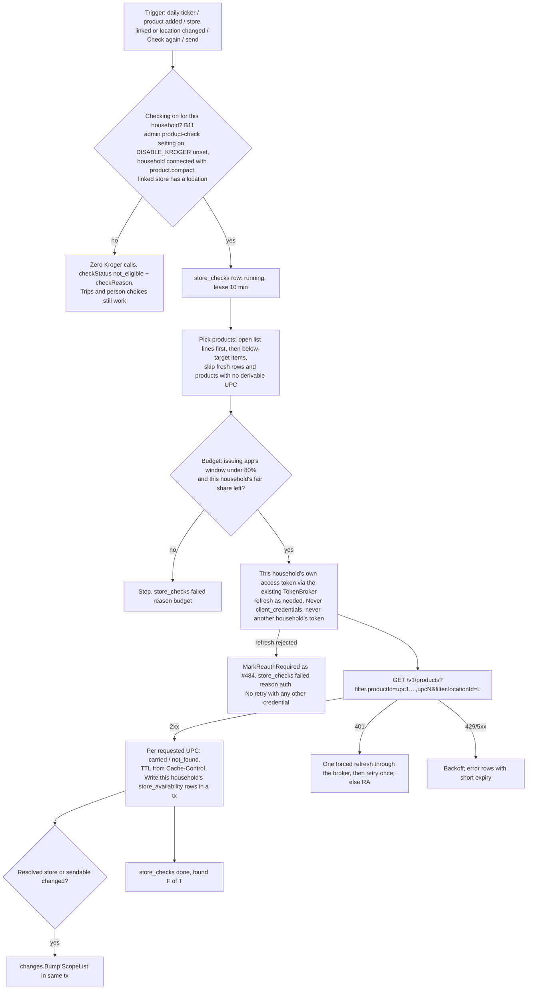
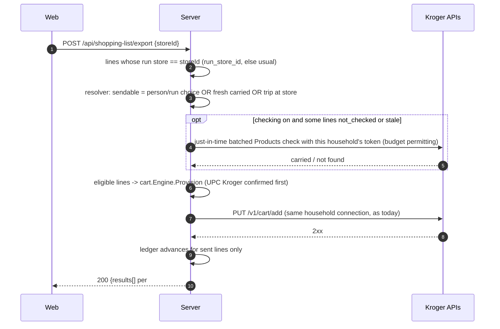

# Multi-store sourcing (#481)

- **Status:** Approved by CJ on 2026-10-31 at 1:37 PM MDT ("Approve #481"). Revised the same afternoon for CJ's Kroger decision at 1:38 PM MDT: "this isn't a for profit venture right now, so let's just leave that alone, and not use a centralized account." Requirements v6 (PM) apply. See [Revision log](#revision-log). Stockbot Architect.
- **Issue:** [#481](https://github.com/Rhionin/stockbot/issues/481). The requirements (PM, v6) and the UX spec (UX, v2) are tracked on that issue. B-numbers are the requirement tickets.
- **Contract:** the HTTP shapes in §6 are in [`api-contract.md`](api-contract.md) under "Stores and multi-store sourcing" (ticket C0). Where this page and the contract differ, the contract wins.
- **Evidence:** master `c4c957d`. Open PR [#484](https://github.com/Rhionin/stockbot/pull/484) (head `bbbc322`), which carries the [#486](https://github.com/Rhionin/stockbot/issues/486) send-error fix. Open PR [#485](https://github.com/Rhionin/stockbot/pull/485) (send result panel), stacked on #484. Related bug [#489](https://github.com/Rhionin/stockbot/issues/489) (saving Kroger app credentials in one household swaps the app for every household).
- **Open for CJ:** Q4, which Kroger developer app households sign in through (§4.6). It gates only the **merge** of B5.

### Accepted by PM (2026-10-31 09:23 MDT), still in force
1. **TTL fallback.** A missing header or `no-store` gives a 1h status and no price or stock. If T1 shows Kroger reads `no-store` strictly, the fallback becomes 0 (§4.2).
2. **Store removal keeps trips**, and returns the per-next-store breakdown (§10, DEP-4).
3. **All banners.** B4 searches every Kroger-family banner, with a Smith's-only fallback (§4.1).
4. **`PUT /api/stores/default`** replaces the requirements sketch's settings path (§6.7).
5. **`cartUrl`** comes from the map T1 verifies. Omitted for unknown banners (§6.4).
6. **Undo ends at "Start a new cart"** (§10, DEP-1).
7. **B12** is a ticket of its own (§8).
8. **UX reason codes** are the canonical wire values (§6.6).

Labels: **Opinion** marks a judgment call. **PROPOSED** needs CJ's approval at PR time. **Spike** marks a value T1 confirms. **Unverified** marks a claim the Kroger docs don't state.

## 1. Context, goals, non-goals

### What master does today
- The shopping list is one flat list. `POST /api/shopping-list/export` sends every unpurchased line to one provider (`internal/cart/engine.go`).
- The Kroger adapter reports `Confirmation: per_request` (`internal/cart/kroger/kroger.go`), so any 2xx marks every line confirmed, even items the store doesn't carry.
- There are no store fields, and no durable record of where something was bought (`MarkPurchased` only sets `purchased_at`; "Start a new cart" deletes purchased auto lines; `fulfillment_ledger` records sends, not purchases).
- **Kroger sign-in:** one `kroger.Adapter` for the whole server (`cmd/server/main.go` `loadCartRegistry`), from `KROGER_CLIENT_ID`/`KROGER_CLIENT_SECRET`/`KROGER_REDIRECT_URI`, overridden by the primary household's `provider_app_credentials` row. Each household's members get their own shopper tokens (`provider_connections`, per person). The only scope requested is `cart.basic:write` (`AuthorizationScope`). Saving app credentials in any household swaps the app for everyone until restart; that's bug #489.

### Goals
1. Households keep their own stores. One store can link to the Kroger-family cart and a Kroger location.
2. The app works out where products are sold:
   - Kroger Products API checks at the linked location, **only through the household's own Kroger connection** (§4.1, §4.5).
   - Learning from trips covers every store. A household with no Kroger connection learns Smith's from trips, like Walmart, Amazon or Macey's.
   - A person's choice always wins.
3. The list is grouped by store. A per-line "this time" override (`run_store_id`) survives "Update the list".
4. "Send to {store}" sends only eligible lines. The rest come back in `heldBack[]`, never dropped silently.
5. **No central account.** No shared lookup app, no app-only (`client_credentials`) token anywhere, no launch gate and no list of allowed households. A household with no connection makes **zero** Kroger calls.
6. **Nothing crosses households.** One household's connection, token or cached results are never used for another household. The availability cache is per household, with no shared table and no cross-household coalescing, and it's deleted when the household disconnects.
7. Comply with the Kroger Terms (https://developer.kroger.com/terms): §5(e) cache only as long as the cache header allows, no permanent copies (permanent rule, no exception sought); §2(c)/(d) documented access only, no getting around limits.

### Non-goals
- Automatic sources for Walmart, Amazon or Macey's; the Walmart affiliate program; Instacart; scraping.
- A shared or central Kroger lookup app, and any request to Kroger for a sharing or retention exception. Nothing waits on Kroger.
- Open Food Facts store names setting any state (a later "Maybe sold at…" chip only).
- Price comparison, splitting one line across stores, the phone-app list.

## 2. Flows

### 2.1 Lookup and refresh



### 2.2 Send to a linked store



A token failure before any cart `PUT` is #484's whole-request `409 reconnect_required` or `502 provider_unavailable` (§6.5). If the just-in-time check's token refresh is rejected, the send stops with `409 reconnect_required` and nothing is sent, because the cart `PUT` would use the same token.

## 3. Data model (PROPOSED: migration `030_multi_store.sql`)

**PROPOSED.** CJ approves this schema at the PR for B1.
- **Why 030:** the last migration on master (`c4c957d`) is `028_esp32_scanner_devices.sql`. `029_firmware_ota.sql` is reserved by [`firmware-ota.md`](firmware-ota.md) §12 and hasn't landed on master or any branch. Re-check the highest number when B1 opens its PR.
- **Ordering:** the runner applies any file missing from `schema_migrations` in name order (`internal/app/migrate.go`), so 030 can merge before 029.
- **Additive only:** `CREATE TABLE/INDEX IF NOT EXISTS` and two nullable `ALTER TABLE ... ADD COLUMN` with no default, last (the runner isn't transactional, #249). No rebuild, no rewrite, no backfill, no stores created automatically (B9).
- **Conventions:** like 022a and 023, no foreign keys to `households` or `products`; Go cleans up references. CHECK constraints only on new tables; Go validates value sets too.

```sql
-- 030_multi_store.sql (PROPOSED)

CREATE TABLE IF NOT EXISTS stores (
    id              TEXT PRIMARY KEY,
    household_id    TEXT NOT NULL,
    name            TEXT NOT NULL,                     -- trimmed, 1-40 chars (Go)
    name_key        TEXT NOT NULL,                     -- case-folded trimmed name (Go)
    kind            TEXT NOT NULL DEFAULT 'physical' CHECK (kind IN ('physical','online')),
    linked_provider TEXT CHECK (linked_provider IS NULL OR linked_provider IN ('kroger')),
    location_id     TEXT,                              -- Kroger 8-char locationId; only when linked
    location_chain  TEXT,                              -- Kroger chain name of that location (cart URL, banner)
    position        INTEGER NOT NULL,
    created_at      TEXT NOT NULL,
    updated_at      TEXT NOT NULL,
    UNIQUE (household_id, name_key)
);
CREATE UNIQUE INDEX IF NOT EXISTS idx_stores_one_per_provider
    ON stores (household_id, linked_provider) WHERE linked_provider IS NOT NULL;
CREATE INDEX IF NOT EXISTS idx_stores_household_position ON stores (household_id, position);

-- What people set. Never written by automation (set_by_user_id NOT NULL).
CREATE TABLE IF NOT EXISTS product_stores (
    household_id    TEXT NOT NULL,
    product_id      TEXT NOT NULL,
    store_id        TEXT NOT NULL,
    state           TEXT NOT NULL CHECK (state IN ('carries','excluded')),
    is_usual        INTEGER NOT NULL DEFAULT 0 CHECK (is_usual IN (0,1)),
    set_by_user_id  TEXT NOT NULL,
    set_at          TEXT NOT NULL,
    PRIMARY KEY (household_id, product_id, store_id),
    CHECK (NOT (is_usual = 1 AND state = 'excluded'))
);
CREATE UNIQUE INDEX IF NOT EXISTS idx_product_stores_one_usual
    ON product_stores (household_id, product_id) WHERE is_usual = 1;
CREATE INDEX IF NOT EXISTS idx_product_stores_store ON product_stores (household_id, store_id);

-- Learned from trips. Household history; survives store removal (DEP-4) and Kroger disconnect.
CREATE TABLE IF NOT EXISTS store_trips (
    id              TEXT PRIMARY KEY,
    household_id    TEXT NOT NULL,
    product_id      TEXT NOT NULL,
    store_id        TEXT NOT NULL,                     -- soft reference
    store_name      TEXT NOT NULL,                     -- snapshot at write time
    store_name_key  TEXT NOT NULL,                     -- snapshot, for relink on re-add
    kind            TEXT NOT NULL CHECK (kind IN ('bought','this_time')),
    line_id         TEXT,
    via_run         INTEGER NOT NULL DEFAULT 0 CHECK (via_run IN (0,1)),
    actor_user_id   TEXT,
    occurred_at     TEXT NOT NULL
);
CREATE INDEX IF NOT EXISTS idx_store_trips_product ON store_trips (household_id, product_id, occurred_at);
CREATE INDEX IF NOT EXISTS idx_store_trips_store ON store_trips (household_id, store_id);
CREATE UNIQUE INDEX IF NOT EXISTS idx_store_trips_one_this_time ON store_trips (line_id) WHERE kind = 'this_time';
CREATE UNIQUE INDEX IF NOT EXISTS idx_store_trips_one_bought ON store_trips (line_id) WHERE kind = 'bought';

-- Kroger check cache (vendor content), per household only. Expired rows are never read and are purged.
-- Deleted for the household when its Kroger connection is removed.
CREATE TABLE IF NOT EXISTS store_availability (
    household_id       TEXT NOT NULL,
    store_id           TEXT NOT NULL,
    product_id         TEXT NOT NULL,
    source             TEXT NOT NULL DEFAULT 'kroger_api' CHECK (source IN ('kroger_api')),
    location_id        TEXT NOT NULL,
    upc                TEXT,
    status             TEXT NOT NULL CHECK (status IN ('carried','not_found','error')),
    stock_level        TEXT,
    price_cents        INTEGER,
    promo_price_cents  INTEGER,
    checked_at         TEXT NOT NULL,
    status_expires_at  TEXT NOT NULL,
    detail_expires_at  TEXT,
    PRIMARY KEY (household_id, store_id, product_id)
);
CREATE INDEX IF NOT EXISTS idx_store_availability_expiry ON store_availability (status_expires_at);

CREATE TABLE IF NOT EXISTS store_checks (
    household_id   TEXT NOT NULL,
    store_id       TEXT NOT NULL,
    state          TEXT NOT NULL CHECK (state IN ('running','done','failed')),
    trigger        TEXT NOT NULL CHECK (trigger IN ('daily','product_added','store_setup','manual','send')),
    started_at     TEXT NOT NULL,
    finished_at    TEXT,
    lease_until    TEXT NOT NULL,
    checked_count  INTEGER NOT NULL DEFAULT 0,
    found_count    INTEGER NOT NULL DEFAULT 0,
    total_count    INTEGER NOT NULL DEFAULT 0,
    failure        TEXT CHECK (failure IS NULL OR failure IN ('budget','kroger_unavailable','rate_limited','auth')),
    PRIMARY KEY (household_id, store_id)
);

-- Rate-limit accounting per issuing developer app. app_key = first 16 hex chars of
-- SHA-256(client_id); never the secret. No household data.
CREATE TABLE IF NOT EXISTS kroger_api_window (
    app_key            TEXT NOT NULL,
    endpoint           TEXT NOT NULL CHECK (endpoint IN ('products','locations')),
    window_started_at  TEXT NOT NULL,
    calls              INTEGER NOT NULL DEFAULT 0,
    blocked_until      TEXT,
    PRIMARY KEY (app_key, endpoint)
);
CREATE TABLE IF NOT EXISTS kroger_household_usage (
    household_id       TEXT NOT NULL,
    endpoint           TEXT NOT NULL CHECK (endpoint IN ('products','locations')),
    app_key            TEXT NOT NULL,
    window_started_at  TEXT NOT NULL,
    job_calls          INTEGER NOT NULL DEFAULT 0,
    on_demand_calls    INTEGER NOT NULL DEFAULT 0,
    PRIMARY KEY (household_id, endpoint)
);

-- Last statements (non-transactional runner).
ALTER TABLE shopping_list_items ADD COLUMN run_store_id TEXT;
CREATE INDEX IF NOT EXISTS idx_shopping_list_items_run_store
    ON shopping_list_items (household_id, run_store_id) WHERE run_store_id IS NOT NULL;
-- Scopes granted at the last code exchange. NULL = connected before #481
-- (cart.basic:write only): no product checks, no error (checkReason no_product_access).
ALTER TABLE provider_connections ADD COLUMN granted_scope TEXT;
```

**Notes**
- **Default store:** `household_settings` key `default_store_id`; no DDL.
- **Tenant lint** (`internal/tenant/sqlcheck.go`): add `stores`, `product_stores`, `store_trips`, `store_availability`, `store_checks`, `kroger_household_usage` to `HouseholdTables`; `kroger_api_window` to `GlobalTables` ("per-app Kroger rate-limit counter; no household data").
- **Purge:** `internal/auth/purge.go` already deletes from every table with `household_id`; B1 adds a test.
- **Keying by product:** like `household_product_overrides` (023). Lines join `items` for `product_id`.
- **Additive-only check (B9):** apply 001–030 to a 028-era fixture built from generic test data. Pre-existing row counts unchanged; `run_store_id` and `granted_scope` NULL everywhere; no `stores` rows; `GET /api/shopping-list` byte-identical for a household with zero stores; a cart send on an existing connection still works.

### 3.1 Precedence (pure Go, `internal/sourcing/resolve.go`)
Inputs, loaded per household in one read: stores in order, `product_stores`, this household's fresh `store_availability` rows (`status_expires_at > now` and `location_id` equals the store's current location), `store_trips` joined to live stores, the default store, the line's `run_store_id`, and the household's checking state (§4.5, for `checkStatus` only).

**Carries(X, P), first match**
1. A person's `product_stores` row: `carries` = yes, `excluded` = no; origin `person`.
2. Automatic and learned, newest first: a fresh `carried` row (origin `found`) and the latest trip at X (origin `trip`). Both mean yes; the newer supplies origin and time. A fresh `not_found` or `error` adds nothing.
3. Unknown.

**Usual(P), first match**
1. A person's `is_usual` row: `person`.
2. Habit: the last N `bought` trips for P (`SOURCING_HABIT_RUNS`, default 2) are all at the same live, non-excluded store: `habit`. A run without P doesn't break the streak; a purchase elsewhere does.
3. The first store in household order where Carries is yes: `found`. The UI shows the origin line ("Found at Smith's" or "You bought it here"), never "Auto".
4. The household default, unless excluded: `household`.
5. None: `none`.

**DEP-5:** for `habit`, the resolver also returns `usualChangedAt` (the trip that completed the streak) and `previousUsualStoreId` (Usual(P) without that trip), only when they differ. Derived; no storage.

**Store for this run:** `run_store_id` (`run`), else Usual(P) (`usual`), else none.

**Sendable(line, S)** for a linked S: true when `run_store_id = S` or Carries(S, P) is yes from any origin; else false with reason `not_confirmed`. A person's `excluded` on S beats trips and Kroger; only an explicit `run_store_id = S` ("Include anyway") overrides it, and then no trip is recorded at the excluded store. For a household without checking, Smith's eligibility comes only from trips and people.

**Check status per (line, S) (DEP-2)**, linked S only, reported as `checkStatus`:
- `found` / `not_found` / `error`: a fresh row with that status. `not_found` means unknown, never "not sold".
- `checking`: `store_checks` for S is `running` with a live lease and no fresh row.
- `not_eligible`, with `checkReason` (first that applies):
  - `not_configured`: `DISABLE_KROGER` is set or the server's product-check setting (§4.1) is off.
  - `not_connected`: the household has no Kroger connection, or it's `disconnected` or `reauth_required`. (A `reauth_required` connection is shown as not connected for checking; the cart UI already offers Reconnect from the connection state, per #484/#485.)
  - `no_product_access`: connected, but `granted_scope` doesn't include `product.compact` (connected before checks shipped, or the product-check setting was off at sign-in).
  - `no_location`: S has no Kroger location.
  - `no_barcode`: P has no derivable UPC.
- `not_checked`: none of the above, including expired rows.

Fresh rows win over `not_eligible`, except that a disconnect deletes them (§4.2), so a disconnected household never shows checked results.

**Invariants (B2/B6 property tests):** no automatic or learned write changes `product_stores`; automatic data sets the usual store only through rule 3.

### 3.2 Writes and live updates
- Every write here runs in one transaction ending with `changes.Bump(ctx, tx, house, changes.ScopeList)`.
- **`run_store_id`:** set by `PUT /api/shopping-list/items/{id}/store`, which upserts the line's `this_time` trip (unless excluded); null deletes it if the line isn't bought. Fill (`upsertAutoLine`) and `SwapAutoLine` keep it. Cleared on purchase; goes with the row on delete.
- **`MarkPurchased`:** resolves the run store at commit time, inserts a `bought` trip with `via_run` if not excluded, sets `run_store_id = NULL`. "Mark all bought" loops per line (opinion).
- **Unpurchase (DEP-1):** `PATCH .../items/{id} {purchased:false}` clears `purchased_at`, deletes the `bought` trip, restores `run_store_id` when `via_run = 1`. A line already removed by "Start a new cart" is `404 not_found`.
- **Kroger disconnect** (the existing disconnect route, or any removal of a connection row): when the household has no remaining Kroger connection, the same transaction deletes that household's `store_availability` and `store_checks` rows. Trips and person choices stay. Connections are per person; while another member of the same household is still connected, the household's rows stay (they never leave the household).

## 4. Lookup and refresh

### 4.1 Kroger client (B5, `internal/cart/kroger/products.go`, `locations.go`)
- **Token: the household's own connection only.** Every lookup (Products and Locations) uses an access token from a `provider_connections` row belonging to a member of the calling household, through the existing `connection.TokenBroker` (the refresh path the cart send uses, as changed by #484). There is **no `client_credentials` code path** anywhere; a B5 test fails if the stub sees a client-credentials grant.
  - **Which connection:** the connection the cart send uses for that household. If several members are connected, the most recently refreshed `connected` row whose `granted_scope` has `product.compact`. Opinion: one is enough; no rotation.
  - **401 on a lookup:** one forced refresh through the broker, then one retry. If the refresh is rejected (an OAuth reconnect-class error, as #484 classifies), call `MarkReauthRequired`, fail the check with `auth`, and stop. Later sends then fail fast with `409 reconnect_required` exactly as #484 does. **No lookup retries with any other credential** or another household's connection.
  - **403 for a missing scope** (T1 records the body): sets nothing on the connection state; B5 removes `product.compact` from `granted_scope`, so lines show `no_product_access`. Cart sends keep working.
  - Tokens stay in the existing encrypted connection row and are never logged.
- **Credentials resolved per connection (Q4-ready).** Code exchange, refresh, cart and lookup calls get app credentials from one function, `connection.AppFor(ctx, conn) (AppCreds, appKey)`. Under Q4 option A (today's model) it always returns the server's app. Under option B it returns the household's own app (§4.6). B5 builds only option A plus this seam; it doesn't build option B.
- **Scope and the admin setting.** The Products API needs `product.compact` on the token: "if you need to get a token to call the Public Products API, you must include the `product.compact` scope in the token request" ([FAQ](https://developer.kroger.com/support/faq)). Locations needs no scope ([Applications](https://developer.kroger.com/documentation/support/website-help/applications)).
  - New server setting `KROGER_PRODUCT_CHECKS` (admin only, default **off**). Off: sign-in asks for `cart.basic:write`, and the authorize URL is byte-for-byte today's (test). On: sign-in asks for `cart.basic:write product.compact`.
  - It's turned on only after T1 confirms the server's app is registered for Products and that asking for the scope doesn't break sign-in (Kroger's help says an app without an API can't add it later: "If you find that you need an API you did not select during registration, you must create a new application"). That switch is ticket I1 (Network Engineer).
  - At code exchange the server stores the token response's `scope` (or the requested scope if the response has none; **Spike** T1) in `granted_scope`.
  - **Older connections** (`granted_scope` NULL) never get checks and never get an error. A person reconnects through today's Connect flow to turn checking on.
- **Products:** `GET /v1/products?filter.productId=<upc,…>&filter.locationId=<8 chars>`. With `filter.locationId`, only products sold at that location come back. Fields used: `upc`, `items[].price.regular`/`promo`, `items[].inventory.stockLevel`, `items[].fulfillment.instore`. Sources: https://developer.kroger.com/documentation/api-products/public/products/overview and https://developer.kroger.com/reference/api/product-api-partner.
  - UPCs come from `catalog.ListBarcodesForProduct` plus `kroger.Normalize`, the cart's path. Every derivable UPC is sent; any match means `carried` and that `upc` is stored; none means `not_found`.
  - Batch size `KROGER_PRODUCT_BATCH_SIZE` (separate from `KROGER_BATCH_SIZE`), provisional 50; **Spike** T1 confirms the maximum.
  - The send's `resolveIdentities` prefers the UPC Kroger confirmed.
- **Locations (B4):** `GET /v1/locations?filter.zipCode.near=<zip>&filter.limit=<n>[&filter.chain=<name>]`, **with the household's token**. "If the parameter `filter.chain` is not provided, the results include all locations and chains owned by The Kroger Co." (https://developer.kroger.com/reference/api/location-api-public).
  - No connection (or `reauth_required`): `409 kroger_not_connected`, zero Kroger calls. The web runs today's connect flow first, then the store search (F1).
  - All banners by default, optional `chain=`; the server drops non-grocery locations (rule from T1). Fallback if T1 shows all-banner search can't work: Smith's only, same contract.
  - Results are never stored; only the chosen `location_id` and `location_chain` are kept.

### 4.2 Cache and TTL (B6) — permanent rule
`ttlFromHeaders(resp)` reads the headers at runtime, never a hard-coded value. No exception from Kroger is being sought, so there's no override setting.

| Response header | `status_expires_at` | `detail_expires_at` (price, stock) |
|---|---|---|
| `Cache-Control: max-age=N` (or `s-maxage`), else `Expires` | `checked_at + min(N, KROGER_STATUS_TTL_MAX)` | `checked_at + min(N, KROGER_DETAIL_TTL_MAX)` |
| Header missing | `checked_at + KROGER_CACHE_FALLBACK_TTL` (default 1h) | NULL: price and stock not saved |
| `no-store` or `no-cache` | same 1h fallback. **Spike:** if Kroger reads `no-store` strictly, the fallback becomes `0` and nothing is persisted (results used only within the request). | NULL |

- Caps `KROGER_STATUS_TTL_MAX` and `KROGER_DETAIL_TTL_MAX` default to 24h and can only shorten.
- Reads filter on expiry; price and stock appear only while `detail_expires_at > now`.
- Purge: the job and the 24h purge loop delete expired rows and null expired price and stock.
- Price and stock are never written to `item_deals` (test).
- A location change deletes the store's rows. A household's last Kroger disconnect deletes all its rows (§3.2).
- **Per household, permanently:** a row obtained with household A's token is never read for, served to or copied to household B, even for the same location and product (§5.3).

### 4.3 On demand vs the daily job (B7)
- **Daily job:** `sourcing.RunRefresh(ctx, 24*time.Hour)`, wired next to `RunPurge`. It runs only for households where checking is on (B11), each with **its own** token, open list lines first, then below-target items, skipping rows fresh for more than 6h (opinion).
- **On demand,** same code path with `trigger`: product added, store linked or location changed, `POST /api/stores/{id}/check`, `POST /api/products/{id}/stores/check`, and the just-in-time send check (that section's `not_checked` lines).
- A household that (re)connects with product checks gets a check on the next trigger, with no restart or setting change.
- **Concurrency:** a live `store_checks` lease (10 min) blocks a second run for the store; a manual check while running returns `202` with the current state.
- **Logs:** counts, status codes and durations only. No product names, UPCs, household names, tokens, client IDs or secrets.

### 4.4 Rate limits, fair share and backoff
- **Cited limits:** Products 10,000/day, Cart 5,000/day, each Locations endpoint 1,600/day ([FAQ](https://developer.kroger.com/support/faq)). "All public APIs have a daily rate limit that is applied equally across all clients … we do not currently support individual rate limits by client. Rate limits reset 24 hours after the first call to an endpoint" ([API basics](https://developer.kroger.com/documentation/public/getting-started/apis)). So the limit is per developer app (the issuing client), as configured by whoever hosts it.
- **Per shopper token: Unverified.** Kroger's docs don't describe a per-user-token limit. The design assumes calls with any shopper's token count against the issuing app and that there's no extra per-shopper cap. T1 item (b) checks this; if limits turn out to be per shopper, the per-app window simply never binds and the per-household share still caps each household.
- **Window per issuing app:** `kroger_api_window (app_key, endpoint)`, `app_key` from `AppFor` (§4.1). Under Q4 option A every household shares the server's app; under option B each household's app has its own window.
  - Hard stop at **80%**: 8,000 Products and 1,280 Locations calls per app per window. Counters increment in a transaction before each call.
- **Fair share:** for the A households with checking on that use the same app, `share = floor(hard_stop / max(A,1))`. The job may use 60% of a household's share; on-demand uses the rest. Unused share isn't lent (opinion). Out of share: job `budget` failure; manual checks `429 rate_limited` with `Retry-After`. Other households are unaffected.
  - Scale (opinion): at 50 UPCs a call, a 300-product household needs about 6 calls a day, so one app covers roughly 1,000 households before sharing gets tight.
- **Backoff:** 429 honors `Retry-After`, else 1, 5, 30 min; after 3 in a row, `blocked_until` to the end of the app's window. 5xx or timeout: one retry after 2 s with jitter, then `error` rows with a 15 min expiry and `kroger_unavailable`.
- **No getting around limits (§2(d)):** never rotates credentials, never uses another app, never borrows another household's connection.
- **No cross-household coalescing.** Identical requests from two households are two requests, each with its own token. (The earlier draft's in-run coalescing is removed.)

### 4.5 Checking on (B11)
- **`lookupsEnabled(household)`** is true when all hold:
  - `DISABLE_KROGER` is unset and `KROGER_PRODUCT_CHECKS` is on;
  - the household has a `connected` Kroger connection whose `granted_scope` includes `product.compact`;
  - the household has a store linked to the Kroger cart with a location set.
- Computed per request from the connection and store rows. No household list, no owner-only mode, no `is_primary` rule: the same rule for every household, CJ's included.
- Every lookup call site checks it: the job, on-add, store setup, both manual checks, the send-time check. The location picker needs only a connected household (it's how the location gets set).
- **When it's off:** stores, cart send (if connected) and trip learning work as usual, with zero Kroger lookup calls. Lines show `checkStatus: not_eligible` with a `checkReason` (§3.1), so the UI never says "Couldn't find".
  - Check routes: `409 kroger_not_connected` when the household has no working connection; `409 store_check_unavailable` when it's connected but checking is still off (`not_configured`, `no_product_access`, `no_location`).
- Lookup code takes its token only from the calling household's scope (grep-style test, B11).
- **DEP-7 fields on `GET /api/stores`:** `lookupsEnabled`; per linked store `checkReason` when checking is off (`not_configured`, `not_connected`, `no_product_access`, `no_location`); and `canConnect`, true when this person may start the Kroger connect flow under the same rule as today's connect button (`POST /api/providers/kroger/authorize`), computed by the same check, not a copy of it. When `KROGER_PRODUCT_CHECKS` is off the reason is `not_configured`, never `no_product_access`, so the web's reconnect line (shown only for `no_product_access` and `canConnect`) stays hidden.

### 4.6 Q4: which Kroger app households sign in through (open for CJ, gates B5's merge)
- **Option A (today):** one server app for every household's sign-in. Each household still uses its own shopper login, token and results. B5 as written.
- **Option B:** each household registers its own Kroger developer app and enters its keys; nothing goes through the server's app. `AppFor` returns the household's app. Extra work is listed under §8 ("If Q4 = B").
- Either way, today's bug #489 (one household's saved keys swap the app for everyone) is fixed in its own issue, not in #481 tickets. Under A, #489's interim fix (admin-only keys) is the end state.

## 5. Security and tenancy

### 5.1 Credentials
- **No new credentials.** Lookups use the household's existing connection tokens through the broker. There are no lookup client ID or secret variables and no `client_credentials` token.
- **App credentials:** unchanged and resolved through `AppFor` (§4.1): the server's `KROGER_CLIENT_ID`/`KROGER_CLIENT_SECRET`, or the saved `provider_app_credentials` row as today (see #489 for that row's cross-household bug).
- **`app_key`:** a truncated SHA-256 of the client ID, only for the rate window. Never the secret.
- **Never exposed:** tokens, client ID and secret never appear in a response, UI payload, log line or error. B5's test greps every new route's bodies and captured logs for the stub's token, client ID and secret.
- **Testing:** never CJ's shopper account or tokens. Tests use `httptest` through `Adapter.WithBaseURL`/`WithTransport` and `carttest` fakes; CI has no network access to Kroger. T1 uses a fresh non-CJ developer app and a throwaway test shopper.

### 5.2 Tenancy
- Every new table except `kroger_api_window` has `household_id`, and every query goes through `tenant.Scope` (#377); the sqlcheck lint enforces it.
- Every route uses `X-Household-Id`. Another household's store, product or line is `404 not_found`.
- A household's lookups use only a connection of one of its own members. No code path reads another household's connection, token or availability rows.
- A product route answers only if the household has an `items` row for that product.

### 5.3 The availability cache is per household, permanently
- One row per (household, store, product). No shared table keyed by location and UPC, and no cross-household coalescing (§4.4).
- A household's last Kroger disconnect deletes its rows (§3.2). Expiry still applies (§4.2).
- Two households with the same location and product each get their own rows from their own calls (tenant test, B6).

## 6. API contract

These shapes are in [`api-contract.md`](api-contract.md) under "Stores and multi-store sourcing" (C0). Auth is Session, `X-Household-Id` required, role **Member** unless stated. Errors use `{error, code, field?}`. Every route can also return `unauthorized`, `not_found`, `busy` and `internal`.

### 6.1 Types

```ts
type StoreKind = 'physical' | 'online';
type Origin = 'person' | 'found' | 'trip';
type CheckStatus = 'not_checked' | 'not_eligible' | 'checking' | 'found' | 'not_found' | 'error';
type CheckReason = 'not_configured' | 'not_connected' | 'no_product_access' | 'no_location' | 'no_barcode';
type UsualReason = 'person' | 'habit' | 'found' | 'household' | 'none';

interface Store {
  id: string; name: string; kind: StoreKind; position: number;
  linkedProvider: 'kroger' | null;
  locationId: string | null;
  locationChain: string | null;
  cartUrl: string | null;                // DEP-6
  check: StoreCheck | null;              // DEP-3
  checkReason?: CheckReason;             // DEP-7: linked store only, present when lookupsEnabled is false
}
interface StoreCheck {
  state: 'running' | 'done' | 'failed';
  startedAt: string; finishedAt: string | null;
  checked: number; found: number; total: number;
  failure: 'budget' | 'kroger_unavailable' | 'rate_limited' | 'auth' | null;
}
interface StoresResponse {
  stores: Store[];
  defaultStoreId: string | null;
  lookupsEnabled: boolean;               // DEP-7, §4.5
  canConnect: boolean;                   // DEP-7: this person may start the Kroger connect flow (today's connect-button rule)
}
interface Availability {                 // only while fresh
  priceCents?: number; promoPriceCents?: number;
  stockLevel?: 'HIGH' | 'LOW' | 'TEMPORARILY_OUT_OF_STOCK';
  checkedAt: string;
}
```

### 6.2 Stores

| Route | Request | Response | Errors (besides the common ones) |
|---|---|---|---|
| `GET /api/stores` | | `200 StoresResponse` | |
| `POST /api/stores` | `{name, kind?, linkedProvider?, locationId?, locationChain?}` | `201 Store`, appended last; starts a `store_setup` check if checking is on | `validation`, `store_name_taken`, `store_already_linked` |
| `PATCH /api/stores/{id}` | any of the same fields | `200 Store`. A location change deletes the store's availability rows and starts a check; unlinking clears location and rows. | `validation`, `store_name_taken`, `store_already_linked` |
| `GET /api/stores/{id}/removal-preview` | | `200 StoreRemovalPreview` (DEP-4) | |
| `DELETE /api/stores/{id}` | | `204` (DEP-4) | |
| `PUT /api/stores/order` | `{storeIds}`, exact permutation | `200 StoresResponse` | `validation`, `conflict` |
| `PUT /api/stores/default` | `{storeId \| null}` | `200 StoresResponse` | `validation` |
| `GET /api/stores/kroger-locations?zip=&chain=` | 5-digit zip; optional exact chain name | `200 {locations: [{locationId, chain, name, address:{line1, city, state, zipCode}}]}`, at most 10, not stored | `validation` (`field:"zip"`), `kroger_not_connected`, `store_check_failed`, `rate_limited` |
| `POST /api/stores/{id}/check` | | `202 Store` with `check.state:"running"` (or current state) | `store_not_linked`, `kroger_not_connected`, `store_check_unavailable`, `rate_limited` |

```ts
interface StoreRemovalPreview {
  storeId: string;
  openLines: number;
  openLinesNext: { storeId: string | null; count: number }[];
  runOverrides: number; usualChoices: number; personChoices: number;
  checkedItems: number; tripsKept: number;
  isDefault: boolean; isLinked: boolean;
}
```

### 6.3 Product stores

| Route | Request | Response | Errors |
|---|---|---|---|
| `GET /api/products/{id}/stores` | | `200 ProductStores` | |
| `PUT /api/products/{id}/stores` | `{stores: [{storeId, state:'carries'\|'excluded'}], usualStoreId}`; `{stores:[], usualStoreId:null}` = "Let the app decide" | `200 ProductStores` | `validation` |
| `POST /api/products/{id}/stores/check` | | `200 ProductStores` after one synchronous batched call | `store_not_linked`, `kroger_not_connected`, `store_check_unavailable`, `store_check_failed`, `rate_limited` |

```ts
interface ProductStores {
  productId: string;
  usualStoreId: string | null; usualReason: UsualReason;
  usualChangedAt?: string; previousUsualStoreId?: string | null;   // DEP-5
  lookupsEnabled: boolean;
  entries: {
    storeId: string;
    carries: 'yes' | 'no' | 'unknown';
    origin: Origin | null;
    person: { state: 'carries' | 'excluded'; isUsual: boolean } | null;
    checkStatus?: CheckStatus; checkReason?: CheckReason;          // linked store only
    checkedAt: string | null;
    availability?: Availability;
  }[];
  suggestions: { storeId: string; from: 'open_food_facts' }[];   // [] in the MVP
}
```

### 6.4 Shopping list (changed and new)

| Route | Change |
|---|---|
| `GET /api/shopping-list` (already indexed) | Entries gain the fields below. The body gains `lookupsEnabled` and `storeChecks: {storeId, check}[]`. (The reconnect line lives on `/household`, so `checkReason` per store and `canConnect` are on `GET /api/stores` only.) With zero stores the new fields are absent or null and existing fields are unchanged. |
| `PUT /api/shopping-list/items/{id}/store` (new) | `{storeId \| null}`; null = "Move back to {usual}". `200 ShoppingListEntry`. Errors `validation`, `conflict` (already bought). |
| `PATCH /api/shopping-list/items/{id}` (newly indexed) | `{purchased}`; `false` un-marks (DEP-1), or `not_found` after "Start a new cart". |
| `POST /api/shopping-list/export` (newly indexed) | Request `{provider?, storeId?, useItemIds?}`. Response is #484's (`results[]`, counts, `reconnectRequired?`, legacy fields) plus `storeId?`, `heldBack[]`, `cartUrl?`. Errors: `store_not_linked`, `validation`, #484's `reconnect_required` (409) and `provider_unavailable` (502), today's `conflict`. |

```ts
interface ShoppingListEntryStoreFields {
  store: { id: string; name: string } | null;
  storeReason: 'run' | 'usual' | null;
  usualStoreId: string | null; usualReason: UsualReason;
  usualChangedAt?: string; previousUsualStoreId?: string | null;
  availableAt: { storeId: string; origin: Origin; checkedAt: string | null }[];
  sendable: boolean | null;              // null when the line's store isn't linked
  checkStatus?: CheckStatus; checkReason?: CheckReason;
  availability?: Availability;
}
```

**Export with `storeId`:** only unbought lines whose run store is `storeId`; the just-in-time check runs first if checking is on (a rejected token refresh ends the send with `409 reconnect_required`, nothing sent). Sendable lines go through `cart.Engine.Provision` as #484 leaves it. Held-back lines never reach the engine or the ledger and appear as `{entryId, itemId, name, quantity, reason:'not_confirmed', checkStatus, checkReason?}`. Without `storeId`: today's behavior for one release with `Deprecation: true`; zero-store households keep calling without it (G10). **`cartUrl`:** from a static, reviewed banner→URL map on `location_chain` (T1 verifies), omitted for unknown banners.

### 6.5 Error codes (registry rows and the `HostedErrorCode` union, same PR)

In hosted error sentences, **`{provider}`** is the linked store's display name (e.g. Smith's). The web fills `{provider}` from that name and uses **`your store`** when it is missing. The web never shows the raw `{provider}` token; `renderHostedErrorSentence` in `shared/contract.ts` is the contract pin for substitution.

| code | HTTP | sentence | notes |
|---|---|---|---|
| `store_name_taken` | 409 | You already have a store with that name. | `field:"name"`. |
| `store_already_linked` | 409 | Another store is already linked to this cart. | One store per provider. |
| `store_not_linked` | 409 | This store isn't linked to an online cart. | Export or check on an unlinked store. |
| `store_check_failed` | 503 | Couldn't reach the store right now. Try again later. | Kroger 5xx or timeout after retry; also store location search. |
| `store_check_unavailable` | 409 | Checking isn't on for this store. | Connected, but checking is off (`not_configured`, `no_product_access`, `no_location`). Body `{error, code, checkReason}`. The web shows the reconnect line only when `checkReason` is `no_product_access` and `canConnect` is true; without `checkReason`, a store with no location would wrongly show Reconnect. The web hides check controls from `lookupsEnabled`, so this is a guard. |
| `kroger_not_connected` | 409 | Connect your store's online cart first. | Store search and check routes when the household has no working Kroger connection. Zero Kroger calls. The web goes to the connect step with no error text. |
| `reconnect_required` | 409 | Couldn't connect to your {provider} account. Nothing was sent. | From #484. Send only, before any cart `PUT`. Body `{error, code, provider}`. Marks the connection `reauth_required`. |
| `provider_unavailable` | 502 | {provider} isn't responding. Try again later. | Shared with non-send routes (e.g. Open Food Facts refresh). Send-only before any cart `PUT`; the send result screen shows UX copy key **`c.res.down`** instead of this sentence. |

- The `rate_limited` notes gain: manual checks and the store search when the household's daily share of its Kroger app's limit is used up, with `Retry-After`.
- Sentences for the six new store and connection codes are drafts for PM and UX approval at C0.

**Send failure rules (#484's, adopted):** before any cart `PUT`, `409 reconnect_required` or `502 provider_unavailable` with no `results[]` and no ledger change. After a batch was accepted: a later 401/403 gives `200` with `reconnectRequired: true`, that batch and every never-attempted batch `failed`/`reconnect_required`; a 5xx or timeout makes only that batch `unknown`/`request_incomplete`, later batches `failed`/`request_incomplete`. At most one cart-triggered refresh retry, only before any batch succeeds.

### 6.6 Send result reasons (canonical set = #484's public names)

| `reason` | status | when |
|---|---|---|
| `no_upc` | `skipped` | No barcode to derive. |
| `no_match` | `skipped` | Barcodes, but none normalize to a Kroger UPC. |
| `batch_rejected` | `failed` | Kroger rejected the batch (4xx on cart `PUT`). |
| `invalid_line` | `failed` | A rejected batch with a line-level error. |
| `reconnect_required` | `failed` | Partial send only: the refused batch and every later batch. |
| `request_incomplete` | `unknown` / `failed` | `unknown`: sent, then failed or indeterminate. `failed`: never attempted after that. |
| `api_error` | `failed` | Fallback. |
| `unavailable` | `skipped` | `per_line` providers only; never Kroger. |
| `no_per_item_result` | `unknown` | `client_handoff`/`none` providers; never Kroger. |

`heldBack[].reason` is separate, with the single value `not_confirmed`.

**Aliases, accepted only until A1:** `no_product_identity` → `no_upc` (copy "No barcode saved for this item", PM ruling); `provider_rejected` → `batch_rejected`; per-line `provider_unavailable` in #484's `ProvisionUnknownReason` is never emitted per line and A1 removes it from the union.

### 6.7 Endpoint and error count
`endpoint-count` goes from **63 to 78 (+15)**: 13 new routes (`GET/POST /api/stores`, `PATCH/DELETE /api/stores/{id}`, `GET /api/stores/{id}/removal-preview`, `PUT /api/stores/order`, `PUT /api/stores/default`, `GET /api/stores/kroger-locations`, `POST /api/stores/{id}/check`, `GET/PUT /api/products/{id}/stores`, `POST /api/products/{id}/stores/check`, `PUT /api/shopping-list/items/{id}/store`) and 2 newly indexed (`PATCH /api/shopping-list/items/{id}`, `POST /api/shopping-list/export`). The error registry gains **8** codes (§6.5). Go 1.22 mux prefers literal segments, so `/order`, `/default` and `/kroger-locations` don't collide with `{id}`.

## 7. Rollout and tests

### 7.1 Order
1. **C0** contract (docs, shared types, contract tests; count 78). **T1** spike in parallel.
2. **#484** (with the #486 fix) merges; B3 and B5 build on it.
3. **B1** migration 030 and stores. Deployed with no stores, every household sees today's behavior.
4. B6, B2, B3, B12, B8: trips and people only, no Kroger lookup calls.
5. **B5, B11, B4, B7:** lookups through each household's own connection. `KROGER_PRODUCT_CHECKS` stays off, so sign-in and behavior are unchanged. **B5 merges only after CJ answers Q4** (§4.6).
6. **I1:** after T1, the admin turns `KROGER_PRODUCT_CHECKS` on (and, only if T1 shows the server's app lacks Products access, plans a new app, which needs CJ's approval because every household would reconnect). From then on, each household that connects or reconnects gets checks; older connections show the quiet reconnect line.
7. Frontend F1–F8 behind the zero-stores rule.

No launch gate and nothing waits on Kroger. If T1 item (a) fails (a shopper token can't check products), stop and report to PM before B5; the fallback is trips-only for everyone, decided by CJ.

### 7.2 Strategy
Go unit and handler tests, the sqlcheck tenant lint, `httptest` Kroger stubs that record the bearer token on every call, `carttest` fakes, an injected clock, and Vitest plus Playwright with a mocked API at 390 and 320. No real network, never CJ's account, generic fixtures only.

### 7.3 Key cases
1. **Precedence:** person beats fresh `carried`; `excluded` beats trip and `carried`; newer of `carried` and trip wins; `not_found` stays unknown; expired or wrong-location rows are unknown; automatic sets usual only with no person `is_usual`; an excluded default is skipped.
2. **Property:** random job, check and trip writes never change `product_stores`.
3. **Habit:** two runs in a row set usual, one doesn't; A, B, A doesn't; a run without the item doesn't break it; DEP-5 fields correct.
4. **Fill:** `run_store_id` survives fill and swap; cleared on purchase; restored on unpurchase with `via_run`.
5. **Export:** only eligible lines sent; `heldBack[]` with `checkStatus`; ledger untouched for held lines; unlinked store 409; no-`storeId` call unchanged; "Include anyway" sends.
6. **Checking (requirements T-B11a–e):**
   - **a.** Two households, only the connected-with-checks one is called; the other has zero calls and zero rows, and its trip learning works.
   - **b.** Same location and product in two households: no row is shared, served or written across them; each request carries its own household's token.
   - **c.** The household's last disconnect deletes its availability rows and keeps trips and choices.
   - **d.** Older connection without `product.compact`: no call, `not_eligible/no_product_access`, no error.
   - **e.** `KROGER_PRODUCT_CHECKS` off: authorize URL byte-for-byte today's, nobody is checked, reason `not_configured`.
   - Also: three households (with checks, connected without, not connected) in one job run call the stub only for the first; a refresh rejected mid-job marks `reauth_required` and makes no call with any other credential; the stub fails on any `client_credentials` grant.
7. **TTL:** `max-age` honored and capped at 24h; missing or `no-store` gives 1h and no price; fallback `0` persists nothing; price disappears after `detail_expires_at`; nothing in `item_deals`.
8. **Budget:** 80% stop per app; two apps have separate windows; fair share between two households on one app; 429 backoff and `blocked_until`; reset 24h after the first call; no coalescing (two identical household requests are two calls).
9. **Secrets and logs:** no token, client ID or secret in any body or log; no product names or UPCs in job logs.
10. **Tenancy:** cross-household store, product or line is 404 on every new route; purge removes every new household table.
11. **Migration:** the additive-only upgrade test.
12. **Send failures:** #484's tests stay green; a just-in-time refresh rejection gives `409 reconnect_required` with no cart `PUT`.
13. **Remove store:** preview counts match DELETE; trips kept; re-adding the same name re-links them.
14. **Scope and DEP-7:** setting on, the authorize URL asks for `cart.basic:write product.compact`; code exchange stores `granted_scope`; a missing-scope 403 doesn't mark `reauth_required`; `GET /api/stores` returns `lookupsEnabled`, per-store `checkReason` and `canConnect` matching today's connect permission for an owner and a member.

## 8. Ticket breakdown

Owners: **Arch**, **BB** (Backend Builder), **FB** (Frontend Builder), **UX**, **NE** (Network Engineer). Estimates are opinions for one developer who knows the repo. Every build ticket includes automated tests.

| # | Ticket | Owner | Depends on | Acceptance criteria (summary) | Size |
|---|---|---|---|---|---|
| C0 | API contract: §6 into `api-contract.md`, count 63→78, 8 error codes, §6.6 reasons and aliases, `checkStatus`/`checkReason`, `lookupsEnabled`/`canConnect`, `heldBack[]`, TS types and `HostedErrorCode` | Arch | — | Both contract tests pass. PM and UX approve the new sentences. | 1 d |
| T1 | Kroger spike, fresh **non-CJ** app and throwaway test shopper, production API | BB | — | Write-up in the repo, no secrets or household data: (a) a shopper token with `cart.basic:write product.compact` reaches Products at a `locationId` and Locations, and one sign-in grants both; (b) limits per app or per shopper; (c) what happens when an app without Products asks for `product.compact`; plus Cache-Control, max batch, `/v1/chains` names and all-banner search, the grocery rule, cart URL per banner, whether the token response returns `scope`, and the missing-scope 403 body. If (a) fails, stop and report to PM before B5. | 1 d |
| B1 | Migration 030 (PROPOSED, CJ approves at the PR) + stores CRUD, order, default, removal preview, delete | BB | C0 | Tenant 404s, name rules, one store per provider, DELETE matches preview, additive upgrade test, sqlcheck lists, purge test. | 3 d |
| B6 | Resolver, availability reads, TTL helper, purge, delete-on-disconnect | BB | B1 | Cases 1, 2, 7, 6b, 6c. `checkStatus`/`checkReason` derivation. | 2 d |
| B2 | Person choices: GET/PUT product stores | BB | B6 | One usual store; no automatic writer; live update. | 1.5 d |
| B3 | Run override, trips, export with `storeId`, `heldBack`, `cartUrl` | BB | B6, #484 merged | Cases 4, 5, 12 with the `carttest` fake. Uses #484's send errors unchanged. | 2.5 d |
| B12 | Unpurchase, habit, DEP-5 | BB | B3 | Case 3; `purchased:false` restores the line and removes its trip. | 1 d |
| B8 | List entry fields, `lookupsEnabled`, `storeChecks` | BB | B6, B3 | §6.4 fields; zero stores byte-identical; no `item_deals` writes. | 1 d |
| B5 | Products client on the household's own token: broker refresh and reauth marking, `AppFor` seam (option A only), `KROGER_PRODUCT_CHECKS` scope setting, `granted_scope`. **Merge gated on CJ's Q4.** | BB | T1, B1, #484 merged | Cases 6d, 6e, 9, 14. No `client_credentials` path. Two households, each request carries its own token. Missing product is `not_found`. Header read at runtime. Preferred UPC in send. | 2 d |
| B11 | Checking only through the household's own connection: `lookupsEnabled`, per-store `checkReason`, `canConnect`, guards at every call site, 409 `kroger_not_connected` / `store_check_unavailable` | BB | B5, B6 | Case 6a, 6c, 14 (DEP-7 fields). Grep-style test: lookup code reads tokens only from the calling household's scope. Connect or reconnect gives a check on the next trigger with no restart. | 0.5 d |
| B4 | Location picker, all banners, Smith's fallback, household token | BB | T1, B5 | Stub sees only the calling household's token. Not connected: `409 kroger_not_connected`, zero calls. Results not stored. | 1 d |
| B7 | Refresh job, on-demand checks, `store_checks`, per-app budget, fair share, backoff, live bump | BB | B5, B6, B11 | Cases 6 (three households), 8, 9. No coalescing. Clock-injected job test. Not connected: zero calls. | 2.5 d |
| I1 | Turn on product checks: set `KROGER_PRODUCT_CHECKS` after T1; if the server's app lacks Products, plan the new-app changeover (CJ approves; every household reconnects) | NE | T1, B5 | Runbook; no secrets in the repo; CJ's recorded approval before any app change. | 0.5 d |
| U1 | Copy and states for DEP-2 to DEP-7 (UX spec v3): reconnect line, connect-first link dialog, remove dialog, reason mapping, sentences for the new error codes | UX | C0 | Approved strings. No "Auto" or "added". | 0.5 d |
| F1 | Stores settings, link flow (connect first, then store search), quiet reconnect line, remove preview | FB | B1, B4, B11, U1 | UX §9, T14–T16, **T29**, **T30**. Reconnect line only for `no_product_access` and `canConnect`. | 2 d |
| F2 | Product "Where to buy" | FB | B2 | UX V4. Person over Found test. | 1.5 d |
| F3 | This time only / Move back / Undo bought | FB | B3, B12 | Override survives "Update the list"; Undo works. | 1 d |
| F4 | Grouped list and zero-stores parity | FB | B8 | Sections in order, then "No store set"; zero stores matches master. | 1.5 d |
| F5 | Also available here | FB | B8 | Collapsed, hidden when empty. | 0.5 d |
| F6 | Linked section: held back, checking, cart link, learning note; send result reuses #485's panel | FB | B3, B7, B8, U1, #485 merged | UX T9–T13, T17, T22. Households without checking never see checking UI or "Couldn't find". Reasons from §6.6; aliases accepted until A1. | 1.5 d |
| A1 | Retire send-reason aliases (`no_product_identity`, `provider_rejected`, per-line `provider_unavailable` in the union) | BB + FB | B3, F6 released, one release after Pi builds stop sending them | Grep finds no legacy values; alias table removed; tests assert canonical values only. | 0.5 d |
| F8 | Vitest + Playwright at 390/320, full scenario set | FB | F1–F6 | Requirements F8 and UX §15, including T22, T29, T30. | 1 d |

**Estimate (Q4 = A):** backend about 18 dev-days, frontend about 9, Architect/UX/NE about 2. ±25%. One backend and one frontend builder in parallel: about 4 weeks.

**If Q4 = B (each household brings its own Kroger app):** about **+6.5 dev-days**.

| Ticket | Extra work | Days |
|---|---|---|
| B5 | Adapter takes app credentials per call (authorize, exchange, refresh, cart, products); `AppFor` returns the household's app; the OAuth callback finds the household's app from `state`; a connection records which app issued it, and refresh uses that app | +1.5 |
| B1 | Migration columns: `provider_connections.app_key`, client-secret ciphertext column (still additive; CJ approves at the PR) | +0.25 |
| #489 | Becomes per-household app storage rather than the admin-only interim: client secret encrypted at rest (today it's stored as given), existing rows migrated, saving or deleting keys forces only that household to reconnect, two-household isolation test | +1.5 |
| B7 | Two-app window and fair-share tests | +0.25 |
| F9 (new) | Household "Your Kroger app" setup: keys form, the exact redirect URI to register, "tick the Products API" checklist, validation and a test-connection step, reconnect prompt | +2 |
| U1 | Setup copy and help text | +0.5 |
| I1 | Household setup guide (how to register a free Kroger app) | +0.5 |

## 9. Open items
1. **CJ, Q4:** which app households sign in through (§4.6). Gates B5's merge only.
2. **T1:** shopper-token Products and Locations access; per-app vs per-shopper limits; what a Products-less app does with `product.compact`; Cache-Control; max batch; banners and chain names; grocery rule; cart URLs; whether the token response returns `scope`.

Nothing waits on Kroger. No support request is planned.

## 10. UX dependencies (UX spec v3 §16)

| DEP | Verdict | Where |
|---|---|---|
| DEP-1: un-mark bought | **Confirmed.** `PATCH ... {purchased:false}`; `404` after "Start a new cart". | §3.2, §6.4, B12 |
| DEP-2: never checked vs can't check vs not found | **Confirmed.** `checkStatus` plus `checkReason`. A household without checking gets `not_eligible` with `not_connected`, `no_product_access` or `no_location` (`not_configured` when the server setting is off; `no_barcode` per line). Only `not_found` may say "Couldn't find". | §3.1, §6 |
| DEP-3: per-store check status | **Confirmed.** `check` on `Store` and `storeChecks` in the list; `POST /api/stores/{id}/check`. | §4.3, §6.2 |
| DEP-4: removal preview | **Confirmed.** Counts per category; trips kept. | §6.2, B1 |
| DEP-5: usual-store change | **Confirmed.** `usualChangedAt`, `previousUsualStoreId`, derived. | §3.1 |
| DEP-6: cart URL | **Confirmed, with a limit.** Static banner map, T1 verifies. | §6.4 |
| DEP-7: checking state | **Confirmed (v3).** `lookupsEnabled` on `GET /api/stores`, `GET /api/shopping-list` and `GET /api/products/{id}/stores`: true only when the server setting is on, the household is connected with `product.compact`, and the linked store has a location. `GET /api/stores` also returns per linked store `checkReason` and household-level `canConnect` (today's connect-button rule). The reconnect line shows only for `no_product_access` with `canConnect`. | §4.5, §6.1, B11, F1 (T29, T30) |

## Revision log
- **2026-10-31 13:37 MDT:** CJ approved the design ("Approve #481").
- **2026-10-31 13:38 MDT and PM v6 (13:42–13:50 MDT):** CJ: "this isn't a for profit venture right now, so let's just leave that alone, and not use a centralized account." Changes from the approved draft:
  - Removed the shared CJ-owned lookup app, its `client_credentials` token and the `KROGER_LOOKUP_CLIENT_ID`/`_SECRET`/`_BASE_URL` variables.
  - Removed the pre-launch gate (`kroger_lookup_households`/`KROGER_LOOKUP_HOUSEHOLDS`, `KROGER_SHARING_CONFIRMATION_REF`, owner-only default, `is_primary` rule). B11 is rewritten as "checking only through the household's own connection" (0.5 d).
  - Removed the Kroger support request and the retention override (`KROGER_STATUS_TTL_OVERRIDE`/`_REF`). Cache-Control capped at 24h is permanent.
  - Lookups (Products and Locations) use the household's own connection through the broker, with #484's reauth marking. New `KROGER_PRODUCT_CHECKS` setting (default off, authorize URL unchanged), new nullable `provider_connections.granted_scope`, `AppFor` seam for Q4.
  - The availability cache is per household permanently; cross-household coalescing removed; rows deleted on the household's last disconnect.
  - Budget per issuing app; per-shopper limits marked Unverified.
  - `checkReason`: `gated` replaced by `not_configured`, `not_connected`, `no_product_access`. `lookupsEnabled` also requires a located linked store. New `canConnect` and per-store `checkReason` on `GET /api/stores` (UX v3).
  - Errors: `kroger_not_connected` and `store_check_unavailable` (409) for the store search and check routes; `reconnect_required` and `provider_unavailable` stay send-only, from #484. Registry +8. Endpoint count stays 78.
  - Send failures and reasons follow #484 (partial-send `failed`/`reconnect_required`, never-attempted `failed`/`request_incomplete`). Alias `no_product_identity` → `no_upc`.
  - T1 re-scoped to shopper-token access, per-app vs per-shopper limits, and a Products-less app. New conditional I1 (NE). B5's merge waits on CJ's Q4.
