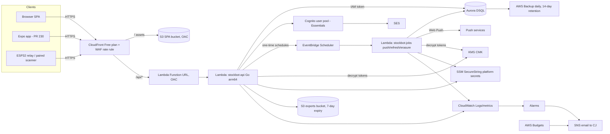

# Stockbot for more than one household: technical design (AWS, serverless)

Status: draft for review. It reworks the PR #224 design doc, which assumed a Hetzner VM + Postgres + RLS.
Facts are cited with a URL (accessed 2026-10-22, us-east-1); opinions are labeled **(opinion)**. "PM req" means a requirement stated by PM in PR #224 review. "PM decision (2026-10-22)" is a scope call PM made that day. Anything PM has not specified is marked **TODO(PM)**. Cost arithmetic is in [multi-tenant-saas-costs.md](multi-tenant-saas-costs.md).

## 1. Context and decisions

- Today: one Go binary (stdlib `net/http`, routes in `internal/server/server.go`) with an embedded React/Vite SPA, and SQLite via modernc at `/data/pantry.db` with `SetMaxOpenConns(1)`. It runs on a Pi behind a Cloudflare tunnel and Caddy.
  - Auth is one shared bcrypt password (from Caddy's basic-auth file) plus a stateless HMAC cookie `pantry_session` (180 days). Login is only enforced when Caddy sets `X-Pantry-Entry: public`; LAN `:8080` is unauthenticated.
  - The literal tenant `user-1` (`HEADLESS_USER_ID`) appears in about 20 non-test Go files. The web client sends `userId=user-1` (`frontend/src/api/contract.ts`).
  - Migration 019 already names `household_id` as the tenant key, and most tables carry `user_id`/`household_id`.
  - There are no automated backups.
- CJ decisions (2026-10-22):
  1. New households run on a hosted cloud service with its **own origin**. `stockbot.rhionin.com` stays on the Pi for CJ's house, with a one-time `pantry.db` import later.
  2. **AWS**, infrastructure in **CDK**.
  3. A **serverless DB**, low cost, tiny traffic.
- PM decisions (2026-10-22):
  1. **Export.** The owner exports household data as JSON (canonical, versioned schema) plus CSV for spreadsheets. The hosted app imports the JSON. A Pi-side importer is later and out of launch scope. The export does not rebuild a SQLite file.
  2. **Erasure.** Day 30 from live data and day 44 from backups is accepted. User-facing copy: "Your household will be permanently deleted after 30 days. Backup copies are cleared within two weeks after that."
  3. **Auth.** Cognito + SES is required.
  4. **Live updates.** While the Scan Queue (web or mobile) is open and visible, new scans appear within about 2 s. Poll every 2 s only while that screen is visible, every 10 s on other visible screens, and stop in the background. No WebSockets for launch.
  5. **Expo.** Moving the Expo app (PR #230) to Cognito sign-in is in launch scope.
- Still **TODO(PM)**: which host runs the USB-dongle scanner.
- Ground rules: simple, low cost, serverless. Avoid fixed-cost traps: NAT, public IPv4, Aurora minimums, ALB, Logs, KMS, Secrets Manager (PM req).

## 2. Options, costs, tradeoffs

Full arithmetic and citations are in [multi-tenant-saas-costs.md](multi-tenant-saas-costs.md). Summary (USD/month, us-east-1):

| Option | Idle | Low traffic | Main tradeoff |
|---|---|---|---|
| A. Lambda + Aurora Serverless v2 (min 0 ACU) + Data API | ~$2.23 | ~$6.57 (≈$45 if it never pauses) | Full Postgres, but a 15–30 s first request after a pause, and 2 s Scan Queue polling keeps it awake while the queue is open |
| B. Lambda + DynamoDB on-demand | ~$1.55 | ~$1.81 | Cheapest idle, but a full rewrite of a relational app; JSON/CSV export is a translator |
| **C. Lambda + Aurora DSQL** | **~$1.79** | **~$1.79** | True scale-to-zero with no resume delay, no VPC. Postgres subset (see §2.1). Scan Queue polling stays inside the DSQL free tier at 3 households |
| D. Lightsail $7 + SQLite + Litestream | ~$8.52 | ~$8.62 | Least code change, but not a serverless DB (conflicts with decision 3) |
| E. Fargate + ALB + RDS t4g.micro | ~$50 | ~$50 | Least Lambda rework, but fixed costs dominate |

Verified Aurora Serverless v2 auto-pause facts (https://docs.aws.amazon.com/AmazonRDS/latest/AuroraUserGuide/aurora-serverless-v2-auto-pause.html):
- Pausing is enabled with `MinCapacity = 0` and needs PG 16.3+/15.7+/14.12+/13.15+.
- `SecondsUntilAutoPause` ranges from 300 s to 86,400 s.
- Resume takes about 15 s, or 30 s or more after a pause longer than 24 h.
- While paused, compute costs $0 and storage is still billed.
- Pausing is prevented by user connections, RDS Proxy, logical replication, global database, and zero-ETL.
- Any connection attempt resumes the DB, including Data API calls and even attempts with bad credentials.
- Maintenance wakes it.

Data API: https://docs.aws.amazon.com/AmazonRDS/latest/AuroraUserGuide/data-api.html

### 2.1 Aurora DSQL vs the existing schema

Sources:
- https://docs.aws.amazon.com/aurora-dsql/latest/userguide/working-with-postgresql-compatibility-unsupported-features.html
- https://docs.aws.amazon.com/aurora-dsql/latest/userguide/sequences-identity-columns.html

| DSQL property | Stockbot today | Impact |
|---|---|---|
| Foreign keys supported | FKs in migrations | OK |
| Sequences / identity columns supported (choose CACHE size) | `INTEGER PRIMARY KEY` rowids | Use `bigint GENERATED BY DEFAULT AS IDENTITY` so the import can keep its IDs, or use UUIDs **(opinion: identity BY DEFAULT keeps the JSON export round-trippable)** |
| No triggers, no PL/pgSQL | `CREATE TRIGGER` in 019_restock_targets.sql and 020_shelve_wiped_items.sql | Move the trigger logic into Go store functions |
| No temp tables, no TRUNCATE | to be checked during porting | Rewrite as needed |
| Repeatable Read + optimistic concurrency (serialization errors) | single writer (`SetMaxOpenConns(1)`) | Add a retry wrapper around every write transaction |
| ≤ 3,000 modified rows per transaction | Pi import, household hard delete, backfill migrations | Batch the import and erasure in chunks of 1,000 rows or fewer |
| DDL and DML in separate transactions, one DDL per transaction, `CREATE INDEX ASYNC` | 21 embedded migrations run at startup (duplicate 006/007 prefixes) | A new PG migration set with a runner that applies one DDL per transaction, executed from a CDK custom resource or CI step rather than at Lambda startup |
| Extensions very limited; no RLS (see §4); C collation; UTC; one `postgres` database | uses no SQLite FTS or virtual tables | Case-insensitive search uses `lower()` indexes |
| IAM token auth, public endpoint, connections ≤ 1 h | — | Lambda signs a token (`dsql:DbConnect`) at connect time; no VPC, no secret |
| Backups through AWS Backup | none today | Add a daily plan |

SQLite-specific SQL (`INSERT OR …`, `ON CONFLICT`, `strftime`, `datetime(`, `json_extract`, `AUTOINCREMENT`) appears in 17 files under `internal/`. Porting it is needed for A, C, and E alike. DSQL adds the retry and batching work on top.

## 3. Recommended architecture (Option C)

**Lambda arm64 (Go, `provided.al2023`) outside any VPC, behind CloudFront (flat-rate Free plan) → Lambda Function URL with OAC; Aurora DSQL single-Region; S3 for the SPA and exports; Cognito Essentials + SES for identity; EventBridge Scheduler for timers; CloudWatch → SNS email for the operator; AWS Budgets.**

Why: it is the only option where the DB is serverless, truly scales to zero with no resume pause, and needs no VPC, NAT, public IPv4, ALB, or DB secret. It stays Postgres-compatible, so the SQL port is mechanical, unlike the DynamoDB rewrite. It costs ≈ $2/month at the expected traffic, including 2 s Scan Queue polling (DSQL stays inside the free tier at 3 households; see the costs doc).

Lambda rework for in-memory state (needed for A, B, and C):

| Today (in process) | Hosted |
|---|---|
| SSE broadcaster `/api/events` | Poll a cheap changes-since cursor only while a screen is visible, and stop in the background (PM decision 2026-10-22). Scan Queue (web or mobile): every 2 s while it is open and visible, so new scans appear within about 2 s. Visibility is the Page Visibility API on web, and AppState plus screen focus on Expo. Other visible screens: every 10 s, same changes-since pattern. The Scan Queue poll is `GET /api/scans?since=<cursor>` (empty or 304 when nothing changed), backed by an index on `(household_id, updated_at)`. No WebSockets for launch. API Gateway WebSockets is a later option if polling is not enough. |
| Push-alert timers (`internal/push/attention.go`, 5-minute settle, 2,500 B batching) | Create a one-time EventBridge Scheduler entry per household batch window, named for idempotency, which invokes `stockbot-jobs` |
| Scanner-mode idle timer | Store `mode_expires_at`; evaluate it lazily on read |
| Background product refresh | Daily scheduled Lambda; the catalog is shared |
| Telemetry registry | CloudWatch EMF metrics + a `device_heartbeats` row |
| Login rate limiter | Handled by Cognito; the WAF rate rule protects the API |
| `internal/scanlistener` (/dev/input) | Stays Pi-only. Hosted ingest is phone camera, keyboard wedge in the browser, or relay `POST /api/device/scans` |

Effort estimate (opinion): 1–2 weeks for statelessness plus 1–2 weeks for the SQL port and DSQL constraints.

## 4. Tenancy isolation

- The tenant is the **household** (PM req). Every household-owned row carries `household_id uuid NOT NULL`, and every index and PK starts with it. Migration 019's naming carries over.
- Install-global tables get re-scoped:
  - `app_settings` and scanner mode → `household_settings`.
  - `push_subscriptions` gains `household_id` + `user_id`.
  - `scan_alert_schedule` PK becomes `(household_id, direction)`.
  - `provider_connections` gains `household_id`.
- `products` and global barcodes stay a **shared catalog** (open question §13). Per-household overrides live in household tables.
- **Enforcement is in the app layer, not RLS.** DSQL's documented `ALTER TABLE` syntax has no `ENABLE ROW LEVEL SECURITY` action (https://docs.aws.amazon.com/aurora-dsql/latest/userguide/alter-table-syntax-support.html, accessed 2026-10-22), so Postgres RLS isn't available on DSQL. The Data API path in option A would also complicate RLS.
  - The store layer takes a `Tenant{HouseholdID}` value derived only from the verified session. There are no "unscoped" query helpers.
  - Repo-wide lint: a test fails on any SQL string touching a tenant table without `household_id =`.
  - `user-1`/`HEADLESS_USER_ID` and the client's `userId` parameter are deleted. The server ignores any client-sent tenant.
- Isolation tests:
  - A table-driven test creates households H1 and H2 and calls every route with H1's token against H2's IDs, expecting 404 (not 403, so existence doesn't leak).
  - A fuzz test runs over route params.
  - A device token from H1 posts scans that land only in H1.
  - Export of H1 contains zero H2 rows.
  - These run in CI against DSQL-compatible Postgres plus a nightly run against a staging DSQL.
- If DynamoDB were chosen instead (not recommended): PK = `HH#<id>`, SK = `<ENTITY>#<id>`, GSI1 for barcodes, and IAM `dynamodb:LeadingKeys` is not usable because users aren't IAM principals, so isolation would still be app-layer.

## 5. Auth

- **Cognito user pool, Essentials tier, with SES, is required** (PM decision 2026-10-22). 10k MAU free; email OTP, passkeys, managed login, refresh token rotation; https://aws.amazon.com/cognito/pricing/. Email must go through SES: Cognito's default email sender is limited to **50 emails per day per AWS account**, which can't be raised and resets at 09:00 UTC (https://docs.aws.amazon.com/cognito/latest/developerguide/quotas.html, accessed 2026-10-22). Request SES production access and a verified sending domain first (§12) so that review wait runs in parallel with the build.
- Considered and not chosen: custom auth in Go (bcrypt + email codes via SES). It is cheaper only in principle, and owning reset, verification, and token security costs more **(opinion)**.
- Signup (PM req): email only → verify the email (code) → set the household name → the #296 restock-mode question (auto or ask first) → phone-camera scanning. People must be verified before they can invite.
  - Implemented with Cognito managed login or SDK flows. A post-confirmation Lambda trigger creates the `users` row. The household is created by an explicit API call after verification.
- Password reset uses Cognito's forgot-password flow.
- Roles (PM req):
  - Members scan, confirm, edit, manage the list, and invite.
  - Owners also remove members, change roles, revoke devices, export, and delete the household.
  - Multiple owners are allowed, never zero. Enforce this in the same transaction (count owners `FOR UPDATE`-equivalent; under DSQL OCC a concurrent demote conflicts and retries) plus a DB check in the store.
  - Membership is many-to-many: `memberships(household_id, user_id, role)`. The switcher UI comes later; tokens carry the user, and the active household is sent as `X-Household-Id` and validated against memberships.
- Invites (PM req; mock `docs/design/mocks/invite.html`):
  - Link or code, 7-day expiry, single use, revocable by any member.
  - `invites(household_id, code_hash, email?, created_by, expires_at, used_at, revoked_at)`.
  - Accepting signs the person up or in, then attaches the membership.
  - Invite email via SES.
- Tokens:
  - **Web:** a server-side BFF cookie. The Lambda exchanges the Cognito code (PKCE) and sets an HttpOnly, Secure, SameSite=Lax cookie with a session ID. Refresh tokens are stored encrypted server-side or kept in the cookie, and CSRF is covered by SameSite plus an origin check. This replaces the `pantry_session` HMAC cookie **(opinion)**.
  - **Mobile (Expo, PR #230):** Cognito auth-code + PKCE via the system browser. Access and refresh tokens go in the secure store, sent as `Authorization: Bearer`. Moving this app off Basic auth (user `pantry`) onto Cognito sign-in is in launch scope (PM decision 2026-10-22).
  - **Devices:** keep the PR #224 design: pairing code or QR (10-minute expiry), a hashed per-device bearer token bound to one household (PM req: one household per device), list and revoke under ⋯ (owners revoke), heartbeat, a 500-scan offline ring, OTA rollback.
  - **Grocy sidecar:** its bearer token becomes a per-household device-class token, if Grocy stays (open question).

## 6. API contract changes

- Remove `userId` from all requests (`frontend/src/api/contract.ts`). The tenant comes from the session plus `X-Household-Id`.
- New endpoints:
  - `/api/auth/*` (callback, logout, session)
  - `/api/households` (create, get, rename, delete with typed confirmation, restore)
  - `/api/households/{id}/members` (list, change role, remove)
  - `/api/invites` (create, list, revoke, accept)
  - `/api/devices/pair`, `/api/devices`, `DELETE /api/devices/{id}`
  - `/api/export` (async JSON + CSV → S3 presigned link) and `/api/import` (hosted app imports the versioned JSON)
  - `/api/scans?since=<cursor>` (Scan Queue poll every 2 s while that screen is visible; empty or 304 when nothing changed; index on `(household_id, updated_at)`). Other visible screens use the same changes-since pattern every 10 s. Replaces SSE on hosted.
  - `/api/me` (delete account)
- Keep `POST /api/device/scans` with idempotency key `(device_id, id)` and heartbeat.
- Errors: households see plain messages (PM req), for example "Something went wrong saving that scan, try again." Codes and internal detail go only to logs and alarms.
- Usage counting (PM req: no limits now, but count): `usage_daily(household_id, day, scans, active_devices, members)`, incremented in the scan transaction. Devices and members are counted from their tables.

## 7. Data migration

- **Schema**: a new `migrations/pg/` set (DSQL-safe: one DDL per transaction, `CREATE INDEX ASYNC`, no triggers). SQLite migrations stay for the Pi. Run the PG migrations from a CDK custom-resource Lambda (`stockbot-migrate`) on deploy, with a `schema_migrations` table. They never run on request-path cold start.
- **Pi import (one time, CJ's house; PM req)**:
  1. CJ runs `stockbot export --household-name …` on the Pi. It writes the versioned JSON export locally. No DB copy leaves CJ's machine except through the import upload.
  2. CJ signs up on hosted, creates the household, and uploads that JSON via `/api/import` (owner only, empty household only).
  3. The job maps `user-1` to the new `household_id`, preserves IDs (identity BY DEFAULT), inserts in ≤ 1,000-row transactions, then resets the sequences.
  4. The import is idempotent per `(household_id, import_id)`.
- **Export** (PM decision 2026-10-22): any time, the owner exports household data as JSON (the canonical, versioned schema) plus CSV for spreadsheets. This is not a rebuilt SQLite `pantry.db`.
  - `stockbot-jobs` writes both files, uploads them to the exports bucket (SSE-KMS, 7-day expiration), and returns a presigned URL.
  - The hosted app must import the JSON.
  - A Pi-side importer is later and out of launch scope.
  - CI covers a JSON export/import round-trip. There is no CI round-trip that rebuilds a SQLite file.

## 8. CDK outline (TypeScript)

One CDK app with environments `dev` and `prod`, in separate AWS accounts if possible **(opinion; at minimum separate stacks with a stage prefix)**.

| Stack | Constructs |
|---|---|
| `Edge` | `cloudfront.Distribution` with origins `S3BucketOrigin.withOriginAccessControl` and `FunctionUrlOrigin.withOriginAccessControl`; ACM cert in us-east-1; WAF WebACL (rate-based rule); optional Route 53 records (or a CNAME at Cloudflare) |
| `Data` | `dsql.CfnCluster` (L1, `deletionProtectionEnabled: true`); AWS Backup plan (daily, 14-day retention); exports bucket (block public access, SSE-KMS, lifecycle 7 days, noncurrent 1 day); KMS CMK |
| `Identity` | `cognito.UserPool` (Essentials feature plan, email sign-in, SES email config), `UserPoolClient`s (web BFF confidential client, Expo public PKCE client), managed login domain, post-confirmation trigger; SES identity for the sending domain |
| `App` | `lambda.Function` api + jobs + migrate (Go arm64, `provided.al2023`), `FunctionUrl` (auth IAM for OAC); EventBridge Scheduler group + role; SSM parameters (names only; values set out-of-band); migrate custom resource |
| `Ops` | Log groups (30-day retention), metric filters, alarms, SNS topic (email to CJ), `budgets.CfnBudget` (for example $10/month actual + forecast) |

Run `cdk-nag` (AwsSolutions pack) in CI. Pin the CDK version.

## 9. Security

- IAM least privilege:
  - api Lambda: `dsql:DbConnect` (not `DbConnectAdmin`) on the cluster ARN; `kms:Decrypt`/`Encrypt` on the CMK with an encryption context of `household_id`; `ssm:GetParameter` on `/stockbot/<stage>/*`; `scheduler:CreateSchedule` on its group plus `iam:PassRole` for the scheduler role only; `s3:PutObject`/`GetObject` on `exports/*`; `cognito-idp:AdminUserGlobalSignOut`/`AdminDeleteUser` on the pool.
  - migrate Lambda: the only role with `DbConnectAdmin`.
  - jobs Lambda: similar to api, scoped down.
- Secrets:
  - **Platform** secrets in SSM SecureString: Kroger app credentials (one set, open question §13), VAPID private key (one per install/stage), Sentry DSN, Open*Facts contribution creds, retailer API key.
  - **Per-household** secrets: Kroger OAuth tokens, which are plaintext in `provider_connections` today. Envelope-encrypt them with the KMS CMK (`encryption context = household_id`) and store the ciphertext in DSQL.
- Encryption at rest: DSQL, S3, and Backup encrypt by default; the CMK is used for tokens and exports.
- Backups: none today. The hosted plan is AWS Backup for DSQL, daily, 14-day retention, with deletion protection on the cluster. The Pi keeps its own pre-migration backups; TODO(PM): Pi backup is out of scope.
- Deletion and erasure (PM decision 2026-10-22: day 30 from live data and day 44 from backups is accepted):
  - Typed confirmation leads to a soft delete (`deleted_at`; hidden, devices and invites disabled), restorable for **30 days**.
  - On day 30 a scheduled job hard-deletes the household's rows in ≤ 1,000-row transactions and deletes its exports.
  - Daily backups roll off after **14 days**. Exports expire in 7 days, and noncurrent versions go 1 day after.
  - Logs hold only IDs, never item names, with 30-day retention.
  - **Stated window: permanently erased from all live data on day 30, and from all backups by day 44 after the delete request.**
  - User-facing copy, verbatim: "Your household will be permanently deleted after 30 days. Backup copies are cleared within two weeks after that."
  - Account deletion: allowed unless the user is the last owner of any household, who must first transfer ownership or delete the household. The user's Cognito user and memberships are removed.

## 10. Ops

- Logs: structured JSON, 30-day retention, no household content (item names) in logs (PM req: no household data anywhere).
- Alarms → SNS email to CJ (PM req for #313 and #320):
  - a `no_space` / storage-error metric filter;
  - a DB-busy, serialization-retry-exhausted, or connection-error metric filter;
  - Lambda errors and throttles;
  - 5xx rate on the Function URL;
  - DSQL DPU per day above the threshold (metric `TotalDPU`, namespace `AWS/AuroraDSQL`, dimension cluster ID, Sum; https://docs.aws.amazon.com/aurora-dsql/latest/userguide/cloudwatch-monitoring.html). `OccConflicts` and `QueryTimeouts` from the same page feed the DB-busy alarm;
  - an import or export job failure.
  - Households only see plain messages.
- AWS Budgets: a $10/month budget with 50/80/100% actual and forecast notifications to the same email. It is free.
- Sentry: keep using it via its DSN in SSM.

## 11. Scan ingest (hosted)

- Free tier (PM req): phone camera (`CameraScanner.tsx`) and a phone-paired scanner.
- Keyboard-wedge USB or Bluetooth scanners work in the browser (`BarcodeInputField.tsx`) on any host with a focused tab.
- Paid: an always-on ESP32 relay (#222/#223) using device tokens.
- The Symcode 2.4 GHz USB dongle needs a host. Keep both USB-wedge-on-a-non-Pi-host and Bluetooth open; the product answer is still **TODO(PM)**.
- `internal/scanlistener` (evdev) remains Pi-only.

## 12. Rollout plan

1. Request **SES production access** and verify the sending domain first, so the AWS review waiting period runs in parallel with the rest (PM decision 2026-10-22: Cognito + SES is required).
2. Port SQL to PG + DSQL constraints behind the store interface. CI runs both SQLite (the Pi) and PG.
3. Add multi-tenancy (`household_id` everywhere, remove `user-1`) with isolation tests, in SQLite first so the Pi gets it too.
4. Make the server stateless for Lambda (2 s Scan Queue polling while that screen is visible, 10 s on other visible screens, no polling in the background, Scheduler, lazy timers) behind a `HOSTED=1` mode. The Pi keeps SSE and in-process timers.
5. CDK `dev` deploy; Cognito, invites, devices; nightly isolation tests against dev DSQL.
6. JSON export/import round-trip test; test the erasure job. No SQLite-file round-trip.
7. Invite-only beta with one test household; alarms and budget live.
8. Second household onboard. Later, an optional import of CJ's house (CJ's decision says the Pi stays).
9. Move the Expo app (PR #230) to Cognito sign-in. This is in launch scope (PM decision 2026-10-22).

## 13. Open questions

- Keep Grocy sync on hosted, or Pi-only? TODO(PM)
- Kroger: do the developer app terms allow one app credential to serve many households? If not, per-household app creds. Legal/terms TODO.
- Is the product/barcode catalog global across households (shared Open Food Facts enrichment and user-contributed names)? Privacy implication: a user-entered product name could leak across households. TODO(PM)
- USB dongle host vs Bluetooth: still TODO(PM).
- Paid tier billing provider and limits: TODO(PM).
- Hosted domain name and whether DNS stays on Cloudflare: TODO(CJ).
- Pi self-host: does it get the new auth, or keep the shared password? TODO(PM)
